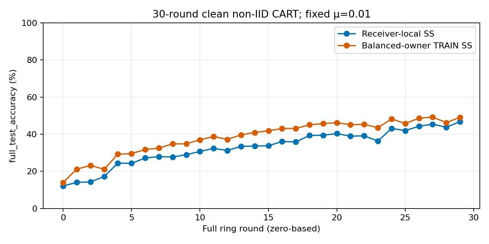
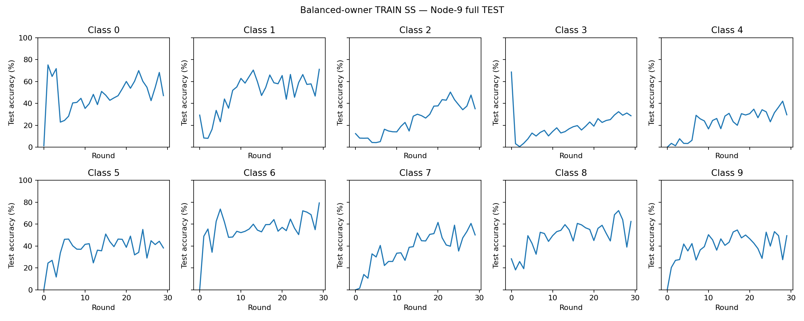

# CART: fixed 30-round clean validation

## Completed — clean multiclass learning improved

Both fresh GPU controls completed all **30 rounds**, **300 activations**, and
**15,000 optimizer steps each**. No attacks, noise, EBM, W&B or production queue
were run. No accuracy-driven changes or automatic extensions were made.

| Metric | Receiver-local SS | Balanced-owner TRAIN SS | Balanced − local |
|---|---:|---:|---:|
| Final Node-9 full-test accuracy | 46.71% | **49.10%** | +2.39 pp |
| Best Node-9 accuracy | 46.71% (R29) | **49.20% (R27)** | +2.49 pp |
| Final mean-node accuracy | 46.187% | **49.769%** | +3.582 pp |
| Final worst-node accuracy | 44.98% | **49.07%** | +4.09 pp |
| Final Node-9 test CE | 1.47972 | **1.40494** | −0.07478 |
| Final node accuracy range | 44.98–46.99% | **49.07–50.57%** | All nodes benefit at the aggregate level |
| Runtime | 211.17 min | 201.40 min | Observed runtime, not a speed trial |
| NaN/Inf failures / OOM | 0 / 0 | 0 / 0 | No failures |

Total training runtime was approximately **6 h 53 min**. The mean/worst values
use all ten stored trained models; Node-9 is the fixed end-of-ring model, not an
ensemble or a selected best model. Peak TF allocator usage was **270.63 MiB**,
with no recorded memory-pressure events; this is not total GPU process usage.



### Does the improvement persist?

| Node-9 metric | Receiver-local SS | Balanced-owner SS |
|---|---:|---:|
| Round 2 (three-round endpoint) | 14.25% | 23.18% |
| Round 29 (thirty-round endpoint) | 46.71% | 49.10% |
| Mean R20–24 | 39.554% | 45.644% |
| Mean R25–29 | 44.408% | 47.772% |
| Late-window improvement | +4.854 pp | +2.128 pp |

Both trajectories still improve over these prespecified-length final windows,
although individual rounds fluctuate. The balanced advantage narrows from
8.93 pp at R2 to 2.39 pp at R29. This is **not proof of convergence or a guarantee
that extending the horizon will reach a target**. The fixed 30-round run stopped.

### Final class accuracy: no longer constant-class collapse

| Class | Local SS: Node 9 | Balanced SS: Node 9 | Difference |
|---|---:|---:|---:|
| airplane | 47.2% | 47.1% | −0.1 pp |
| automobile | 60.4% | 71.1% | +10.7 pp |
| bird | 31.2% | 35.1% | +3.9 pp |
| cat | 21.9% | 28.7% | +6.8 pp |
| deer | 27.4% | 29.6% | +2.2 pp |
| dog | 39.7% | 38.2% | −1.5 pp |
| frog | 75.1% | 79.3% | +4.2 pp |
| horse | 50.6% | 50.1% | −0.5 pp |
| ship | 58.9% | 62.4% | +3.5 pp |
| truck | 54.7% | 49.4% | −5.3 pp |

Balanced final cat accuracy spans **25.3–36.4%** across nodes; deer spans
**26.4–43.6%**. Every final node has nonzero accuracy on every class. Final Node-9
predictions are distributed across all classes (646–1,869 predictions/class out
of 10,000), not concentrated in one constant prediction. Cat/deer are still weak,
and improvement is not uniform: truck and dog accuracy decrease at Node 9.



The clean owner-gradient mechanism supports broader learning in **both** arms.
This pair isolates the *additional selection-rule effect*, not the entire benefit
of owner gradients, anchoring, or EBM. EBM was absent. The original strictly local
one-class method and this owner-assisted method have different information
access: helpers provide fresh gradients from older owners' TRAIN data.

### Verification and reproducibility

| Check | Actual outcome |
|---|---|
| Full test suite | 574 passed, 2 display-dependent skipped, 644 subtests passed; 3 warnings |
| Compilation | Passed |
| Lazy import audit | 233 source files, zero changes needed, zero retained heavy imports |
| Synthetic CPU/GPU check | Passed at batch sizes 512 and 392; largest relative gradient difference 2.490×10⁻⁶, largest update difference 7.451×10⁻⁹ |
| Saved three-round report regression | Passed; 14 PNGs / 4 CSVs generated in temporary storage, zero training |
| Actual thirty-round traces | All 30,000 steps checked; paired actual samples/augmentation/helper keys matched |
| Strict handoff / fixed anchor | Selected input hashes equal frozen-reference hashes; μ=.01 checked throughout |
| Final memories | 100 snapshot hashes checked across two controls; complete R29 caches |
| Earlier-run reproducibility | First 30 activations **of each arm** exactly match its old three-round input/output hashes, optimizer telemetry, selections, owner-gradient records, epoch metrics and full-test confusions |
| Historical integrity | 23,963 before; all 23,963 matched; zero changed/missing; 636 allowed new result/plot files at automatic completion |

The raw run manifest and generated report contain the executed settings and
all 30 round points. The final historical-integrity recheck also permits added
analysis files only under this study's new directories.

Exact commands executed from the repository root:

```bash
environment/basil-noise-env/bin/python -m compileall -q gui basil_core reporting scripts tests run_gui.py
DISPLAY= CUDA_VISIBLE_DEVICES=-1 TF_ENABLE_ONEDNN_OPTS=0 TF_NUM_INTRAOP_THREADS=1 TF_NUM_INTEROP_THREADS=1 MPLCONFIGDIR=/tmp/papermerge-balanced-30r-tests PYTEST_DISABLE_PLUGIN_AUTOLOAD=1 environment/basil-noise-env/bin/python -m pytest -q tests
environment/basil-noise-env/bin/python scripts/audit_lazy_imports.py --report gui/worker_state/cart_balanced_selection_30r_lazy_imports.json
environment/basil-noise-env/bin/python scripts/run_cart_balanced_selection_30r.py --device GPU --verify-device
```

Actual persistent execution command (now completed; **do not rerun to overwrite evidence**):

```bash
tmux new-session -d -s cart-clean-30r -c /home/ojaswi/PaperMerge 'exec env MPLCONFIGDIR=/tmp/papermerge-cart-30r-plots /home/ojaswi/PaperMerge/environment/basil-noise-env/bin/python -u /home/ojaswi/PaperMerge/scripts/run_cart_balanced_selection_30r.py --device GPU --execute > /home/ojaswi/PaperMerge/gui/worker_state/cart_balanced_selection_30r_execution.log 2>&1'
```

### Conclusion and next gate

**Clean learning validation is positive; full A/B/C/D threat validation is not
complete.** Balanced selection improves overall and worst-node accuracy in this
matched seed, and previously near-zero classes recover. The ≥50% worst-node
research target is not reached (49.07%); it was never a software pass/fail rule.

Freeze this candidate and evidence. Before a new threat comparison, explicitly
decide whether owner gradients and selection scores are trusted clean auxiliary
channels or must themselves resist Byzantine corruption/noise. The existing
outbound Hidden attack does not attack these helpers. Do not advertise full-node
Byzantine resilience from a snapshot-only threat model. No additional runs have
been started, and this result does not justify tuning against the test set.

[All round values and machine-checked review](../newResults/nonIID/cart_owner_gradients/clean_balanced_selection_fixed_anchor_30r_v1/BALANCED_SELECTION_REVIEW.md) ·
[Mean-node curve](../newPlots/nonIID/cart_owner_gradients/clean_balanced_selection_fixed_anchor_30r_v1/mean_node_accuracy_comparison.png) ·
[Worst-node curve](../newPlots/nonIID/cart_owner_gradients/clean_balanced_selection_fixed_anchor_30r_v1/worst_node_accuracy_comparison.png) ·
[Final node confusion matrices](../newPlots/nonIID/cart_owner_gradients/clean_balanced_selection_fixed_anchor_30r_v1/balanced_owner_ss/final_node_confusion_matrices.png)

## Decision

The prespecified plan was **two fresh, paired 30-round controls**, not the full A/B/C/D threat study.
This tests whether the improvement seen at three rounds persists and whether
weak classes are learned and retained. No desired accuracy is a correctness
assertion; there is no test-driven tuning, early stopping or automatic extension.

| Fixed setting | Both controls |
|---|---|
| Data | CIFAR-10, one complete class per node, 5,000 TRAIN examples/node |
| Evaluation | All 10,000 TEST examples after each activation, evaluation only |
| Horizon | 30 full ring rounds = 300 activations/control |
| Training | Five complete epochs, batch 512, final batch 392; 50 steps/activation |
| Model | Existing 117,706-parameter CNN and canonical seed 2025 initialization |
| SGD | LR `0.05/(1+0.05*r)`, zero momentum/decay/clipping, reset per activation |
| Memory/handoff | S=5 distinct latest predecessors; exact selected-weight loading |
| Anchor | Fixed μ=0.01, frozen selected received snapshot |
| Owner responses | 16 TRAIN examples per available older owner per update; no helper SGD |
| Deliberately absent | Attack, channel noise, EBM, W&B, production queue |
| Execution | Serial deterministic float32 GPU, TF32 off, 6,144 MiB allocation cap |

The **only scientific difference** is the selected starting model:

| Control | Selection score |
|---|---|
| `receiver_local_ss` | CE on the active receiver's fixed 512-example TRAIN probe |
| `balanced_owner_ss` | Mean CE over the available owners' fixed 512-example TRAIN probes |

Both evaluate identical candidate/probe pairs. Only already visited owners and
the active owner are available in round 0; all ten classes become available
after the first traversal. Balanced-owner selection is **our CART adaptation,
not the BASIL paper's receiver-local rule**.

## What the saved three-round traces actually show

These are existing observations, not results of the new 30-round run.

| Control / class | Highest saved activation TEST accuracy | Final Node-9 TEST accuracy | Evidence |
|---|---:|---:|---|
| Receiver-local / cat | 25.3% (R1, N1) | 0.0% | Transient class performance is subsequently lost |
| Balanced-owner / cat | 68.6% (R0, N9) | 0.5% | Clear loss of earlier class performance |
| Receiver-local / deer | 10.5% (R2, N9) | 10.5% | Weak measured TEST performance |
| Balanced-owner / deer | 4.1% (R2, N0) | 1.3% | Weak learning at saved TEST checkpoints |

The per-epoch measurements are **64-example/class TRAIN analysis probes**,
not held-out validation or TEST. Full TEST is available only after activations.
They must not be mislabeled as epoch-level test results.

| Control / active owner | Round | Before | Epoch 1 | Epoch 2 | Epoch 3 | Epoch 4 | Epoch 5 |
|---|---:|---:|---:|---:|---:|---:|---:|
| Receiver-local / deer (N4) | 0 | 10.94% | 100% | 100% | 100% | 1.56% | 0% |
| Balanced-owner / cat (N3) | 2 | 1.56% | 1.56% | 3.13% | 1.56% | 1.56% | 1.56% |
| Balanced-owner / deer (N4) | 2 | 1.56% | 1.56% | 0% | 0% | 1.56% | 0% |

Within non-owner activations, the largest balanced-control cat TRAIN-probe drop
was **43.75 percentage points at R1/N0**. Its peak TRAIN-probe accuracy was
73.44% at R0/N9 after epoch 4. Deer reached only 14.06% on that probe in the
balanced control. These observations distinguish **loss of cat performance**
from **weak deer learning**. Prediction bias/constant-class behavior and
selection changes remain possible contributors; these tables alone do not
establish a single cause or prove learned semantic representations.

## Unchanged objective

For the current node and available older owners, let `C` be their class set:

```text
L = (1 / |C|) Σ[c in C] CE_c(theta)
    + (0.01 / 2) ||theta - theta_selected||²

gradient = mean of fresh owner/local CE gradients
           + 0.01 * (theta - theta_selected)
```

The current class uses its full local SGD batches; older owners each contribute
a fresh 16-example TRAIN batch. This is equal **class** weighting, not equal
example weighting. Model weights are never averaged. Helpers perform gradient
evaluation, not optimizer updates. No EBM term is active in this clean study.

## Execution, evidence, and limitations

Entry point: `scripts/run_cart_balanced_selection_30r.py`. With no arguments it
prints a lazy no-training plan. `--verify-device` checks the full CNN on synthetic
512/392-example batches against an independent gradient calculation and CPU/GPU
tolerances. `--execute` runs only these two controls, then validates saved traces
and generates the report automatically. `--report` performs analysis only.

Fresh output locations (existing evidence is not overwritten):

```text
newResults/nonIID/cart_owner_gradients/clean_balanced_selection_fixed_anchor_30r_v1/
newPlots/nonIID/cart_owner_gradients/clean_balanced_selection_fixed_anchor_30r_v1/
```

Each activation has its own atomic JSON file; batch traces are streamed. This
avoids growing live history and repeated whole-history rewrites without changing
SGD. Full rolling memories and trained node weights are checkpointed after each
activation. **These are evidence checkpoints; exact automatic resume has not
been implemented for this diagnostic.** Finite-value checks abort on genuine
failure, without generating later rounds. A terminal disconnect is avoided by
running in a durable tmux session, but power/hardware failures remain possible.

The report checks all 30,000 optimizer steps, paired actual sample/augmentation
keys, fixed anchors and final cache hashes; it creates round CSVs, per-epoch TRAIN
probe CSVs/heatmaps, TEST class trajectories and final node confusion matrices.
The original 23,963 evidence files and papers have a SHA-256 baseline; only new
files in the two declared output directories are allowed by the integrity check.

Estimated paired runtime: roughly eight hours based on the prior 47-minute
three-round pair, not a completion guarantee. This remains a single-seed bounded
diagnostic. The helper gradient and selection-score channels are clean simulated
auxiliary services; they have **no demonstrated Byzantine defense or privacy
guarantee**. Full A/B/C/D is not automatically authorized by higher accuracy here.

## Implementation changes for this validation

| File | Change | Mathematical effect |
|---|---|---|
| `basil_core/cart_owner_gradient_worker.py` | Explicitly permits horizon 30 alongside existing 1/3 | None; same owner availability rule |
| `scripts/run_cart_owner_selection_diagnostic.py` | Explicit study horizon and optional per-activation storage | None; original three-round default remains |
| `scripts/run_cart_balanced_selection_30r.py` | Fresh paired configs, source-bound proof, automatic report/integrity check | Extends fixed observation horizon only |
| `scripts/report_cart_owner_selection_diagnostic.py` | Validates the specified 3/30-round counts | Read-only mathematics verification |
| `scripts/report_cart_balanced_selection_diagnostic.py` | Streaming pairing digest, configurable horizon, per-epoch/class/confusion reporting | Analysis only; no feedback into training |
| `tests/test_cart_balanced_selection_30r.py` | Lazy plans, immutable settings, owner horizon and trace contracts | No research training |
