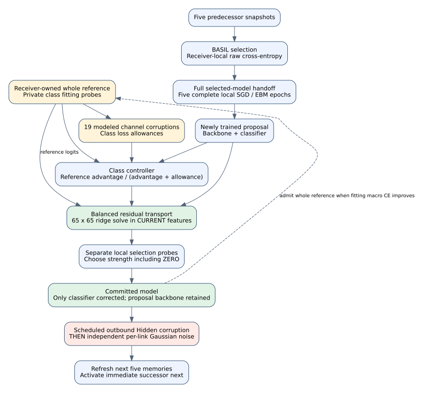
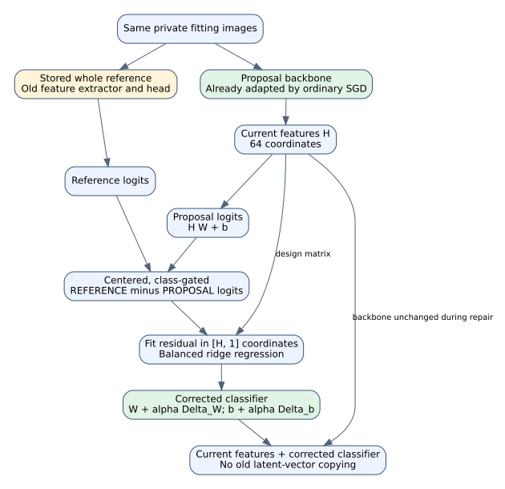
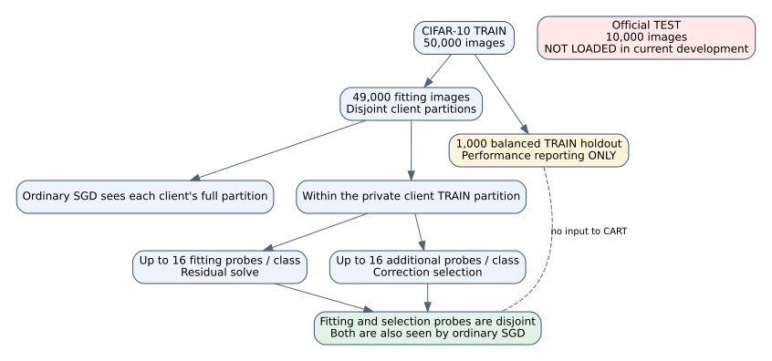
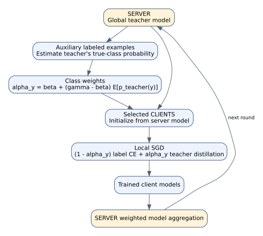
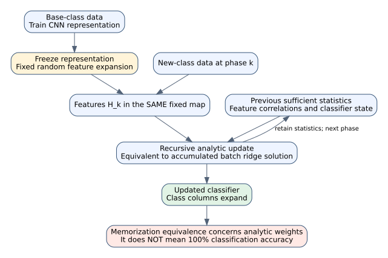
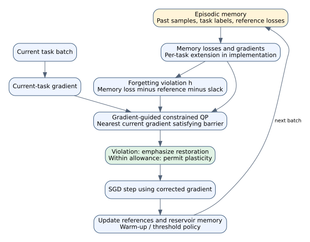

# CART: architecture, mathematics, implementation and paper study guide

Prepared 27 October 2026 for Ojaswi Sinha. This file is intended to remain useful
without another assistant conversation. It describes the **current implemented
classifier-transport revision**, not the older manuscript's ClassRegistry and
proximal controller. Diagrams are original explanatory diagrams, not copied
paper figures. Downloaded papers and executable code are linked below.

**Offline paper library:** the [complete reference index](../papers/FIRECRAWL_REFERENCE_INDEX.md)
links the saved PDFs and their original sources. The 27 October download audit
added 13 PDFs and validated all 66 local PDFs. The original *Revisiting GEM*
PDF remains blocked by OpenReview; its available extracted text is labeled
separately. The index also identifies misleading filenames in the original
collection so they are not copied into citations.

**Start with Section 0 for a plain-language explanation.** It assumes no
computer-science background. The later sections give the exact mathematics,
implementation and paper comparisons.

**If you have only ten minutes:** read Sections 0, 1 and 3, the gate/transport
equations in Sections 4.4–4.7, and the highlighted reading locations in Sections
8.2, 9.1 and 10.1. Section 12 supplies meeting questions and answers. The paper
explanations and code map can be studied afterward without another conversation.

## 0. CART explained without computer-science knowledge

### 0.1 Imagine ten students passing around a notebook

Imagine ten students sitting in a circle. Their job is to recognize pictures:
cars, cats, dogs, airplanes and other categories.

Each student has their **own** picture cards. They do not pass the cards around.
They pass a notebook containing the rules they have learned about recognizing
pictures. In our experiment, the notebook stands for the model's numbers.

The students do not all have the same kinds of cards. One might have many car
pictures but very few cat pictures. Another might have mostly animals.
This uneven distribution is what **non-IID data** means here.

When a student studies mostly their own categories, the shared notebook can
become better at those categories and worse at others. The next student might
then change it again. Useful information can be lost as the notebook travels.

There are two other difficulties:

- A dishonest student may deliberately change the notebook before passing it on.
  This represents our **Byzantine outbound attack**.
- Some numbers may change accidentally during transmission. This represents
  the experiment's **channel noise**.

The analogy explains the idea. The experiment changes model numbers in software;
it does not involve real students or measure an actual radio channel.

### 0.2 What arrives from another student?

Only the notebook—the model's learned numbers—arrives. The previous student's
photos and the calculations they used to learn are not sent.

The receiving student can choose among notebooks stored from five earlier
students. BASIL is the rule used to choose a notebook that works well on some
of the receiver's own picture cards. The chosen notebook might come from an
earlier student rather than the person immediately beside them.

The receiver then studies their own cards for five complete passes. This is
ordinary local training. Both the control and CART perform these same passes.

### 0.3 What does CART add?

CART gives each receiver four connected tools:

| Tool | Plain meaning | Its job |
| --- | --- | --- |
| Memory | Keep an older notebook from this student's own earlier turn. | Preserve a source of useful past answers. |
| Class controller | Ask which picture categories the older notebook still handles better. | Choose where old information might help, and be more cautious when simulated noise makes it unreliable. |
| Translator | Put useful old answer information into the newly trained model. | Adjust the final answer chart while retaining the newly learned picture clues. |
| Checker | Try the change on another small pile of the student's own cards. | Keep an improvement in the chosen local score, or keep the original model instead. |

These tools form the proposed **training architecture**. They work together
at every visit. They do not merely attach extra descriptive information to a
model: an accepted correction changes its actual answer-producing weights.

### 0.4 What is the “answer chart”?

Think of image recognition as two jobs:

1. **Spot useful clues:** edges, shapes, colors and combinations of those clues.
2. **Turn those clues into an answer:** car, cat, airplane, and so on.

The first part is called the **backbone** or feature extractor. The second is
the final **classifier**.

After ordinary training, CART keeps the newly trained clue-spotting part as it
is. It makes a small adjustment to the final answer chart using selected old
answer information. It does not drag the entire model back to an older version.
On a later turn, ordinary training can update the whole model again.

The old and new models may describe picture clues differently. CART therefore
shows the **same private pictures** to both models, compares their answers,
and fits the correction using the new model's clues. It does not assume old
hidden feature numbers can simply be copied into a changed model.

### 0.5 One receiver's turn, step by step

Imagine student 4 is now learning:

1. Student 4 receives a chosen notebook from predecessor memory.
2. Student 4 studies **student 4's own pictures** for five complete passes.
3. CART opens student 4's older saved notebook—not automatically student 3's.
4. It asks whether that older notebook gives better answers on some categories
   in a small local fitting pile.
5. It also uses a noise allowance. Roughly, this says how much the older
   notebook's score changes when copies of its numbers are randomly disturbed.
6. If old information looks useful, a small calculation translates selected
   answer differences into a correction to the new answer chart.
7. Another, separate local pile checks whether the correction improves the
   chosen score. CART can choose **no correction**.
8. The resulting model is sent onward. The experiment then applies any scheduled
   malicious change and transmission noise to outgoing copies.

The small fitting and checking piles come from the receiver's training cards.
Neither is the separate 1,000-picture development holdout used to report results.

### 0.6 The class gate, without symbols

For one picture category, ask:

- Did the newly trained model become worse than the saved model on the local
  fitting pictures?
- How large is that difference?
- How much should we discount it because the modeled channel can disturb the
  reference's behavior?

The **gate** is a number between zero and one that controls the amount of old
information used. No useful old advantage means zero. A stronger old advantage
and a smaller noise allowance allow more influence.

This is a control weight, not the probability that the old model is correct.
The score used here is cross-entropy: confidently wrong answers are penalized
more strongly than uncertain answers. It is not simply the number of mistakes.

### 0.7 What makes the proposal interesting?

The proposed idea is to connect private class memory, a channel-aware class
controller, a translator into the current classifier, and a local checker in
a server-free learning ring. The aim is to preserve useful old category
information **while still allowing new learning**.

Other researchers already use memory, teacher guidance and analytic classifier
fitting. Our research must show what this particular architecture adds and
whether its connected parts improve the result. Calling it CART does not by
itself prove that the design is original.

### 0.8 What have we actually measured?

In one five-round non-IID test, the same attacked and noisy setup achieved:

- **45.46%** with BASIL and EBM, without CART.
- **48.22%** after adding the current CART revision.
- **68.82%** in the clean reference setup.

The CART gain is about **three extra correct answers per hundred pictures on
average** in that comparison. It helped the average, but not every category,
and it did not match clean performance. We must repeat with other starting
conditions, data splits and noise amounts before claiming a reliable advantage.

The separate first IID comparison did not improve: CART scored **60.26%** and
its matched control scored **60.38%**. So the current result is an early benefit
in the uneven-data setting, not a win in every setting.

### 0.9 A small dictionary

| Technical word | Plain meaning in this project |
| --- | --- |
| Node/client | One of the ten learners in the circle. |
| Model parameters | The learned numbers passed between learners. |
| Non-IID | Learners have different mixtures of picture categories. |
| Local training | A learner improves the model using its own pictures. |
| Gradient | A calculated direction for changing model numbers to reduce training loss. It is calculated locally, not received as another client's photos. |
| Reference | An older complete model retained by the same receiver. |
| Proposal | The receiver's model after ordinary training, before the CART correction. |
| Feature | A numerical clue extracted from an image. |
| Logit | A model's raw score for one answer category. |
| Gate | A weight controlling how much selected reference information is used. |
| Ridge solve | A small equation-solving step that fits a correction while discouraging very large changes. |
| Holdout accuracy | Performance on separate pictures used to measure the result. |
| Seed | A setting controlling a particular random start and split; repeating seeds checks whether a result depends on one lucky setup. |

## 1. Start here: what is the contribution?

**CART is our proposed decentralized training architecture for retaining class
knowledge during non-IID ring learning.** Its current revision couples:

1. A receiver-owned whole reference model and private class probes.
2. A controller that identifies class knowledge worth retaining and attenuates
   its influence using a modeled channel-distortion allowance.
3. A transport module that maps reference logit information into the **current
   model's feature coordinates** by correcting its small linear classifier.
4. A separate local acceptance check before committing the correction.

These modules change learned model weights and the state maintained between
activations. They are more than descriptive metadata. The neural backbone is
the same standard ResNet in both arms; the proposed architectural contribution
is the **training and retention architecture around that backbone**.

The precise novelty argument is the receiver-local, class/channel-controlled
transport architecture under the selected-model ring protocol. Distillation,
ridge regression, class-aware weighting and classifier alignment already have
prior art. Their presence alone does not establish novelty. An exact prior match
has not been ruled out, and component ablations remain necessary.

### A short explanation for the professor

> CART lets each receiver remember a locally evaluated model. After normal
> training, it checks which supported classes have lost useful reference
> information. It transfers selected reference outputs into the new classifier
> using the new model's features, while preserving the backbone learned during
> that activation. A local probe check controls the amount committed. The
> proposed contribution is this class- and channel-aware retention architecture
> in a decentralized ring, with no server or extra teacher payload.

### Current evidence, with the scope kept explicit

Five full rounds, Dirichlet alpha .2, seed 2025, absolute Gaussian sigma .01,
CIFAR-10 TRAIN-only development holdout:

| Configuration | Mean accuracy | Worst node | Worst-class mean |
| --- | ---: | ---: | ---: |
| Clean common learning recipe | 68.82% | See saved metrics | 42.40% |
| Hidden + noise + BASIL + EBM | 45.46% | 44.20% | 17.90% |
| Same impaired setup + CART | **48.22%** | **46.60%** | 16.80% |

CART's paired gain is **2.76 percentage points**, with about 6.7% runtime
overhead. All ten node differences are positive in this run. Those nodes are
dependent; they are not ten independent seed replications. Worst-class mean
decreased, so this is not an improvement on every metric.

The clean gap is still **20.60 percentage points**. The result supports a
specific preliminary benefit over the same mitigation stack. It does not yet
establish near-clean performance, superiority over every impaired configuration,
cross-seed reliability, a long-horizon effect, or original novelty. The first
five-round IID pair later finished at **60.26% with CART versus 60.38% without
CART**, a difference of **-0.12 percentage points**. Its clean reference was
still running at this update. Thus the current evidence is an early non-IID
gain and no IID gain. Use the live result files for later updates.

**A valid present claim:** “In our five-round, single-seed non-IID development
comparison, adding CART to the matched Byzantine/noise/BASIL/EBM setup improved
mean heldout accuracy from 45.46% to 48.22%.”

## 2. The problem CART is addressing

A non-IID client can have many examples of one class and few or none of another.
Training on successive clients changes both features and decision boundaries.
Local improvement can therefore coexist with loss of useful class information.
Byzantine outbound corruption and parameter-channel noise add separate problems.

The roles in our system are distinct:

| Component | Role |
| --- | --- |
| BASIL selection | Choose an incoming model using receiver-local raw CE over predecessor memory. |
| EBM | Add a second-order gradient-norm regularizer during local optimization. |
| Common local-prior objective | Established training-time imbalance correction, shared by controls and CART. |
| CART | Retain selected class information through a receiver-local classifier transport after local training. |

CART does not receive the attacker identities. It does not certify malicious
senders or reconstruct labels absent from its private data. The current channel
is a controlled Gaussian perturbation of parameters, not a measured wireless link.

The logical ring is `0 -> 1 -> ... -> 9 -> 0`. One client visit is an activation;
ten visits form one round. Each sender refreshes the next five clients' memories,
but only its immediate successor activates next. Incoming models are selected
and installed in full; the current protocol does not use 50/50 consensus.

## 3. Architecture diagrams

### 3.1 Complete receiver architecture



Plain-text version:

```text
Predecessor snapshots -> BASIL -> full selected model -> five local epochs
                                                        |
                                                        v
                                          proposal backbone + classifier
                                                        |
Local whole reference + private probes + channel allowance
                 -> class gates -> residual classifier fit
                 -> separate local selection -> committed model
                                                        |
                            outgoing attack, then per-link Gaussian noise
                                                        |
                                             next five receiver memories
```

Reference updates use a **whole committed model**, not independently best
class scores taken from incompatible models. A new reference is admitted when
its mean fitting-probe raw CE improves. It remains private to the receiver.

### 3.2 Why current feature coordinates matter



Old and new hidden features can use different coordinates after CNN training.
Copying an old feature vector or classifier directly can be inconsistent. CART
evaluates both models on the same private images, then fits reference-output
residuals using the **new** feature matrix. The encoder is trainable during
ordinary epochs and unchanged by this final correction.

### 3.3 Data boundaries



- The 50,000 CIFAR-10 TRAIN images are split into 49,000 fitting images and a
  fixed balanced 1,000-image development holdout.
- A receiver's fitting and selection probes are disjoint subsets of its own
  49,000-pool partition. Both were also available to ordinary SGD.
- They are separate for the additional classifier fit, not independent of the
  complete network-training process.
- The 1,000-image holdout reports performance; it is not an input to CART's
  gates, fit, or acceptance decision.
- The official 10,000-image TEST set is not loaded in these development runs.

## 4. CART mathematics, step by step

### Read the model/data origins first

**A predecessor sends model parameters, not its raw images or gradients.**
BASIL chooses one of five stored predecessor snapshots using the receiving
client's own data. The selected sender need not be the immediate predecessor.

For example, client 4 can select a snapshot from clients 3, 2, 1, 0 or 9.
Client 4 then trains on **client 4's private images**. Its CART reference is a
model it retained after an earlier **client-4 activation**, not automatically
the model received from client 3.

| Name used below | What it is | Where it comes from |
| --- | --- | --- |
| Selected input model | One whole incoming parameter vector | BASIL's choice from predecessor memory. |
| Proposal model, subscript $p$ | Current receiver's model after its five local epochs | Starts from the selected input, then changes through local SGD/EBM. |
| Reference model, subscript $r$ | An older whole model retained by this same receiver | Admitted after an earlier receiver-local training activation. |
| $\mathcal D_i$ | Client $i$'s private training dataset | A disjoint IID or Dirichlet partition of the 49,000 fitting images. |
| Fitting/check probes | Two disjoint subsets of that receiver's training data | Selected locally; no predecessor images are requested. |
| SGD gradient | Derivative of the current local batch objective | Calculated at the receiving client using its current parameters and private mini-batch. |
| $d_c$ and $g_c$ | A loss gap and a scalar class gate | Comparisons of local probe losses; **neither is an SGD gradient**. |
| $\Delta$ | A matrix of classifier-weight corrections | Computed by a local linear solve after ordinary SGD finishes. |

The tables under each formula state its symbols and their origins. A plain-text
reading accompanies the equations so the guide remains usable in a Markdown
viewer without a math extension. Display equations use standard `$$` delimiters.

### 4.1 Common model and ordinary training

Write the current model as

$$
z_\theta(x)=h_\phi(x)W+b,\qquad \theta=(\phi,W,b).
$$

**Read it as:** logits = current image features times classifier weights, plus
classifier bias.

| Symbol | Meaning | Origin |
| --- | --- | --- |
| $x$ | One image | The receiving client's private probes or training batch; holdout images are used separately for reporting. |
| $\theta$ | The complete model's parameters | Received snapshot initially; locally updated parameters during training. |
| $\phi$ | Backbone parameters | All feature-extractor parameters of that model. |
| $h_\phi(x)$ | Feature vector produced from image $x$ | A forward pass through that backbone; 64 values in this model. |
| $W$ | Linear classifier kernel | A 64-by-10 learned weight matrix. |
| $b$ | Classifier bias | Ten learned bias values. |
| $z_\theta(x)$ | Ten unnormalized class scores, called logits | Output of the model; not probabilities and not gradients. |

For the current model, `h` has 64 features and there are ten output classes.
The full network has 272,474 parameters. The classifier has only
`64*10+10=650` parameters. Both control and CART use this same architecture.

The matched local-prior objective uses local counts

$$
\pi_{i,c}=\frac{\max(n_{i,c},1)}{\sum_k\max(n_{i,k},1)},\qquad
F_i(\theta)=\operatorname{CE}(y,z_\theta(x)+\log\pi_i).
$$

**Read it as:** estimate each class's local frequency from the receiver's data;
add its log-frequency to training logits when calculating local CE.

| Symbol | Meaning | Origin |
| --- | --- | --- |
| $i$ | Receiving client index | The currently active logical ring client. |
| $c,k$ | Class indices | The ten CIFAR-10 labels; $k$ runs over classes in the denominator. |
| $n_{i,c}$ | Number of class-$c$ examples owned by client $i$ | Counts over that client's **full** private fitting partition, not a predecessor's data and not just its probes. |
| $\max(n_{i,c},1)$ | A floor of one for absent classes | A fixed numerical rule that keeps logarithms finite; it does not invent images. |
| $\pi_{i,c}$ | Floored, normalized local class frequency | Calculated from those local counts. |
| $\pi_i$ | Vector of all ten local frequencies | One vector for the receiving client. |
| $x,y$ | Training image and its true label | The current receiver's mini-batch. |
| $\operatorname{CE}$ | Cross-entropy classification loss | Compares the true label with the adjusted model scores. |
| $F_i(\theta)$ | Local batch training objective, averaged over the batch in code | Calculated on the receiver; gradients of this objective drive SGD. |
| $\log$ | Natural logarithm, applied class by class | Converts the local prior vector to logit offsets. |

This prior adjustment is established work, not CART's new contribution.
Selection, CART probes and inference use raw logits. With EBM enabled, the
common gradient includes

$$
\nabla F_i+2\sigma^2 H_{F_i}\nabla F_i,
$$

**Read it as:** ordinary local CE gradient + the second-order EBM correction.

| Symbol | Meaning | Origin |
| --- | --- | --- |
| $\nabla F_i$ | Gradient of the current receiver's batch loss with respect to all model parameters | Computed locally by TensorFlow automatic differentiation. It is not sent by the previous node. |
| $\sigma$ | Absolute per-coordinate channel standard deviation | The configured experiment value, currently .01 in this comparison. |
| $\sigma^2$ | Channel-coordinate variance and common EBM coefficient | Squared configured sigma; shared by control and CART. |
| $H_{F_i}$ | Hessian of the same batch loss | A second derivative with respect to model parameters. |
| $H_{F_i}\nabla F_i$ | Hessian-vector product | Computed by nested differentiation without storing a full Hessian matrix. |
| $2$ | Factor from differentiating the squared gradient norm | Mathematical derivative, not a tuned multiplier. |

For clarity, the common optimizer uses the following parameter-velocity form:

$$
v_{t+1}=0.9v_t-\eta G_t,
\qquad
\theta_{t+1}=\theta_t+v_{t+1}.
$$

**Read it as:** retain momentum, subtract the learning-rate-scaled local
gradient, then add that velocity to the current model parameters.

| Symbol | Meaning | Origin |
| --- | --- | --- |
| $t$ | Optimizer mini-batch step within an activation | Advances during the receiver's five full local epochs. |
| $v_t$ | SGD momentum/parameter-velocity vector | Local optimizer state; reset to zero at the start of each activation. |
| $0.9$ | Momentum coefficient | Fixed common configuration in both arms. |
| $\eta$ | Current round's learning rate | The declared cosine schedule; constant across local steps of that round. |
| $G_t$ | Applied local batch gradient | CE/EBM expression above plus the common kernel-only L2 gradient. |
| $\theta_t$ | Current model parameters at step $t$ | Initialized from the BASIL-selected incoming model, then changed locally. |

**The CART gate $g_c$ below is a different quantity from optimizer gradient
$G_t$. CART's ridge solve also produces a weight correction, not a batch gradient.**

plus the common kernel-only L2 contribution. EBM keeps coefficient `sigma^2`;
the ridge coefficient introduced below belongs to a separate CART solve.

### 4.2 Private class probes and whole reference

Let `P_fit,c` contain up to 16 local TRAIN examples of class c. Select up to
16 additional examples for `P_check,c`, excluding fitting examples. A rare
class may have fewer or no check examples. It is not eligible for transfer
without check support.

Let `theta_r` be the stored whole reference and `theta_p` the newly trained
proposal. On fitting probes define raw class CE:

$$
L_{r,c}=\frac{1}{|P_{fit,c}|}\sum_{(x,c)\in P_{fit,c}}
 \operatorname{CE}(c,z_{\theta_r}(x)),
$$

**Read it as:** average the reference model's ordinary CE over this receiver's
fitting images of class $c$.

| Symbol | Meaning | Origin |
| --- | --- | --- |
| $r$ | Reference-model label | This receiver's older stored whole model, not the previous sender. |
| $p$ | Proposal-model label, used in $L_{p,c}$ | This receiver's newly trained model after its five local epochs. |
| $c$ | One supported class | A class with examples in this receiver's data. |
| $P_{fit,c}$ | Fitting-probe set for class $c$ | Up to 16 private receiver-local training examples. |
| $\lvert P_{fit,c}\rvert$ | Number of those fitting examples | May be below 16 for a rare class. |
| $x$ | One fitting-probe image | Always local to the receiver. |
| $\theta_r$ | Complete stored reference parameters | Saved after a prior local activation of this receiver. |
| $z_{\theta_r}(x)$ | Reference logits on that local image | A new local forward pass through the reference model. |
| $L_{r,c}$ | Reference class loss | A scalar calculated from those logits and true local labels. |
| $L_{p,c}$ | Proposal class loss | Calculated on the **same fitting probes**, using $\theta_p$ instead. |

These losses are forward-evaluation scores. Calculating them is not an SGD
update, and no previous node's reported accuracy is trusted here.

and similarly `L_p,c` for the proposal. These are evaluated at actual complete
models, so the reference targets are mutually coherent.

### 4.3 Channel allowance

Freeze the reference and probes. Generate 19 independent corruptions using
the declared parameter channel, `xi_j ~ N(0,sigma^2 I)`. Define

$$
s_c=\max(L_{r,c},0.1),\quad
S_j=\max_c\left[\frac{L_c(\theta_r+\xi_j)-L_{r,c}}{s_c}\right]_+,
$$

**Read it as:** scale each class's loss change and keep the largest harmful
change across classes for a synthetic channel corruption.

| Symbol | Meaning | Origin |
| --- | --- | --- |
| $s_c$ | Positive class normalization scale | Computed from the stored reference loss; .1 is a fixed scale floor. |
| $j$ | Synthetic calibration-draw index here | One of 19 independently generated local corruptions. |
| $\xi_j$ | A full parameter-noise vector | Generated **locally** from the configured Gaussian model; not the actual unknown noise on a received snapshot. |
| $\theta_r+\xi_j$ | Synthetically corrupted reference model | A temporary local copy used for calibration. |
| $L_c(\theta_r+\xi_j)$ | Class-$c$ loss of that temporary copy | Evaluated on the same private fitting probes. |
| $[a]_+$ | Positive part: max of $a$ and zero | Discards loss decreases when measuring harmful corruption. |
| $S_j$ | Worst normalized class-loss increase in draw $j$ | Maximum across the receiver's supported classes. |

$$
q=\max_{j=1}^{19}S_j,\qquad b_c=L_{r,c}+q s_c,\qquad u_c=b_c-L_{r,c}.
$$

**Read it as:** use the largest of the 19 scores to form a class allowance;
subtract baseline reference loss to get the extra loss budget.

| Symbol | Meaning | Origin |
| --- | --- | --- |
| $q$ | Largest calibration score | Maximum of the receiver's 19 locally generated $S_j$ values. |
| $19$ | Number of calibration draws | Fixed design setting. |
| $L_{r,c}$ | Uncorrupted reference class loss | Previous formula, evaluated locally. |
| $s_c$ | Class scale | Previous formula's positive reference-loss scale. |
| $b_c$ | Reference loss plus modeled channel allowance | Calculated locally from the reference and calibration scores. |
| $u_c$ | Nonnegative extra allowance, equal to $q s_c$ | Used to attenuate the reference's influence in CART's gate. |

Here `u_c` is a nonnegative allowance in CE units. Under exchangeability, this
construction has a narrow 95% marginal coverage interpretation for one fresh
same-channel corruption of that **fixed reference**. It is not 95% accuracy,
a guarantee for a different peer model, or a guarantee over all future visits.
The experiment assumes sigma is known; estimation in deployment is future work.

### 4.4 Class controller

Let

$$
d_c=\max\bigl(L_{p,c}-L_{r,c},0\bigr),\qquad
g_c=\frac{d_c}{d_c+u_c+10^{-6}}.
$$

**Read it as:** loss gap = max(proposal loss minus reference loss, zero).
Class gate = loss gap divided by (loss gap + channel allowance + tiny constant).

| Symbol | Meaning | Origin |
| --- | --- | --- |
| $c$ | Class being considered | A label supported by the current receiver's private data. |
| $L_{p,c}$ | Current proposal's class CE | Forward evaluation after this receiver's five SGD/EBM epochs. |
| $L_{r,c}$ | Older local reference's class CE | Forward evaluation of this receiver's stored model on the same probes. |
| $d_c$ | How much worse the proposal is on that class, clipped below at zero | Difference of the two **loss values**; not a gradient or parameter displacement. |
| $u_c$ | Modeled channel allowance for that reference class | Local 19-draw calibration above; not a predecessor's claimed statistic. |
| $10^{-6}$ | Small denominator constant | Fixed numerical safeguard against division by zero. |
| $g_c$ | Scalar strength between zero and one | Controls how much reference-output information to transfer for this input class. |

Set the gate to zero if the class lacks selection support or the reference's
measured class recall is at most .1. That recall test is an empirical check,
not a statistical certificate.

Interpretation:

- No measured reference advantage gives `d_c=0`, hence no class transfer.
- A larger reference advantage increases its influence.
- A larger modeled corruption allowance attenuates that influence.
- The resulting gate lies in `[0,1]`; it is not a calibrated probability.

### 4.5 Functional residual targets

Center logits to remove irrelevant common shifts:

$$
\widetilde z=z-\frac{1}{10}\sum_k z_k.
$$

**Read it as:** subtract the mean of an image's ten logits from every logit.

| Symbol | Meaning | Origin |
| --- | --- | --- |
| $z$ | Ten raw scores for one image | Either the proposal or reference model's local forward pass. |
| $z_k$ | Score for output class $k$ | One element of that vector. |
| $k$ | Output-class index | Runs across all ten model outputs. |
| $10$ | Total output-class count | CIFAR-10's classifier dimension. |
| $\widetilde z$ | Mean-centered logit vector | Preserves softmax probabilities while removing an arbitrary common shift. |

For fitting example j, form the ten-dimensional target

$$
E_j=g_{y_j}\left(\widetilde z_{\theta_r}(x_j)
                    -\widetilde z_{\theta_p}(x_j)\right).
$$

**Read it as:** desired correction = that example's class gate times the
reference-minus-proposal centered output difference.

| Symbol | Meaning | Origin |
| --- | --- | --- |
| $j$ | Fitting-example index | A sample within the receiver's local fitting probes, not a client ID. |
| $x_j,y_j$ | Fitting image and true label | The current receiver's private data. |
| $g_{y_j}$ | Gate for that image's true class | Previous class-controller formula. |
| $\theta_r,\theta_p$ | Reference and proposal parameter sets | Older local memory and newly locally trained model, respectively. |
| $\widetilde z_{\theta_r}(x_j)$ | Centered reference logits | Locally evaluating the older model on this same image. |
| $\widetilde z_{\theta_p}(x_j)$ | Centered proposal logits | Locally evaluating the newly trained model on this same image. |
| $E_j$ | Ten target residual values for this image | Computed output differences; these are neither labels from another client nor SGD gradients. |

The gate uses the example's true input class. It scales that example's full
logit-residual vector; it does not store ten separate models or verify absent
classes. A teacher supplies desired output behavior while the current model
supplies the feature coordinates in which to express the correction.

### 4.6 Balanced ridge transport

Let A stack proposal features with an appended constant for the bias. Let K
be the number of supported fitting classes and `m_c` their fitting counts:

$$
A_j=[h_{\phi_p}(x_j),1],\qquad D_{jj}=\frac{1}{K m_{y_j}}.
$$

**Read it as:** append a bias coordinate to each current feature vector, and
weight samples so each locally supported class has equal total influence.

| Symbol | Meaning | Origin |
| --- | --- | --- |
| $j$ | Local fitting-example index | One row of the probe matrix. |
| $\phi_p$ | Proposal backbone parameters | Newly trained at this receiver, held fixed during the following solve. |
| $h_{\phi_p}(x_j)$ | Current feature vector | A forward pass through the proposal backbone, not an old latent vector. |
| $1$ | Appended constant feature | Allows the solve to correct the classifier bias. |
| $A_j,A$ | One augmented feature row and the stacked feature matrix | Locally computed; A has 65 columns for this model. |
| $K$ | Number of classes represented in fitting probes | A local support count; it can be less than ten. |
| $m_{y_j}$ | Number of fitting probes of class $y_j$ | Counts among the fitting probes, not the full dataset count $n_{i,c}$. |
| $D_{jj},D$ | One sample weight and the diagonal weighting matrix | Numeric class-balancing weights. **This D is a matrix, not dataset $\mathcal D_i$.** |

Each supported class therefore has the same total fitting weight. Solve

$$
\Delta^*=\arg\min_\Delta
 \|D^{1/2}(A\Delta-E)\|_F^2+\lambda\|\Delta\|_F^2,
$$

**Read it as:** find a small classifier correction that fits the weighted
reference-output residuals, with a penalty on unnecessarily large corrections.

| Symbol | Meaning | Origin |
| --- | --- | --- |
| $\Delta$ | Candidate classifier-correction matrix | Unknown solved locally; 65 rows by ten output columns. |
| $\Delta^*$ | Correction minimizing this objective | Result of the ridge linear solve, not a batch gradient. |
| $A$ | Proposal's augmented feature matrix | Receiver-local forward computation above. |
| $E$ | Stacked residual targets | The $E_j$ values from reference/proposal comparisons. |
| $D^{1/2}$ | Square roots of diagonal class-balancing weights | Gives weighted least squares. |
| $\lVert\cdot\rVert_F^2$ | Sum of squared entries of a matrix | The Frobenius-norm-squared fitting error or correction penalty. |
| $\lambda$ | Positive ridge regularization strength | Computed from local feature scale below; separate from EBM. |
| $\arg\min$ | Choose the matrix giving the smallest objective | Optimization notation. The code solves normal equations directly. |

$$
\lambda=0.01\,\frac{\operatorname{tr}(A^TDA)}{65},\qquad
\Delta^*=(A^TDA+\lambda I)^{-1}A^TDE.
$$

**Read it as:** set the regularization from average feature energy and solve
the regularized normal equations for the classifier residual.

| Symbol | Meaning | Origin |
| --- | --- | --- |
| $A,D,E$ | Features, sample weights and residual targets | All calculated at this receiver from its fitting probes. |
| $A^T$ | Transpose of A | Rearranges rows/columns in the normal equations. |
| $A^TDA$ | Weighted feature-correlation matrix | A 65-by-65 local matrix. |
| $\operatorname{tr}$ | Sum of the matrix's diagonal entries | Measures its total feature energy. |
| $65$ | Number of augmented feature coordinates | 64 backbone features plus one bias coordinate. |
| $0.01$ | Fixed ridge-fraction setting | Declared configuration, not tuned using the performance holdout. |
| $\lambda$ | Positive penalty scale | Fixed fraction times average local feature energy. |
| $I$ | 65-by-65 identity matrix | Makes every direction regularized. |
| $(\cdot)^{-1}$ | Matrix inverse in the mathematical expression | The implementation uses `numpy.linalg.solve` instead of explicitly forming it. |
| $\Delta^*$ | Solved classifier correction | Rows 1–64 correct W; the last row corrects b. |

The implementation uses a linear solve, not an explicit inverse. For this
backbone, the system is 65 by 65 and its output is a 65 by 10 correction.

### 4.7 Commit selection

For candidate strengths `alpha in {0,.25,.5,.75,1}`, evaluate

$$
W_\alpha=W_p+\alpha\Delta^*_{1:64,:},\qquad
b_\alpha=b_p+\alpha\Delta^*_{65,:}.
$$

**Read it as:** apply a selected fraction of the solved correction to the
proposal classifier, leaving the proposal backbone unchanged.

| Symbol | Meaning | Origin |
| --- | --- | --- |
| $W_p,b_p$ | Classifier kernel and bias before CART | The receiver's model after its ordinary five epochs. |
| $\alpha$ | Accepted correction amount | Chosen from 0, .25, .5, .75 and 1 using separate local check probes. |
| $\Delta^*_{1:64,:}$ | First 64 rows of the solved correction | Kernel update; the colon means all output classes. |
| $\Delta^*_{65,:}$ | Last row of that correction | Bias update for all ten outputs. |
| $W_\alpha,b_\alpha$ | Candidate committed classifier | The proposal classifier plus this scaled local correction. |

Use mean **class** CE on the separate local check probes to choose a measured
improvement. The implementation scans the four positive strengths, keeps
improvements exceeding `1e-4`, and otherwise keeps zero. It re-evaluates the
actual corrected network and falls back to zero if its check CE increases
beyond numerical tolerance. The backbone remains exactly `phi_p`.

### 4.8 A small worked example

Suppose a supported class has proposal CE 1.4, reference CE .8 and channel
allowance .2. Then `d=.6` and `g` is approximately `.6/(.6+.2)=.75`.
A reference logit residual of 2 becomes a target residual of 1.5.

For one output column, simplify the feature matrix and targets to

$$
A=\begin{bmatrix}1&1\\0&1\end{bmatrix},\quad
D=\begin{bmatrix}.5&0\\0&.5\end{bmatrix},\quad
E=\begin{bmatrix}1.5\\0\end{bmatrix}.
$$

| Symbol | Meaning in this toy example |
| --- | --- |
| $A$ | Two augmented feature rows; first column is the feature, second is the constant bias coordinate. |
| $D$ | Equal sample weights of .5 on the diagonal. It is not a training dataset. |
| $E$ | Desired residuals 1.5 and zero for **one** output column. |

The first column is a feature and the second is the bias coordinate. Here
`lambda=.01*1.5/2=.0075`. The solve gives approximately

$$
\Delta=\begin{bmatrix}1.4566\\.02153\end{bmatrix}.
$$

| Symbol/value | Meaning in this toy solve |
| --- | --- |
| $\Delta$ | Solved two-entry correction for the illustrated output column. |
| $1.4566$ | Approximate feature-weight correction. |
| $.02153$ | Approximate bias correction. |

It fits the desired residual while penalizing unnecessarily large changes.
The separate selection probes still decide how much to commit. This example
illustrates the algebra; it is not a CIFAR-10 accuracy result.

## 5. What is proved, and what remains empirical?

**Unique well-defined ridge solution.** Since D is positive on fitting rows,
`A^T D A` is positive semidefinite. The appended constant makes its trace
positive, so lambda is positive. Adding `lambda I` makes it positive definite.
Differentiation gives

$$
2A^TD(A\Delta-E)+2\lambda\Delta=0,
$$

**Read it as:** the derivative of the ridge objective with respect to its
classifier-correction matrix is zero at the solution.

| Symbol | Meaning in this proof | Origin |
| --- | --- | --- |
| $A,D,E$ | Current features, class weights and teacher residual targets | The receiving client's fitting probes. |
| $\Delta$ | Classifier correction being optimized | A local matrix, not the CNN's SGD gradient. |
| $\lambda$ | Positive regularization strength | Local feature-scale formula above. |
| $2A^TD(A\Delta-E)$ | Derivative of the weighted squared fitting error | Calculus with respect to $\Delta$. |
| $2\lambda\Delta$ | Derivative of the ridge penalty | Calculus with respect to the same matrix. |
| $0$ | Zero matrix | The first-order optimality condition for the strictly convex quadratic. |

This derivative is used to **derive** the analytic solution. CART does not run
an additional sequence of SGD gradient steps to fit this matrix.

which gives the normal equations and unique minimizer. Its regularized fitting
objective is no worse than the zero correction, subject to numerical checks.

**Preserved backbone at commit.** Only the last classifier kernel and bias are
changed. All backbone arrays are copied unchanged from the proposal, and their
hashes are checked. This statement applies to that activation's repair; future
SGD can still change the backbone.

**Measured selection safeguard.** Zero correction is available. Actual local
check macro CE cannot increase beyond the declared tolerance after acceptance.
This is an empirical TRAIN-probe statement. It does not guarantee per-class
accuracy, unseen-example accuracy, Byzantine tolerance, global non-forgetting
or convergence.

**Accuracy benefit.** The current +2.76pp is an independently reconstructed
development observation. More seeds, sigmas, horizons and ablations must test
its reliability. Clean need not be matched for an incremental robustness
contribution to be useful, but the gap must be reported honestly.

## 6. Exactly where it is implemented

Line numbers refer to the current checkout; function names are the durable guide.
These new files must be committed and pushed before remote GitHub links exist.

| Responsibility | Code and entry point |
| --- | --- |
| Current ResNet-20/GroupNorm backbone | [factorial_model.py](../basil_core/factorial_model.py#L9), `build_model` |
| Common CE/prior/EBM/L2 training | [factorial_worker.py](../basil_core/factorial_worker.py#L21), `PlainWorker`; shared loop in [research_protocol.py](../basil_core/research_protocol.py) |
| Local fitting/check probes | [cart_head_worker.py](../basil_core/cart_head_worker.py#L25), `prepare` |
| Teacher comparison and gates | [cart_head_worker.py](../basil_core/cart_head_worker.py#L56), `transport`, especially lines 70–78 |
| Balanced residual solve | [cart_head_transport.py](../basil_core/cart_head_transport.py#L10), `fit_residual` |
| Local strength selection | [cart_head_transport.py](../basil_core/cart_head_transport.py#L44), `choose_scale` |
| Classifier-only update/recheck | [cart_head_worker.py](../basil_core/cart_head_worker.py#L79), lines 79–89 |
| Training transaction and reference admission | [cart_head_worker.py](../basil_core/cart_head_worker.py#L91), `train` |
| Reference corruption calibration | [cart_feasible_worker.py](../basil_core/cart_feasible_worker.py), `admit`; [cart_feasible_memory.py](../basil_core/cart_feasible_memory.py#L33), `calibrate_envelope` |
| Immutable variant/stage configuration | [cart_coherent_study.py](../basil_core/cart_coherent_study.py#L14), `configuration`; factory at line 89 |
| Checkpoint reference state | [protocol_checkpoint.py](../basil_core/protocol_checkpoint.py); `pack_memory`/`unpack_memory` in [cart_feasible_worker.py](../basil_core/cart_feasible_worker.py#L208) |
| Launch and monitor | [run_cart_coherent_pilot.py](../scripts/run_cart_coherent_pilot.py) |
| Saved-artifact verification and paired effects | [report_cart_coherent_pilot.py](../scripts/report_cart_coherent_pilot.py); [report_factorial_study.py](../scripts/report_factorial_study.py) |
| Independent final-model inference | [verify_cart_holdout.py](../scripts/verify_cart_holdout.py#L35) |
| Mathematical and worker tests | [test_cart_head_transport.py](../tests/test_cart_head_transport.py) |
| Exact interrupted/resumed replay | [test_cart_coherent_recovery.py](../tests/test_cart_coherent_recovery.py) |

High-level pseudocode:

```text
for each receiver activation:
    select and fully install the BASIL candidate
    identify fixed private fitting and disjoint selection probes
    run the same five complete local epochs as the control
    save the resulting model as the proposal
    if this receiver has a reference and selection support:
        compare reference/proposal class losses on fitting probes
        compute class gates from loss gaps and reference channel allowances
        fit centered logit residuals in the proposal feature coordinates
        choose correction strength on local selection probes, including zero
        change only classifier weights and bias
        recheck actual selection loss, falling back to the proposal if needed
    admit the whole committed model as reference if fitting macro CE improves
    apply the scheduled outbound attack, then independent channel noise
    refresh five successors' memories and record the completed activation
    save the complete activation-boundary state
    activate the immediate successor next
```

## 7. Which papers should I study first?

There is no single paper covering every module of the current proposal.

| Priority | Paper | Why it matters |
| --- | --- | --- |
| 1 | **FedCAD: Class-Wise Adaptive Self Distillation** | Closest direct comparison for class-dependent teacher trust in heterogeneous FL. |
| 2 | **ACIL: Analytic Class-Incremental Learning with Absolute Memorization and Privacy Protection** | Explains analytic classifiers and exactly what a ridge-memory theorem can and cannot establish. |
| 3 | **Gradient-Guided Epsilon Constraint Method for Online Continual Learning (GEC)** | The important earlier comparator for our rejected constraint-based revisions; explains why hard retention can damage plasticity. |
| Background | **Learning without Forgetting** | Establishes teacher-output distillation as prior work. [Downloaded PDF](../papers/prototype_retention/learning_without_forgetting_2016.pdf). |

The next sections explain the full method and study logic of these three papers
in original words. They are preparation notes, not substitutes for their proofs
or evidence that we reproduced their experiments.

## 8. FedCAD paper: full reading guide

### 8.1 Versions and links

Authors: Yuting He, Yiqiang Chen, Xiaodong Yang, Yingwei Zhang and Bixiao Zeng.

- [Publisher page and verified bibliographic information](https://ojs.aaai.org/index.php/AAAI/article/view/21620).
- Published title: **Class-Wise Adaptive Self Distillation for Federated Learning
  on Non-IID Data (Student Abstract)**, AAAI 2022 Student Abstract and Poster
  Program, volume 36(11), pages 12967–12968.
- [Downloaded publisher abstract](../papers/cart_head_transport_20261027/fedcad_aaai_2022_student_abstract.pdf).
- The detailed seven-page workshop version is titled **Class-Wise Adaptive Self
  Distillation for Heterogeneous Federated Learning**:
  [downloaded full version](../papers/cart_head_transport_20261027/class_wise_adaptive_self_distillation_2022_workshop_version.pdf),
  [original PDF](https://federated-learning.org/fl-aaai-2022/Papers/FL-AAAI-22_paper_43.pdf).

**Do not describe the seven-page workshop PDF as a full AAAI main-track paper.**
The section/page references below refer to that detailed version.

### 8.2 The important paragraphs

**Read first:** [PDF page 3](../papers/cart_head_transport_20261027/class_wise_adaptive_self_distillation_2022_workshop_version.pdf#page=3),
under the class-wise adaptive weights heading, especially the paragraphs around
Equations 5 and 6. They explain that teacher influence should vary by class
because the teacher is not equally reliable on every class.

**Why this matters to CART:** class-dependent teacher weighting is already prior
work. CART's architectural argument must identify its different teacher source,
channel allowance, current-feature residual fit and post-training acceptance.

**Read next:** [PDF page 4](../papers/cart_head_transport_20261027/class_wise_adaptive_self_distillation_2022_workshop_version.pdf#page=4),
the paragraph immediately following Algorithm 1 and the experimental auxiliary
data paragraph. They reveal the server and auxiliary-data assumptions.

### 8.3 Problem, motivation and related work

**In simple terms:** FedCAD says a teacher may be helpful for cats but unreliable
for cars. Students should therefore listen to that teacher by different amounts
for different categories. Its server uses example pictures to estimate those
amounts. This idea is already prior research.

The paper starts from client drift: clients fit different label distributions,
so local training can lose information useful to the shared global task.
Distillation from a global model can reduce that drift, but a teacher that is
wrong on a class can transmit harmful guidance. A uniform KD coefficient treats
strong and weak teacher classes alike. FedCAD therefore makes that coefficient
class-dependent. Its related work places this alongside proximal regularization,
importance penalties, aggregation changes and federated distillation.

### 8.4 Method and equations

The teacher is the **server's global model**, not a receiver's private historical
reference. Let `p^g_T` and `p_T` be teacher/student softmax probabilities at
temperature T. The distillation term is teacher-to-student cross-entropy:

$$
L_d=-\sum_k p^g_{T,k}(x)\log p_{T,k}(x).
$$

**Read it as:** encourage the local student's probability vector to match the
server teacher's softened probability vector.

| Symbol | Meaning in FedCAD | Source in that paper's architecture |
| --- | --- | --- |
| $x$ | A local client's image | Client training data. |
| $k$ | Output-class index | Runs over the model's classes. |
| $g$ in $p^g$ | Global-teacher superscript | The server-aggregated model; it is not CART's class gate. |
| $T$ | Softmax temperature | A configured softening parameter. |
| $p^g_{T,k}(x)$ | Teacher probability for class $k$ | A forward pass through the fixed global teacher on this local image. |
| $p_{T,k}(x)$ | Student probability for class $k$ | The current client model's forward pass. |
| $L_d$ | Distillation loss for the image | Calculated at the client and differentiated with respect to **student** parameters. |
| $\log$ and the minus sign | Negative log probability | The usual teacher-to-student cross-entropy calculation. |

For fixed teacher probabilities this has the same student gradient as KL
divergence, since teacher entropy is constant. Ordinary label CE is `L_c`.
FedCAD trains with

$$
L=(1-\alpha_y)L_c+\alpha_yL_d.
$$

**Read it as:** mix ordinary supervised learning with teacher guidance, using
a coefficient specific to the image's true class.

| Symbol | Meaning in FedCAD | Source |
| --- | --- | --- |
| $L$ | Combined local training loss | The client's CE/KD objective used during SGD. |
| $y$ | True class of the local training image | Its local label. |
| $\alpha_y$ | Teacher weight for that class | Estimated from auxiliary-data global confidence, then provided by the server. |
| $L_c$ | Ordinary label cross-entropy | Local student predictions compared with local true labels. |
| $L_d$ | Teacher/student distillation loss | Previous formula, evaluated locally. |
| $1-\alpha_y$ | Weight on ordinary supervision | Keeps the total two-component weighting normalized. |

These are FedCAD's SGD loss weights. They are not CART's post-training
correction strength, even though both notations use the Greek letter alpha.

Its class weight uses global-teacher predictions on auxiliary examples of that
class. With normalized probabilities, its Equation 6 can be written as

$$
\alpha_y=\tfrac12(\gamma-\beta)
 E_{x|y}\left[p^g_y-\sum_{k\ne y}p^g_k\right]
 +\tfrac12(\gamma+\beta)
 =\beta+(\gamma-\beta)E_{x|y}[p^g_y].
$$

**Read it as:** class trust rises from its lower bound toward its upper bound
as the global teacher assigns more probability to that class's true labels.

| Symbol | Meaning in FedCAD | Source |
| --- | --- | --- |
| $\alpha_y$ | Class-specific distillation weight | Computed by the server. |
| $\beta,\gamma$ | Lower and upper trust bounds | Paper hyperparameters, not CART's ridge strength or noise sigma. |
| $E_{x\mid y}[\cdot]$ | Mean over examples whose true class is $y$ | Estimated with the server's auxiliary labeled data. |
| $p^g_y$ | Teacher probability assigned to the true class | Global-teacher forward predictions. |
| $p^g_k$ | Teacher probability of another output class | Elements of the same normalized output vector. |
| $k\ne y$ | All output classes except the true label | Used to compare true-class probability with the remaining probability mass. |
| $\tfrac12$ | Factor in the paper's confidence-margin expression | Algebra; after using probability normalization, it yields the simpler final expression. |

The last equality follows from `sum_k p^g_k=1`. Thus teacher probability on the
**true** class controls its influence, bounded between beta and gamma. A uniform
weight recovers fixed-weight self-distillation; zero weight recovers label-only
local training.

### 8.5 Complete learning loop



The server evaluates class trust, broadcasts its model and weights, clients
run weighted CE/KD SGD, and the server aggregates their models. The next round
repeats with the updated global teacher. This is server-aggregated FL rather
than selected-model ring handoff.

### 8.6 Experiments and interpretation

The detailed version evaluates CIFAR-10, CIFAR-100 and FEMNIST. Default
Dirichlet concentration is .5 with ten clients; auxiliary data uses 32 examples
per class. Its CIFAR runs use 100 rounds and ten local epochs. It compares
FedAvg, FedProx and uniform self-distillation, then examines heterogeneity,
local/global accuracy and client participation.

For example, its table reports CIFAR-10 accuracy 73.14% for FedCAD versus 72.56%
for uniform self-distillation and 71.29% for FedAvg. Its FEMNIST result is not
the highest of every comparator. The lesson is a condition-dependent benefit,
not automatic dominance. Those numbers cannot be compared numerically with
our five-round ring experiment.

### 8.7 What to learn for our contribution

Credit class-adaptive teacher trust to this prior line. The current CART
candidate instead uses a private receiver reference, local probes, a modeled
channel allowance and a classifier residual after ordinary training. It does
not require a server's auxiliary dataset or add FedCAD's CE/KD mixture to every
SGD step. A protocol-matched adaptive-distillation ablation is still needed.

## 9. ACIL paper: full reading guide

### 9.1 Links and important paragraphs

**ACIL: Analytic Class-Incremental Learning with Absolute Memorization and
Privacy Protection**, Huiping Zhuang and coauthors, NeurIPS 2022.

- [Official paper PDF](https://proceedings.neurips.cc/paper_files/paper/2022/file/4b74a42fc81fc7ee252f6bcb6e26c8be-Paper-Conference.pdf).
- [Downloaded paper](../papers/cart_head_transport_20261027/acil_neurips_2022.pdf).

**Read first:** [PDF pages 4–5](../papers/cart_head_transport_20261027/acil_neurips_2022.pdf#page=4),
Equations 3–4: ridge classification and its analytic solution.

**Most important for claims:** [PDF page 5](../papers/cart_head_transport_20261027/acil_neurips_2022.pdf#page=5),
Theorem 3.1 and the following absolute-memorization paragraph. The theorem
concerns equality with joint **analytic** training under the feature-map
assumptions. It does not promise perfect classification accuracy.

**Read next:** [PDF page 6](../papers/cart_head_transport_20261027/acil_neurips_2022.pdf#page=6),
the paragraph discussing the limitation of freezing the CNN. That is essential
when comparing it with a fully adapting ring model.

### 9.2 Problem and complete architecture

**In simple terms:** ACIL keeps a mathematical summary table instead of every
old picture. When new categories arrive, it updates its answer chart from that
table. Its special equality result depends on keeping the way pictures are
converted into features fixed during incremental learning.

Class-incremental learning introduces new classes over phases. Retaining all
old images for replay may be undesirable. ACIL first learns a CNN on base
classes, freezes its feature mapping, expands features through a fixed random
mapping, and analytically fits a classifier. Later phases update sufficient
statistics instead of replaying historical images.



### 9.3 Mathematics

Let H contain the fixed expanded features and Y the one-hot targets. The basic
classifier solves

$$
\min_W\|HW-Y\|_F^2+\gamma\|W\|_F^2,
\qquad W=(H^TH+\gamma I)^{-1}H^TY.
$$

**Read it as:** ACIL fits an analytic classifier to labels in its fixed feature
space, penalizing large classifier weights.

| Symbol | Meaning in ACIL | Source |
| --- | --- | --- |
| $H$ | Feature matrix for the available data | Its frozen CNN and fixed feature-expansion map. |
| $Y$ | One-hot label matrix | Ground-truth labels for the current base or accumulated classes. |
| $W$ | Classifier matrix being fitted | The analytic classifier, not the frozen CNN parameters. |
| $\gamma$ | Positive ridge penalty coefficient | ACIL's regularization setting. |
| $I$ | Identity matrix matching feature dimension | Mathematical regularizer. |
| $H^T$ | Feature-matrix transpose | Used to form feature correlations and feature/label correlations. |
| $\lVert\cdot\rVert_F^2$ | Sum of squared matrix entries | Regression error or weight penalty. |
| $\min_W$ | Optimize over classifier weights only | The backbone is not being gradient-trained in these incremental updates. |
| $(\cdot)^{-1}$ | Inverse in the analytic expression | Leads to the batch ridge solution and its recursive counterpart. |

An equivalent sufficient-statistics view, with class columns padded as needed,
is

$$
S_k=S_{k-1}+H_k^TH_k,\qquad T_k=T_{k-1}+H_k^TY_k,
\qquad W_k=(S_k+\gamma I)^{-1}T_k.
$$

**Read it as:** add the new phase's feature and label statistics to the old
statistics, then update the classifier without retaining all old image rows.

| Symbol | Meaning in ACIL | Source |
| --- | --- | --- |
| $k$ | Incremental phase index | A newly introduced group of classes; not a ring-client ID. |
| $H_k,Y_k$ | New-phase features and labels | Current-phase data processed by the same fixed feature map. |
| $S_{k-1},T_{k-1}$ | Retained historical sufficient statistics | Saved from earlier phases, rather than raw historical images. |
| $H_k^TH_k$ | New feature-correlation contribution | Calculated from current-phase features. |
| $H_k^TY_k$ | New feature/label-correlation contribution | Calculated from current-phase features and labels. |
| $S_k,T_k$ | Updated accumulated statistics | Old statistics plus the new contributions. |
| $\gamma,I$ | Ridge strength and matching identity matrix | The same regularization convention as the batch problem. |
| $W_k$ | Updated analytic classifier | Equivalent to the corresponding batch ridge result under the fixed-map assumptions. |

The paper gives a recursive inverse/autocorrelation update using the matrix
inversion identity. This avoids reconstructing all past feature rows. Its
Theorem 3.1 states that the recursive classifier equals the batch analytic
solution for the accumulated data under the specified fixed representation.

### 9.4 Experiments, meaning and limitations

The paper evaluates CIFAR-100, ImageNet-Subset and ImageNet-Full across
different phase counts, comparing analytic learning with regularization,
distillation and rehearsal methods. It reports competitive accuracy and reduced
forgetting without retaining an explicit historical exemplar buffer. Some
baseline results are taken from prior publications, as stated in its tables.

Its absolute-memorization statement is **not** zero test error. It preserves
the analytic solution's information relative to its own joint ridge counterpart.
It cannot automatically equal a jointly trained nonlinear CNN. The frozen
representation limits adaptation. Its privacy discussion is not a differential
privacy guarantee that we can transfer to CART.

### 9.5 Relation to CART

The ridge normal equations are established mathematics. CART's current target
is a **class-gated historical logit residual**, not ACIL's one-hot class target.
Our features are recomputed after ordinary CNN training, rather than kept fixed
through the whole incremental sequence. We solve a local residual problem;
we do not accumulate ACIL's global feature statistics or inherit its theorem
of equivalence to joint incremental ridge learning.

## 10. GEC paper: full reading guide for the earlier comparison

### 10.1 Links and the paragraph that matters most

**Gradient-Guided Epsilon Constraint Method for Online Continual Learning**,
Lai and coauthors, NeurIPS 2025.

- [Official paper PDF](https://proceedings.neurips.cc/paper_files/paper/2025/file/b3c2854d9e94282a373d8fa58b567b27-Paper-Conference.pdf).
- [Downloaded paper](../papers/cart_novelty_audit_20261026/gec_epsilon_constraint_neurips_2025.pdf).

**The most important paragraph for our prior novelty discussion:**
[PDF page 6, immediately after Equation 13](../papers/cart_novelty_audit_20261026/gec_epsilon_constraint_neurips_2025.pdf#page=6).
It explicitly discusses per-task extensions, dynamic thresholds and warm-up.
These generic ideas therefore cannot be claimed as CART inventions.

**Study its actual implementation too:**
[Algorithm 1 on PDF page 21](../papers/cart_novelty_audit_20261026/gec_epsilon_constraint_neurips_2025.pdf#page=21)
and [Appendix E.2 on page 22](../papers/cart_novelty_audit_20261026/gec_epsilon_constraint_neurips_2025.pdf#page=22).
The appendix includes per-task constraints, loss-scale-based slack, look-ahead
gradients and warm-up. The single-constraint equation is not the entire method.

### 10.2 Problem and argument across the paper

**In simple terms:** GEC asks how much old knowledge to protect without stopping
new learning. It allows a controlled amount of change instead of insisting that
every remembered score must stay perfect. It changes gradient directions using
memory-loss constraints.

The introduction asks why simple experience replay can outperform stricter
non-forgetting methods. A small memory buffer is an imperfect proxy for unseen
data. Enforcing its losses too tightly can obstruct useful new learning.

Section 2 supplies multi-objective/epsilon-constraint background. Section 3
interprets replay's combined objective as an implicit allowance on memory loss.
Section 4 argues that conflicting memory gradients need not imply harmful test
behavior: some memory-loss increase can support useful generalization.
Section 5 then makes the allowance explicit and adaptive through a constrained
gradient update. Experiments examine accuracy, forgetting, plasticity/stability,
slack and runtime. Related work and the appendices connect it with replay,
GEM/A-GEM and multi-objective learning.

### 10.3 Main equations and signs

Let `f(theta)` be current-task loss and `m(theta)` memory loss. Using a reference
memory loss and permitted slack epsilon, define

$$
h(\theta_k)=m(\theta_k)-m(\theta_{k-1})-\bar\epsilon.
$$

**Read it as:** forgetting violation = current memory loss minus reference
memory loss minus the permitted increase.

| Symbol | Meaning in GEC | Source |
| --- | --- | --- |
| $k$ | Current optimizer-step index | The online continual-learning stream; not a class index here. |
| $\theta_k$ | Current model parameters | Parameters at the current gradient update. |
| $m(\theta_k)$ | Loss on remembered examples now | An episodic memory batch, not a previous ring client's raw data. |
| $m(\theta_{k-1})$ | Reference memory loss in the single-constraint exposition | The preceding parameter state; the practical extension tracks task references. |
| $\bar\epsilon$ | Allowed memory-loss increase | GEC's slack/threshold setting. |
| $h$ | Constraint violation | Positive means the permitted loss increase has been exceeded. |

For the single-constraint exposition, the paper solves

$$
v_k=\arg\min_v\tfrac12\|v-\nabla f\|^2,
\qquad \langle\nabla m,v\rangle\ge a h,
\qquad \theta_{k+1}=\theta_k-\eta v_k.
$$

**Read it as:** find a direction close to the current-task gradient that meets
the memory condition, then use it for an ordinary descent update.

| Symbol | Meaning in GEC | Source |
| --- | --- | --- |
| $v,v_k$ | Candidate direction and the chosen direction | Solution of GEC's quadratic program. |
| $\nabla f$ | Gradient of current-task loss | Computed from the incoming task mini-batch. |
| $\nabla m$ | Gradient of memory loss | Computed from remembered examples. |
| $\lVert\cdot\rVert^2$ | Squared Euclidean distance between directions | Keeps the correction close to the current-task gradient. |
| $\langle\cdot,\cdot\rangle$ | Vector inner product | Measures alignment with the memory gradient. |
| $a$ | Positive barrier strength | GEC hyperparameter; this is not CART's selected correction strength. |
| $h$ | Current memory-loss violation | Previous formula. |
| $\eta$ | Learning rate | GEC's optimizer configuration. |
| $\theta_k,\theta_{k+1}$ | Model before and after the update | Local continual-learning optimization states, not incoming ring snapshots. |

Its update has the form

$$
v_k=\nabla f+\lambda_k\nabla m,\qquad
\lambda_k=\max\left(0,
\frac{a h-\langle\nabla f,\nabla m\rangle}{\|\nabla m\|^2+\delta}\right).
$$

**Read it as:** add enough memory-gradient correction to meet the barrier;
use zero correction when it is unnecessary.

| Symbol | Meaning in GEC | Source |
| --- | --- | --- |
| $v_k$ | Applied descent direction before multiplying by the learning rate | The constrained update solution. |
| $\nabla f$ | Current-task gradient | Incoming examples. |
| $\nabla m$ | Memory gradient | Episodic examples. |
| $\lambda_k$ | Nonnegative multiplier of the memory gradient | Computed from the constraint; unrelated to CART's ridge lambda. |
| $a,h$ | Barrier strength and violation | GEC's configured strength and measured memory loss. |
| $\langle\nabla f,\nabla m\rangle$ | Alignment of the two gradients | A dot product of the actual gradient vectors. |
| $\lVert\nabla m\rVert^2$ | Squared memory-gradient length | A normalization factor. |
| $\delta$ | Small numerical stabilization constant | Avoids an unstable denominator. |
| $\max(0,\cdot)$ | Clip below at zero | Prevents a negative memory-correction multiplier. |

The sign matters: since the actual parameter step is `-eta*v`, a positive
inner product with the memory gradient tends to reduce memory loss. When the
constraint is violated, the correction emphasizes restoration. When satisfied,
some conflicting direction is allowed to support plasticity.

### 10.4 Complete practical method



The practical version uses per-task memories and gradients, a multi-constraint
QP, reference updates, reservoir sampling and a warm-up. The appendix describes
a 5% loss margin and five warm-up updates for each new task. These are already
prior mechanisms, not our architectural novelty.

### 10.5 Experiments and theoretical boundaries

The paper studies online class-incremental Seq-CIFAR10, Seq-CIFAR100 and
Seq-TinyImageNet using a reduced ResNet-18, single-pass task training and
episodic memories. Results are averaged over five runs. It compares ER,
GEM/A-GEM, regularization and stronger replay methods, reporting accuracy and
forgetting/plasticity tradeoffs plus computation. Some baseline entries are
adopted from prior reports, as the paper states.

Its continuous-time analysis has explicit objective/constraint assumptions.
It is not a convergence or Byzantine guarantee for our stochastic noisy ring.
Its class-incremental accuracy numbers are not directly comparable with our
five-round CIFAR-10 ring metric.

### 10.6 Why it mattered to our unsuccessful revisions

Our earlier per-step and whole-model constraint controllers could preserve
their measured probe envelopes while damaging accuracy. GEC's discussion of
overly strict retention helps explain that stability/plasticity failure mode.
It also prevents claiming slack, warm-up, memory constraints or gradient
projection as new. The current CART revision changes the intervention itself:
post-training classifier transport in current features, without a hard
per-class envelope on the committed whole network.

## 11. Architecture comparison to remember

| Question | FedCAD | ACIL | GEC | Current CART candidate |
| --- | --- | --- | --- | --- |
| Coordination | Central server | Continual-learning sequence | Online continual-learning sequence | Selected-model directed ring |
| Retained information | Global teacher and class trust | Feature sufficient statistics | Episodic samples/reference losses | Receiver-owned whole teacher and local probes |
| Main intervention | Weighted CE/KD during SGD | Analytic classifier update | Gradient constraint/QP | Classifier residual after five local epochs |
| Feature policy | Trained local model | Fixed after base representation training | Gradient-updated network | Trained normally, preserved during final correction |
| Class trust source | Auxiliary-data global confidence | Not this controller | Memory constraints | Local teacher advantage and channel allowance |
| Extra public auxiliary data | Used in detailed version | Different base-data setting | No corresponding server assumption | Not used |
| Specific Gaussian model allowance | Not this mechanism | Not this mechanism | Not this mechanism | Explicit modeled parameter-channel allowance |

This comparison identifies differences, not proof that no other paper uses a
similar combination. The additional downloaded multi-anchor/analytic-classifier
paper also shows that historical-model distillation plus analytic classification
already exists more broadly. Its acceptance status remains unverified.

## 12. Questions likely to arise in the meeting

**Is this a new CNN backbone?** No. The same standard backbone is used for fair
comparison. The proposed contribution is the decentralized retention/training
architecture and its specific coupling of modules.

**Is ridge regression itself the innovation?** No. It is an established tool
inside the proposed architecture. The contribution must be supported by exact
mechanism differences and ablations.

**What does CART do beyond a proximal penalty?** It computes a functional
correction in the current feature coordinates and changes classifier weights;
it does not pull all parameters toward an older model.

**Why should it help non-IID data?** It uses equal class weights and selected
reference behavior to counter loss of supported-class information, while
preserving feature adaptation. Whether it succeeds is empirical.

**Can a class absent from a client be verified?** No. There are no local labeled
probes for it. Effects on absent classes are unverified.

**Does it share raw images or a ClassRegistry?** The current revision sends the
ordinary model parameters. Its teacher and probes remain local. It does not
transmit the old manuscript's ClassRegistry.

**Does it guarantee every class improves?** No. Our worst-class mean decreased
in the first positive mean-accuracy run. The measured local safeguard is macro
CE, not a universal class-accuracy guarantee.

**Is its noise gate a probability?** No. It is a bounded heuristic based on a
loss gap and a modeled channel allowance. The narrow reference calibration
statement cannot be expanded into global accuracy or Byzantine guarantees.

**Can I claim a useful contribution without matching clean?** Yes, if reliable
matched experiments support the claimed improvement. Report the clean gap and
the regimes where it works. Right now the result is one development seed.

**What still needs to be demonstrated?** Replication, additional sigmas and
horizons, all requested configurations, and component ablations. Performance
benefit and originality are separate parts of the argument.

## 13. What tests and ablations come next?

Freeze the candidate before expanding tests. Compare at the same partition,
seed, sigma, model, training budget and endpoint:

1. Full stack without CART versus full stack with CART.
2. Label-only classifier adaptation with comparable extra data/compute.
3. Ungated transport versus class-gated transport.
4. Fixed/no channel allowance versus the channel-dependent controller.
5. Reference/memory policy and acceptance-selection ablations.
6. A protocol-matched adaptive-distillation comparator informed by FedCAD.

The agreed final scope remains IID and Dirichlet .2, seeds 2025–2027, sigmas
.005/.01/.02, and ten requested condition types. Three zero-noise conditions
are run once per seed; seven noisy conditions use all three sigmas: 144 unique
runs. The final matrix is still gated; its old CART row must not be mistaken
for the new classifier-transport revision.

For a fixed sigma and configuration, aggregate across the three seeds:

$$
\bar a_\sigma=\tfrac13\sum_{s=1}^3 a_{s,\sigma},\qquad
\bar\Delta_\sigma=\tfrac13\sum_s(a^{CART}_{s,\sigma}-a^{control}_{s,\sigma}).
$$

**Read it as:** for a fixed noise value, average the three independent-seed
accuracies and average each seed's matched CART-minus-control difference.

| Symbol | Meaning | Source |
| --- | --- | --- |
| $s$ | Independent seed index | Seeds 2025, 2026 and 2027. |
| $\sigma$ | One fixed noise standard deviation | Keep .005, .01 and .02 as separate groups. |
| $a_{s,\sigma}$ | A configuration's declared endpoint accuracy | Verified metrics for that seed and noise value. |
| $a^{CART}_{s,\sigma},a^{control}_{s,\sigma}$ | Matched treatment and control endpoints | Same seed, split, model, optimizer, impairment and training horizon. |
| $\bar a_\sigma$ | Mean accuracy across seeds | Computed only when all three required seeds are present. |
| $\bar\Delta_\sigma$ | Mean paired CART benefit | The average of within-seed differences, not a mixture of noise levels. |
| $\tfrac13$ | Equal seed weight | Three independent runs; node count is not used as a seed count. |

Report sample SD across those seeds. Do not mix sigmas, take only the best
round, or use dependent nodes as substitutes for independent seeds.

## 14. If assistant usage runs out

Read [AI_HANDOFF.md](AI_HANDOFF.md) for the complete project and continuation
rules. Current source is frozen while the six-arm five-round cohort runs.

Monitor with a literal output path to avoid an unset shell variable:

```bash
cd /home/ojaswi/PaperMerge
environment/basil-noise-env/bin/python scripts/run_cart_coherent_pilot.py \
  --monitor \
  --output "$PWD/.papermerge/local-tests/cart-head-transport-5r-iid-noniid-v1"
```

Important files:

- Cohort: `.papermerge/local-tests/cart-head-transport-5r-iid-noniid-v1/`.
- Live campaign: `campaign.json`; immutable selections/source: `plan.json`.
- Verified comparisons: `reports/coherent_pilot_summary.json`.
- Independent predictions/receipts: `reports/holdout_recheck/`.
- Training log: `/tmp/cart-head-transport-5r-iid-noniid-v1.log`.
- Automatic verification log: `/tmp/cart-head-5r-validation-watch.log`.
- Latest full suite: `/tmp/cart-head-full-suite.log`, 1169 tests plus 644
  subtests passed. The later independent-verifier unit test also passed.

The monitor refreshes every five seconds, clears an interactive terminal and
stops on completion. Exiting the monitor does not stop training. Do not launch
a duplicate cohort, delete checkpoints or edit fingerprinted training files
while workers run. Do not concurrently write reports into the same cohort.

The user pushes to GitHub and pulls on HPC manually. Do not auto-push. Do not
stage environments, datasets, ignored raw runs or the preexisting changes in
the two environment launcher files and `gui/queue_state.json`. The requested
handoff matches an ignore pattern and needs selective force-add if committed;
that is not authorization to force-add other ignored files.

New useful papers must be downloaded as original PDFs under a new `papers/`
subfolder, with provenance and honest publication status. The current related
paper title inventory is [CART_related_papers.txt](../papers/CART_related_papers.txt).
Read [download receipts](../papers/cart_head_transport_20261027/download_receipts.json)
and the [paper comparison notes](../papers/cart_head_transport_20261027/README.md).

If copying this guide elsewhere, keep its `figures/cart-study-guide/` folder
beside it so the offline SVG diagrams continue to display. Their editable
Graphviz `.dot` sources are saved alongside the images.

### Final rehearsal statement

> We propose CART as a class-aware decentralized training architecture. It
> transfers selected local reference behavior into the current classifier,
> preserving feature adaptation and using a local acceptance check. A first
> five-round non-IID development comparison improved mean accuracy by 2.76
> percentage points over the same BASIL/EBM stack. The clean gap, worst-class
> tradeoff, and missing replications remain explicit. The contribution under
> investigation is the specific architecture and demonstrated effects, with
> established distillation and analytic-learning ingredients properly credited.
