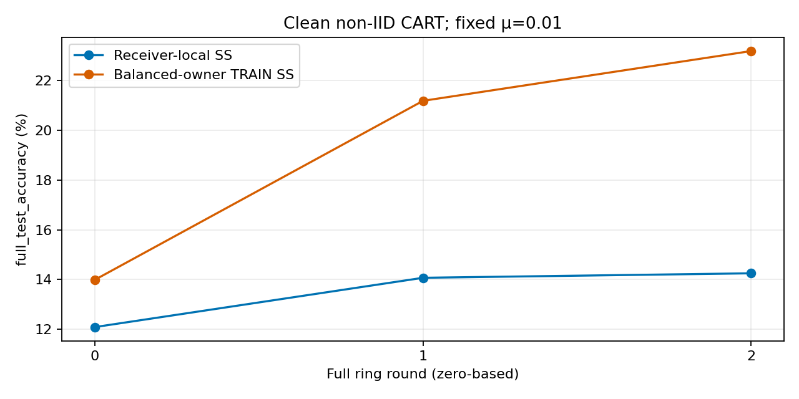
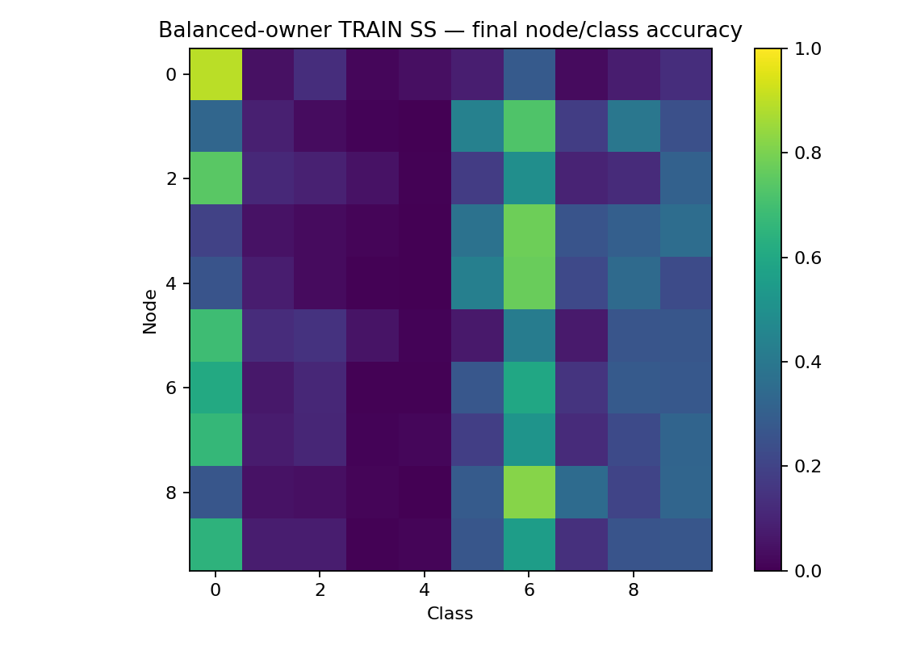

# CART: fixed-anchor balanced selection diagnostic

## Completed result — improvement, not a solved non-IID protocol

Both fresh GPU controls completed three full rounds. **Balanced TRAIN selection
improved the matched receiver-local control**, but several classes remain very
weak. This is not approval to launch full A/B/C/D.

| Final metric | Receiver-local SS | Balanced-owner TRAIN SS | Change |
|---|---:|---:|---:|
| Node-9 full-test accuracy | 14.25% | **23.18%** | +8.93 pp |
| Mean-node full-test accuracy | 12.178% | **22.549%** | +10.371 pp |
| Worst-node full-test accuracy | 10.38% | **17.36%** | +6.98 pp |
| Node-9 test CE | 2.28542 | **2.06104** | −0.22438 |
| Node-9 mean accuracy on other nine classes | 7.056% | **22.767%** | +15.711 pp |
| Node-9 own class (truck) | 79.0% | 26.9% | Less specialization, not an improvement on every class |
| Runtime | 24.38 min | 22.75 min | Observed runtime only; not a speed experiment |
| NaN/Inf failures / OOM | 0 / 0 | 0 / 0 | No failures |

`Node-9` means the fixed end-of-ring trained model, not an ensemble or best-node
selection. Mean/worst metrics use the ten stored trained node models.

| Zero-based round | Local SS Node 9 | Balanced SS Node 9 | Local mean | Balanced mean |
|---|---:|---:|---:|---:|
| 0 | 12.09% | 13.99% | 10.401% | 10.857% |
| 1 | 14.07% | 21.18% | 11.937% | 16.932% |
| 2 | 14.25% | 23.18% | 12.178% | 22.549% |



### First exact divergence explains the selection issue

The first four activations have identical output hashes across controls.
Their first different input is **Round 0, Node 4**, choosing between these
two candidates (among five):

| Candidate | Receiver-local CE (class 4) | Mean TRAIN CE over available classes 0–4 |
|---|---:|---:|
| Initialization cached under sender 9, R−1 | **2.295599** | 2.305942 |
| Node 3 trained snapshot, R0 | 5.097894 | **2.150827** |

The receiver-local rule correctly selects initialization, which fits the new
receiver class better than the trained snapshot does. The balanced rule selects
Node 3, which has lower mean training loss across the available classes. This
is direct evidence of a mismatch between the one-class selection criterion and
the desired multiclass retention—not a bug in the BASIL minimum-loss rule.

The fixed μ and paired actual shuffle/augmentation/helper samples remove the
adaptive-coefficient confound of the earlier comparison. Subsequent parameter
and gradient differences are expected consequences of different selected inputs.

### Classes still failing

| Final Node-9 class accuracy | Local SS | Balanced SS |
|---|---:|---:|
| airplane | 17.0% | 64.6% |
| automobile | 5.0% | 8.1% |
| bird | 3.8% | 8.2% |
| cat | 0.0% | **0.5%** |
| deer | 10.5% | **1.3%** |
| dog | 0.0% | 26.9% |
| frog | 0.0% | 55.5% |
| horse | 0.0% | 14.0% |
| ship | 27.2% | 25.8% |
| truck | 79.0% | 26.9% |

Cat and deer are weak across nodes, not just at Node 9: their balanced-control
mean node class accuracies are **1.8% and 1.04%**, respectively; the best node
reaches only **5.2% and 4.1%** on those classes. Some classes improved while
others degraded. Do not describe this as successful all-class learning.



The previous direct-predecessor diagnostic reached 25.35%, but used a different
adaptive-anchor rule. It is a historical reference, **not a matched third arm**
of this fixed-anchor comparison. The present result does not establish that
balanced selection outperforms direct handoff.

[Machine-checked report and per-class tables](../newResults/nonIID/cart_owner_gradients/clean_balanced_selection_fixed_anchor_3r_v1/BALANCED_SELECTION_REVIEW.md) ·
[Mean-node plot](../newPlots/nonIID/cart_owner_gradients/clean_balanced_selection_fixed_anchor_3r_v1/mean_node_accuracy_comparison.png) ·
[Worst-node plot](../newPlots/nonIID/cart_owner_gradients/clean_balanced_selection_fixed_anchor_3r_v1/worst_node_accuracy_comparison.png)

## Question and prespecified comparison

Does selecting an incoming snapshot using **available owners' balanced training
loss** retain more classes than selecting using only the receiver's one class?

This is a new CART adaptation, **not BASIL Equation (3)**. The paper-style
receiver-local selector remains the control. Neither condition averages models.

| Setting | Both conditions |
|---|---|
| Dataset | Full CIFAR-10 TRAIN, one complete class/node, 5,000 examples/node |
| Evaluation | Full 10,000-image TEST; evaluation only |
| Horizon | Three complete ring rounds, fixed before results |
| Local training | Five full epochs, batch 512, last batch 392, 50 updates/activation |
| Model | Existing 117,706-parameter CNN |
| SGD | Initial LR 0.05, existing round decay, reset each activation |
| Prohibited extras | No clipping, momentum, weight decay, attacks, channel noise or EBM |
| Memory/handoff | S=5 distinct latest predecessor snapshots; complete replacement |
| Helpers | Fresh full-model CE gradients, 16 TRAIN samples/available older owner/step |
| Anchor | Fixed μ=0.01; exact selected reference frozen for five epochs |
| Cloud/queue | W&B disabled; production queue untouched |

The earlier SS-versus-direct-handoff diagnostic used an adaptive anchor. Here
μ is fixed identically in both conditions so changing selection does not also
change its coefficient. The selected reference itself necessarily differs.
This does not overwrite or reinterpret earlier results.

## Selection and training are separate

For candidate snapshot θⱼ and available owner classes C:

| Control | Selection score |
|---|---|
| `receiver_local_ss` | `CE_i(θⱼ; B_i)` — current receiver only |
| `balanced_owner_ss` | `mean_{c∈C} CE_c(θⱼ; B_c)` — equal owner weights |

Each owner supplies the same deterministic, unaugmented 512-image TRAIN probe
for every candidate. Both conditions collect the same candidate diagnostics;
only their selection score differs. Test accuracy and sender-reported metrics
are not inputs. Ties within 1e-8 choose the nearest counterclockwise sender.
Only already-visited owners and the current owner are available in Round 0;
all ten are available after one traversal.

Both conditions optimize:

$$L(\theta)=\frac{1}{|C|}\sum_{c\in C} CE_c(\theta)
       +\frac{0.01}{2}\|\theta-\theta_{selected}\|_2^2.$$

$$\nabla L=\frac{1}{|C|}\sum_{c\in C}\nabla CE_c
       +0.01(\theta-\theta_{selected}).$$

Helpers compute gradients at the **current** parameters, not stale cached
weights. They run no optimizer. Gradients supervise the encoder as well as the
classifier. This is additional communication/supervision beyond plain BASIL.

```text
Five rolling candidates
        │
        ├── same owner TRAIN probes ── receiver-local or balanced score
        │
        └── choose ONE complete snapshot ── freeze reference
                                                │
                          five complete local epochs
                          + fresh owner gradients
                          + fixed snapshot anchor
                                                │
                           cache in next five nodes
                           only next node activates
```

## Implementation

| File | Responsibility |
|---|---|
| `scripts/run_cart_balanced_selection_diagnostic.py` | Explicit paired configs, fixed-anchor subclass, TRAIN selector and bounded execution |
| `scripts/run_cart_owner_selection_diagnostic.py` | Reused full-data runner with explicit opt-in study hooks; historical defaults unchanged |
| `basil_core/strict_cart.py` | Small overridable anchor-policy hook; default confidence/gap mathematics unchanged |
| `scripts/report_cart_balanced_selection_diagnostic.py` | Validate saved steps, pairing, selection, frozen anchors, checkpoints; create tables/plots |
| `tests/test_cart_balanced_selection_diagnostic.py` | Lazy dry-run, paired selector inputs, five-epoch fixed-anchor and incomplete-result rejection |

Every new result refuses overwrite. Checkpoints preserve rolling snapshots for
evidence; this diagnostic does not claim validated automatic resume.

The fixed-anchor implementation is in
[`create_worker`, line 56](../scripts/run_cart_balanced_selection_diagnostic.py#L56).
Its actual override is:

```python
def _anchor_control(self, selected_loss, target, current, support):
    # Prespecified mu, not selected loss/global accuracy, controls the
    # anchor. Registry verification/transport remains unchanged.
    return dict(mu=.01, rule='fixed_frozen_selected_snapshot',
                supportedClasses=[i for i, count in enumerate(support) if count > 0])
```

The default hook in
[`StrictCartWorker`, line 66](../basil_core/strict_cart.py#L66)
still returns the original adaptive rule for all older callers:

```python
def _anchor_control(self, selected_loss, target, current, support):
    """Overridable policy; the historical default is unchanged."""
    return anchor_strength(self.mu_max, selected_loss, target, current, support)
```

Selection wiring is at
[`choose_start`, line 75](../scripts/run_cart_balanced_selection_diagnostic.py#L75).
The balanced scorer is at
[`select_balanced_snapshot`, line 87](../basil_core/cart_owner_protocol.py#L87).
The separately verified EBM combination is at
[`owner_objective_gradients`, line 38](../basil_core/cart_owner_ebm.py#L38);
**that EBM path was not enabled in this clean learning comparison**.

## Verification before execution

- Focused suites: **51 passed**, 2 dependency deprecation warnings, 7.49 seconds.
- Synthetic CPU/GPU check: both 512 and 392 active batches, all nine older
  owners, independent full-objective gradients and SGD updates passed.
- Largest relative gradient difference: **2.48997321e-6**, below declared 0.01.
- Largest parameter-update difference: **7.45058060e-9**, below declared 1e-4.
- GPU configuration: deterministic float32, TF32 disabled, existing 6-GiB cap.
- Compile check passed; lazy-import audit: **231 sources**, no required changes.
- Full suite: **570 passed, 2 skipped, 644 subtests passed**, 3 warnings,
  82.73 seconds. Skips require a display; TensorFlow tests did run.

## Post-run evidence validation

| Check | Result |
|---|---|
| Executed activations / local SGD updates | 60 / 3,000; both runs complete |
| Actual batch traces | 3,000 checked for owner freshness and paired input/augmentation/helper keys |
| Local epochs / final batches | Five complete 5,000-example epochs per activation; final batches 392 |
| Frozen reference | Every input hash equals its immutable anchor hash |
| Anchor coefficient | Every control stage μ=0.01; actual float32 values checked within representation tolerance |
| Selection | Every chosen sender satisfies its configured minimum and nearest-predecessor tie rule |
| Selection provenance | All stored probes match keyed TRAIN indices and actual available owners |
| Rolling cache | 100 final snapshot hashes verified, 50/control, all Round 2 |
| Initialization / partition | Identical across controls |
| Peak TensorFlow GPU allocator | 270.63 MiB; 6,144-MiB cap; zero pressure events |
| Earlier result/plot/paper integrity | **23,934 / 23,934 SHA-256 matches; 0 changed; 0 missing** |

Partition hash: `fe885d5e2e9680b32e05705485d67aed3dc7ef6a77964617abb7da2b0d9abcd2`.
Initial-model hash: `7c717dbbd9bd1f2f230b1ff3d288bd8fec33dcd3ec730eb43e8a14e496cdc2df`.

Each control computes 11,250 extra owner-gradient responses. Their logical
coordinate payload totals **5,296,770,000 bytes/control**; this is a simulated
message volume, not measured network traffic. Extra helper communication and
computation must not be concealed when comparing with plain BASIL.

The synthetic device checks alone do not establish a learning benefit or
bit-identical long-run CPU/GPU execution; the completed paired trajectory is
separate evidence for the early, limited improvement reported above.

```bash
# Full regression suite actually executed: 570 passed, 2 skipped,
# 644 subtests passed, 3 warnings, 82.73 s.
DISPLAY= CUDA_VISIBLE_DEVICES=-1 TF_ENABLE_ONEDNN_OPTS=0 TF_NUM_INTRAOP_THREADS=1 TF_NUM_INTEROP_THREADS=1 MPLCONFIGDIR=/tmp/papermerge-balanced-selection-tests PYTEST_DISABLE_PLUGIN_AUTOLOAD=1 environment/basil-noise-env/bin/python -m pytest -q tests

# Zero-training plan
environment/basil-noise-env/bin/python scripts/run_cart_balanced_selection_diagnostic.py

# Synthetic device verification (refuses proof overwrite)
MPLCONFIGDIR=/tmp/papermerge-balanced-selection-proof environment/basil-noise-env/bin/python scripts/run_cart_balanced_selection_diagnostic.py --verify-device --device GPU

# Bounded clean comparison only; refuses result overwrite
MPLCONFIGDIR=/tmp/papermerge-balanced-selection-run environment/basil-noise-env/bin/python scripts/run_cart_balanced_selection_diagnostic.py --execute --device GPU

# Saved-result validation and plots; never trains
MPLCONFIGDIR=/tmp/papermerge-balanced-selection-report environment/basil-noise-env/bin/python scripts/report_cart_balanced_selection_diagnostic.py
```

## Limitations and next gate

This is one seed, three rounds and clean simulated owner services. It does not
test EBM, communication-noise mitigation or Byzantine robustness. An authentic
hash binds a helper response to a model but cannot prove the response is honest.
The existing outbound Hidden attack does not define malicious helper gradients
or selection scores. Full-node B/C/D therefore remains blocked until that
additional threat boundary is addressed explicitly. No production queue is
started by this diagnostic, regardless of its accuracy.
