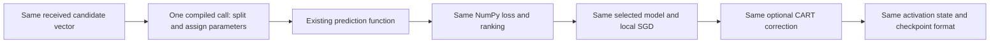

# Faster model loading with checkpoint pickup

The optional `transfer` scheduler resumes the **same frozen study**, using a
compiled parameter-transfer/inference adapter. It preserves the existing plan,
100 nodes, 100 rounds, six slots per GPU, datasets, conditions and random streams.
It skips completed runs, resumes valid checkpoints and starts never-started
configurations from their seeded initialization. A failed worker is recorded
separately while peers and pending jobs continue.

## Measured validation

On the local RTX4070Ti, these full-TRAIN tests used 100 nodes and 120 activations,
including the full 66-candidate window and an active attack. They include
selection, five local steps, CART and round evaluation:

| Dataset | Original time | Compiled transfer | Speedup |
| --- | ---: | ---: | ---: |
| MNIST | 40.09 s | 25.58 s | 1.57x |
| CIFAR-10 | 69.50 s | 44.11 s | 1.58x |

All training state and telemetry matched exactly. This is about 36% less wall
time in those bounded tests, not a measured four-GPU HPC campaign speedup.
The [trajectory receipt](validation/CART_COMPILED_TRANSFER_MATH_20261028.json)
also records twelve small IID/non-IID/three-seed trajectory and checkpoint-pickup
checks, including five accepted CART corrections.

The [six-slot pickup receipt](validation/CART_COMPILED_TRANSFER_PICKUP_20261028.json)
checks one completed configuration skipped unchanged, one original-engine
checkpoint resumed, and ten configurations started from zero. All twelve final
states match the original engine and pass independent CPU verification. The
full suite passed 1,295 tests plus 644 subtests, with four skips.

## What changed

The original candidate-scoring path assigns every model tensor from Python and
then calls the compiled prediction function. That repeats many small host calls
for each of up to 66 candidates. `CompiledTransferWorker` sends one flat parameter
vector and performs its splits, reshapes and assignments inside a TensorFlow
function, followed by the **existing prediction function**. The receiver still
evaluates every candidate required by the original selector. It keeps the same
float64 NumPy loss calculation and ranking/tie rules. Training uses the existing
gradient and SGD functions; CART uses the existing qualification and correction.



This is an execution optimization, not an additional research contribution or
an accuracy intervention. It does not reduce the candidate window, training
steps, data, node count, or round horizon. It does not make the complete algorithm
constant time: candidate scoring, screening, training and evaluation remain.

## Checkpoint and source integrity

The 23 original training-source files and the original resilient launcher are
unchanged. `plan.json` is preserved byte for byte. The additional runtime source
hashes, original-plan hash and failure policy are recorded in
`compiled_transfer_execution.json`; implementation snapshots are stored under
`runtime_sources/compiled_transfer_v1`. Runs using the adapter declare it in
`run.json`. Their original mathematical/checkpoint contract stays intact.

Before enabling the adapter, **each selected physical GPU** must compare the
original and compiled paths on both selected datasets. The check requires exact
candidate losses, model state, SGD weights and training telemetry. A mismatch
refuses the switch; it does not silently relax tolerances. These local device
checks supplement the multi-seed trajectory/recovery checks; they are not a
formal proof over every possible future input or a Byzantine guarantee.

The process-local worker factory selects the adapter explicitly. No frozen
source file is overwritten. The supervisor and worker both check its declared
runtime implementation hashes. Later implementation changes require a separate
version, rather than changing a resumed runtime silently.

ETA rate measurements use work performed **since the adapter started**, excluding
earlier slower activations. Historical rates from other runtime adapters are not
pooled. Pending unseen workloads still use clearly labeled planning priors.
Campaign elapsed time restarts with the supervisor; each run retains its saved
elapsed training time and the adapter's starting activation/time markers.

## Pickup procedure for the active HPC study

Running workers keep the code they already loaded. A pull alone cannot upgrade
them. Stop the named manager gracefully, wait for its worker processes to exit,
then verify the new adapter and resume the same output directory. Work after
the last committed activation may be replayed; completed runs are skipped.

```bash
cd ~/Masters_Research/PaperMerge
source .venv-hpc/bin/activate
RUN="$PWD/.papermerge/local-tests/cart-v2-focused-72-100r-6slot-resilient-v1"

tmux send-keys -t cart-v2-resilient-100r C-c
python scripts/hpc.py gpu-status
# Wait until the old campaign workers have exited before continuing.

git pull --ff-only
export MPLCONFIGDIR="$RUN/matplotlib-cache"

python scripts/run_cart_v2_transfer.py --verify-gpus --output "$RUN" &&
python scripts/run_cart_v2_managed.py --execute --scheduler transfer \
  --resume-plan --output "$RUN" --ntfy-topic papermerge-ojaswi \
  --tmux cart-v2-transfer-100r

python scripts/monitor_sharp_study.py --output "$RUN" --timezone America/New_York
```

Do not add new `COMMON` settings to this recovery command. Node count, 100-round
horizon and six workers per GPU come directly from the saved plan. No additional
VRAM cap or concurrency increase is introduced. Keep the original output name.

If no checkpoint exists, the corresponding configuration starts from zero.
If a checkpoint exists but fails its source/data/runtime/cursor integrity checks,
the worker is listed as failed; its checkpoint is preserved. It is not silently
deleted or treated as a new run. Failures remain in `failed_runs.json` and the
append-only event log. Finished configurations are not re-run on recovery.

Automatic ntfy alerts and final matched three-seed graphs remain managed by the
same supervisor. To retry unfinished jobs after queue exhaustion, repeat the
managed command with a free tmux name; do not alter the saved plan.

Independent final inference and runtime provenance checking:

```bash
python scripts/verify_cart_v2_transfer_results.py \
  --output "$RUN" --require-complete
```

If the GPU exactness gate fails, keep its diagnostic output. The existing
`resilient` scheduler remains available to resume the original implementation
with `--resume-plan`; all original source/plan hashes remain valid. Persistent
filesystem EIO still needs a storage-health investigation; this adapter addresses
parameter-transfer overhead, not storage reliability.

## Code map

| File | Role |
| --- | --- |
| `basil_core/sharp_compiled_transfer.py` | Compiled transfer and inference adapter |
| `scripts/run_cart_v2_transfer.py` | Frozen-plan recovery, bounded slots, isolated failures |
| `scripts/cart_v2_transfer_worker.py` | Explicit worker factory and runtime provenance |
| `scripts/verify_cart_v2_transfer.py` | Per-GPU exactness gate and scoring timings |
| `scripts/check_cart_compiled_transfer.py` | Real-data trajectory, checkpoint and full-window checks |
| `scripts/verify_cart_v2_transfer_results.py` | Adapter provenance plus independent CPU inference |
| `basil_core/sharp_monitor.py` | Rates measured since the runtime switch |
