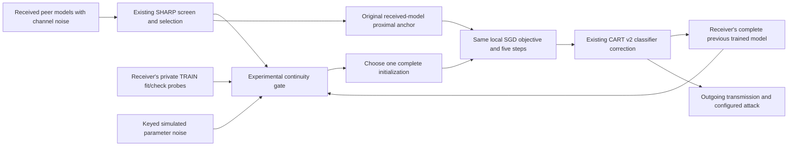

# CART continuity candidate: architecture, mathematics and evidence

Status: experimental research candidate, 28 October 2026. The complete-model
continuity intervention is separate from CART v2. It is not enabled in the
72-run HPC campaign, and its novelty and robustness are not established.

## What the completed HPC output says

The completed metrics and figures have now been pulled from user commit
`42da8f81`. All 171 exported file hashes match, and the summary recomputes from
all 72 metric arrays. The [local metric verification receipt](validation/CART_HPC_EXPORTED_METRICS_20261028.json) also checks the frozen runtime and figure provenance. Model
checkpoints remain on HPC, so this is not independent inference verification. The campaign completed all 72 configurations with no process failures,
100 clients, 100 rounds, 5 local steps and absolute channel sigma 0.01.

| Data | Clean | Both mitigations | Both mitigations + CART v2 | Paired CART effect, percentage points |
|---|---:|---:|---:|---:|
| MNIST IID | 97.41% | 90.82% | 90.85% | +0.027 ± 0.025 |
| MNIST Dirichlet | 97.21% | 89.23% | 89.22% | −0.010 ± 0.017 |
| CIFAR-10 IID | 63.07% | 20.80% | 23.38% | +2.583 ± 3.924 |
| CIFAR-10 Dirichlet | 56.60% | 10.00% | 10.00% | 0.000 ± 0.000 |

Values are final-round TRAIN-holdout means over three seeds; ± denotes sample
SD of paired effects, not a confidence interval. Rounded displayed means need
not subtract to the more precise paired effect. The CIFAR IID effect is mostly
seed 2025 (+7.108 points versus +0.510 and +0.130). The non-IID result fails the
intended recovery target. Execution success is distinct from scientific success.
Preserve these results and their source versions rather than replacing them.

## Explain it to a younger student

Imagine 100 students passing around a notebook. Each student has pictures of
some things, and learns to recognize them. Receiving a notebook can help, but it
can also erase useful learning if the incoming notebook is old, damaged, or good
at different things.

CART v2 mainly tries to repair the notebook's final answer page. That cannot
always recover knowledge lost from the earlier pages that recognize shapes and
features. This candidate lets each student keep a complete copy of their last
notebook. Before switching to an incoming notebook, the student checks it on
small groups of their own pictures. The incoming notebook must improve the
average and avoid excessive damage to any group they can check. Otherwise the
student continues from their own notebook, then performs the usual training.

The difficult part is learning from other students while retaining useful local
knowledge. Keeping one's own notebook forever is an explicit comparison: if it
works just as well, the extra class checks have not demonstrated a contribution.
The student cannot check picture groups absent from their own data. These checks
do not magically protect unseen classes or establish global accuracy.

## Proposed architecture and exact code locations

- [Candidate routing and worker](../basil_core/cart_continuity_candidate.py):
  `route`, `eligible`, `selector`, `ContinuityWorker.train`.
- [Paired five-arm screen](../scripts/probe_cart_continuity.py): current control,
  CART v2, unconditional own-model continuity, macro-loss continuity, and the
  class/noise candidate. The latter three also retain v2 post-training correction.
- [Existing v2 loop](../basil_core/sharp_cart_v2_protocol.py): unchanged. The
  diagnostic wraps its selector inside its own process; this is not a released
  new v2 revision and must not be mixed into existing results.
- [Private probes](../basil_core/sharp_cart.py): `probes` creates deterministic,
  disjoint fit/check indices within each client's TRAIN partition. They are not
  independent of all SGD training, nor are they official TEST examples.
- [Unit checks](../tests/test_cart_continuity_candidate.py): class harm versus
  scalar mean improvement, unsupported classes, initialization/anchor separation,
  and exact SGD equivalence when the initialization is unchanged.

The old sender-list telemetry describes the peer pool, even when the candidate
routes the local carrier. New `selection.continuity` records identify the actual
route explicitly. Legacy attack-ancestry summaries must not be interpreted as
actual carrier provenance. A production revision needs a separately versioned
configuration and actual route/ancestry schema before HPC use.

## Equations with each symbol explained

Let the per-class loss on a private probe be

$$
L_{i,c}^{s}(\theta)
=\frac{1}{|B_{i,c}^{s}|}\sum_{(x,y)\in B_{i,c}^{s}}
 -\log p_\theta(y\mid x),\qquad s\in\{f,k\}.
$$

Here $i$ is the receiving client and $c$ is a class. $s=f$ means its fit probe;
$s=k$ means its separate check probe. $B_{i,c}^{s}$ contains local TRAIN images
$x$ with label $y=c$, and $|B_{i,c}^{s}|$ is their number. $p_\theta(y\mid x)$ is
the probability predicted by the model with parameters $\theta$. This is a
forward-pass cross-entropy measurement, not a gradient and not data received
from another client. Only classes present in both probes form the supported set
$C_i$. A singleton local class example cannot support both probes.

The class-balanced probe mean is

$$
\overline L_i^{s}(\theta)
=\frac{1}{|C_i|}\sum_{c\in C_i}L_{i,c}^{s}(\theta).
$$

$C_i$ is the supported class set, so every checked class receives equal weight
regardless of its local image count. This prevents a frequent local class from
entirely dominating the routing score. It does not represent unobserved classes.

For a peer that improves the mean but harms a checked class, form an empirical
channel allowance:

$$
\xi_m\sim\mathcal N(0,\sigma^2 I),\qquad
b_{i,c}^{s}
=\max\left(0,\max_{1\le m\le M}
 \left[L_{i,c}^{s}(a_i+\xi_m)-L_{i,c}^{s}(a_i)\right]\right).
$$

$a_i$ is the receiver's last complete locally trained model, stored before
outgoing parameter corruption. It is not a previous node's gradient. $\xi_m$ is
one keyed, simulated Gaussian parameter error; $\sigma$ is the configured
absolute per-coordinate channel standard deviation, $I$ is the identity matrix,
$M$ is the configured number of draws (19), and $m$ indexes a draw.
$b_{i,c}^{s}$ is the largest positive observed class-loss increase among those
draws. The maximum with zero makes it nonnegative. Full $\sigma$ is used here;
no independence or $\sigma^2/q$ claim is made for adaptively selected peer models.
If the peer improves every checked class, all budgets can remain zero and no
simulation is required. If it does not improve both means, reject it without
simulation. This is empirical calibration, not a conformal coverage guarantee
or an adversarial bound.

Let $p_i$ denote the complete peer model produced by the existing SHARP selector.
Choose the initialization by

$$
\theta_i^0=
\begin{cases}
p_i,&\text{if }\overline L_i^s(p_i)<\overline L_i^s(a_i)-\varepsilon
\text{ and }L_{i,c}^s(p_i)\le L_{i,c}^s(a_i)+b_{i,c}^s
\quad\forall s\in\{f,k\},\ c\in C_i,\\
a_i,&\text{otherwise}.
\end{cases}
$$

$\theta_i^0$ is the model used to start this activation's SGD; $p_i$ comes from
received peer parameters and $a_i$ is the receiver-owned carrier. $\varepsilon$
is a fixed mean-loss improvement tolerance, $10^{-4}$. The rule selects one
complete feature extractor and classifier together. It does not blend
incompatible classifier/backbone pieces. Without a previous model or any
supported class, the current experimental rule uses the peer and claims no
class-loss bound for that activation.

For supported probes with a carrier, the selected initialization satisfies

$$
L_{i,c}^s(\theta_i^0)\le L_{i,c}^s(a_i)+b_{i,c}^s,
\qquad
\overline L_i^s(\theta_i^0)\le\overline L_i^s(a_i).
$$

The proof has two cases. Accepting $p_i$ explicitly checks both inequalities.
Choosing $a_i$ gives equality in the second and satisfies the first because
$b_{i,c}^{s}\ge0$. This is a finite-probe **initialization property**, not a
learning theorem: SGD can subsequently increase a class loss, an attacker can
overfit a probe, and unseen examples/classes have no such protection. The
property is straightforward from the acceptance rule and is not itself a claim
of mathematical novelty.

Local SGD retains the declared objective

$$
J_i(\theta)=\operatorname{CE}_{i,B}(\theta)
+\lambda_i\|\nabla_\theta\operatorname{CE}_{i,B}(\theta)\|_2^2
+\frac{\mu}{2}\|\theta-p_i\|_2^2.
$$

$B$ is the current keyed SGD mini-batch drawn from the receiver's TRAIN data.
$\nabla_\theta\operatorname{CE}$ is the gradient computed at the model's current
parameters, rather than a gradient sent by the previous node. $\lambda_i$ is
the existing configured RLA coefficient, and $\mu$ is the existing proximal
coefficient. The anchor remains the original received model $p_i$, even when
$\theta_i^0=a_i$. Keeping this objective isolates the initialization intervention;
it does not extend the original channel-variance motivation to a noise-free
local carrier. A future change to the anchor or coefficient requires its own
matched objective ablation and a new revision.

## What might be a contribution, and what is already known

[Downloaded comparison and important paragraphs](../papers/cart_continuity_novelty_20261028/README.md).

| Mechanism | Prior work | Candidate distinction to test |
|---|---|---|
| Retain local model; prefer peers with lower local loss | FedFomo, Section 3 / Equation 3 | A scalar gate or self-memory alone is insufficient novelty |
| Preserve knowledge across clients/tasks | FedWeIT parameter decomposition; FedKNOW gradient integration | Whole-model route before SGD in a noisy sequential ring, with no new task labels or shared raw data |
| Class-aware decentralized Byzantine integration | Bristle, Sections 3.1–3.3 | Bristle freezes a pretrained backbone and integrates output layers; this candidate trains full models and measures class damage before full-model replacement |
| Class-aware distillation / analytic head correction | FedCAD, ACIL and existing CART v2 | These pieces remain attributed; classifier repair alone is not the proposed new contribution |
| Remembered loss constraints | GEM / GEC | The finite routing constraint is not claimed as a new mathematical principle |
| Uncertainty-driven memory | ICLR 2025 online FCL paper | That paper selects replay examples using predictive uncertainty; here simulated parameter error calibrates a model-routing allowance |

The narrow hypothesis is that class-wise, channel-calibrated, receiver-owned
continuity improves useful cross-client transfer beyond generic self-retention
and scalar-loss routing when an entire learned backbone can be overwritten.
A targeted literature difference and a new name do not establish novelty. The
hypothesis fails if the candidate only matches a simpler control, prevents
collaboration, or does not improve the specified non-IID setting.

## Tests required before claiming success

1. Short paired screens: same initialization, data, steps, noise and attack
   schedule; compare current control, v2, always-own, scalar macro routing and
   class/noise routing. Record class harm, peer acceptance, runtime and actual
   route. Begin before attacks to verify learning, then test early attack onset.
2. Require a measurable contribution from the class constraints/calibration,
   rather than only from preserving one's local model. Add zero-budget routing
   to determine whether noise calibration itself helps.
3. Validate promising settings on three development seeds and both IID and
   Dirichlet CIFAR-10. Track global balanced/per-class performance and class
   absence, rather than only local probe loss. Reject chance-level non-IID output.
4. Freeze a separate revision and compare final and last-ten-round means, paired
   seed differences, worst-node/worst-class behavior, compute and communication
   cost. Independently verify saved models on held-out data before a paper claim.
5. Preserve the old v2 baseline. A CART-only intervention may reuse matching
   frozen controls, but a changed base selector/objective requires new controls.
   Do not overwrite old runs or silently mix versions in averaged plots.

The desired close-to-clean result remains a target. It cannot be promised,
selected into existence by changing metrics, or inferred from code tests.

## Outcome of the first five-round continuity screen

Full TRAIN CIFAR-10 IID, 100 clients, seed 2025, sigma 0.01, five local steps,
attack onset after the screen. The same current selector, proximal term and RLA
regularizer are used. These are short development results, not a benchmark win.

| Arm | Final mean accuracy |
|---|---:|
| Both mitigations, current control | 11.220% |
| Current CART v2 | 11.284% |
| CART plus unconditional own-model continuity | 10.857% |
| CART plus macro-loss continuity | 11.114% |
| CART plus class/noise continuity | 10.808% |

[The saved validation receipt](validation/CART_CONTINUITY_IID_5R_20261028.json) records all five arms. All five saved final model sets passed independent CPU inference checks, with
paired data/initialization and recorded initialization bounds checked. Thus this
own-versus-pooled-peer candidate did not solve the learning failure. A satisfied
probe constraint does not imply useful global learning. We retain this negative
screen rather than relabeling it as successful novelty.

## Separate fresh-hop candidate

[Fresh selector](../basil_core/cart_fresh_continuity_candidate.py) and
[screen runner](../scripts/probe_cart_fresh_continuity.py) add the immediate
predecessor as a complete-model candidate alongside the pooled peer model and
local carrier. It reuses the same already-received keyed noisy link: there is
no extra communication, clean copy, attacker-label oracle or noise redraw. A
fresh copy that fails the peak screen is not admitted through this route.

Each candidate is checked against the carrier with the same gate. The lowest
class-balanced probe score among resulting admissible whole models is chosen.
Consequently the same finite-probe initialization inequality holds for the
class/noise mode when a carrier and supported classes exist: every selectable
outcome already satisfies it. The scalar-loss mode is an explicit matched
ablation; both modes get access to the fresh copy. If only the scalar mode
works, the class/noise component has not demonstrated a benefit.

The proximal anchor is the selected peer candidate (fresh or pooled), even when
the resulting initialization is the local carrier. A fresh or carrier route
records denominator q=1; pooled selection retains its actual q. For a carrier,
this coefficient remains a declared regularizer, not a derived channel variance.
Actual fresh/pool/own routing and sender lists are recorded separately. These
are additional experimental changes and must not be mixed with the completed
v2 results or treated as identical objective comparisons.

The next bounded screen uses Dirichlet CIFAR-10, 100 clients, five rounds,
sigma 0.01 and Hidden attack from displayed round three, with the current
control/v2 plus fresh scalar/class-aware candidates. No new HPC campaign is
recommended until the paired short results justify its cost.

The completed five-round fresh-versus-pool screen also failed: control 10.000%,
v2 10.000%, scalar routing 10.001%, and class/noise routing 10.028%. The latter
selected its own carrier on all 400 post-bootstrap activations. All four saved
model sets passed independent CPU inference. One final summary initially failed
because the mean hop over an empty peer list was NaN; the summary was recovered
from the complete checkpoint as `null` for that undefined diagnostic, with no
training or metric change. The [receipt](validation/CART_FRESH_CONTINUITY_DIRICHLET_5R_20261028.json)
retains both the failure/recovery explanation and model verification. This
shows why a class constraint around an unlearned model can prevent useful
transfer rather than preserve useful knowledge.

## Learned-class-qualified fresh handoff: next experiment

[Qualified selector](../basil_core/cart_qualified_continuity_candidate.py),
[ten-round screen](../scripts/probe_cart_qualified_continuity.py), and
[qualification tests](../tests/test_cart_qualified_continuity_candidate.py)
make two further changes, which are explicit experimental interventions:

- Prefer the already-received immediate predecessor if it passes the peak screen;
  otherwise use the original selected pool. The original pool's expensive loss
  ranking is skipped when it will not be used. The same keyed channel samples
  and peak rule are retained; this optimization does not supply a clean model.
- Protect only locally learned classes: both probes need at least eight class
  examples, class accuracy at least 40%, and class CE at most 0.8 times log(C).
  Here C is the total number of classes. These are fixed development thresholds,
  not statistical certificates. Uniform-prediction loss fails qualification.

For these qualified classes, require incoming class CE not to exceed the
carrier's class CE plus the empirical Gaussian allowance on either probe.
If it violates a bound, restore the complete carrier; otherwise admit the fresh
peer. There is no macro-improvement veto on unlearned classes. With no qualified
class the fresh copy is admitted and no class-protection claim is made.
The same two-case proof gives the finite-probe allowance bound only for the
qualified classes. It does not give mean-loss monotonicity across all classes.

Compare three arms using the same fresh-hop policy, q, proximal anchor, steps,
noise and attack schedule: fresh control without v2 repair; fresh with v2 repair;
and fresh with learned-class protection plus v2 repair. This is necessary to
distinguish the benefit of recency from the incremental retention mechanism.
The ten-round development screen uses 100 Dirichlet CIFAR-10 clients, seed 2025,
sigma 0.01, with attacks starting in displayed round four. It is not the
100-round professor study and does not replace any archived v2 result.
