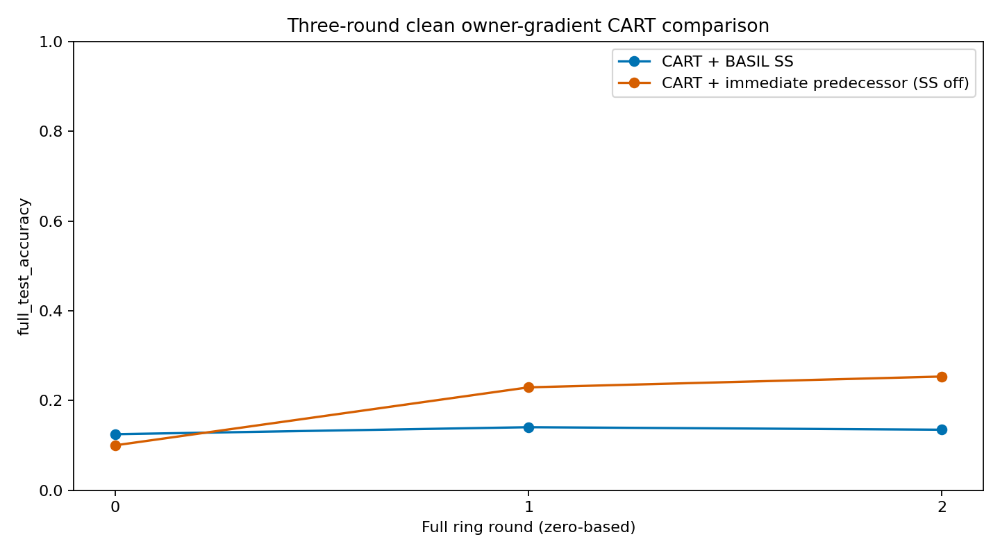

# Owner-gradient CART: three-round Snapshot Selection diagnostic

## Question and declared scope

Does receiver-local, one-class Snapshot Selection disrupt cumulative learning,
or does the balanced owner-gradient objective remain inadequate even with direct
predecessor handoff? This is a **fresh, paired, clean diagnostic**, not an attack
study or a change to the approved BASIL baseline. The operator approved exactly
two controls and three full ring rounds per control before execution.

| Setting | CART + BASIL SS | CART + immediate predecessor |
|---|---|---|
| Starting parameters | One minimum receiver-local CE snapshot | Complete immediate predecessor snapshot |
| Snapshot averaging | None | None |
| BASIL memory | Latest five distinct predecessors | Same five-predecessor cache |
| Candidate evaluation | Same own-class 512-example TRAIN batch | Same batch, diagnostics only; does not choose source |
| Local training | Five full passes over 5,000 own-class examples | Identical |
| Batch sizes | Nine batches of 512, final batch 392 per epoch | Identical |
| SGD steps | 50/activation, 1,500/control | Identical |
| Optimizer | SGD; reset per activation; momentum 0 | Identical |
| Learning rate | 0.05 / (1 + 0.05 × full ring round) | Identical |
| Owner helper batch | 16 TRAIN examples per older-owner response | Identical |
| Initialization, partition, shuffle, augmentation | Seed 2025 with keyed streams | Identical |
| CART anchor | Existing receiver-supported confidence/gap, cap 0.01 | Same rule |
| Attacks / noise / EBM / clipping / weight decay | Off | Off |
| W&B / GUI queue / automatic promotion | Off | Off |

The SS-off condition is an explicitly labelled diagnostic control, **not BASIL
Snapshot Selection**. Both evaluate candidates for local diagnostics. No sender
telemetry or test accuracy selects the starting model. Complete model loading
and hash checks precede training, without stale-model mixing or averaging.

## Objective and information boundary

Let `C` be the currently available class owners, including the active owner `i`.
For each owner, `F_c(theta)` is a mean minibatch cross-entropy at the **same
current parameters**. The objective is

$$L_i(\theta)=\frac{1}{|C|}\sum_{c\in C}F_c(\theta)
 +\frac{\mu_e}{2}\|\theta-\theta_{input,i}\|_2^2.$$

The applied gradient is the mean of full encoder/classifier owner gradients,
plus `mu_epoch * (theta - theta_input)`. Helpers perform zero SGD updates and
return gradients, not raw images. This is **additional clean supervised gradient
communication simulated in one process**, not pure one-class-only BASIL, deployed
RPC, a privacy guarantee or a Byzantine-safe helper aggregator.

```text
same current theta_k -> own full-epoch batch CE gradient
       |
       +--> earlier owner c: 16 TRAIN images -> full CE gradient
       +--> earlier owner d: 16 TRAIN images -> full CE gradient
       |
       v
equal-class gradient mean + frozen-input CART anchor
       |
only the active node applies SGD -> train through five full epochs
       |
deliver trained snapshot to five clockwise caches; next node activates
```

Round 0 requests only owners that already activated earlier in the traversal.
After the first full traversal all ten owners are available, so Rounds 1 and 2
request the nine owners other than the active node. Every helper gradient is
refreshed at **each current SGD step**. Current state hashes, source owners,
round/step contexts and tensor shapes are checked; stale gradients are rejected.
Equal class weights apply despite the 512/392-versus-16 sample-count difference.

The CART reference is exactly the chosen input and stays frozen for the five
epochs. The controller uses only receiver-local training evidence. Its numerical
coefficient may differ between controls because the chosen input changes the
local selection loss and subsequent registry/controller state. This is an
ablation of the **whole selection-policy effect within CART**, not a contrast
with a forced-identical anchor coefficient.

## Measurement, safety and evidence

The balanced 640-image TRAIN analysis probe is the same as previous diagnostics.
It is evaluated before training and after each epoch, never used to set
coefficients/select snapshots, and **not held out from ordinary local SGD**.
Helpers exclude this probe and the SS batch. The intact 10,000-image test set
is evaluated after each activation only; it cannot affect learning or stopping.

Fresh canonical initialization and partition hashes must match. The saved-data
review also checks all local batch-order/augmentation hashes and helper
sample indices/augmentation keys across controls. Differences in model
trajectories, selected snapshots and derived anchor values are expected.

Finite-value checks abort on the first error and retain the actual batch,
parameters, helper indices/keys and context. One active model plus one serially
reused helper model run under the verified 6,144-MiB GPU cap, TF32 disabled.
The allocator is not forcibly reset during SGD. Evidence checkpoints are atomic
files containing every rolling snapshot, registry and next-activation cursor;
**automatic resume has not been validated or exposed**.

Both controls write only to the new scoped directory:

```text
newResults/nonIID/cart_owner_gradients/clean_three_round_selection_pair_v1/
    basil_ss/
    immediate_predecessor/
    summary.json
    OWNER_SELECTION_REVIEW.md

newPlots/nonIID/cart_owner_gradients/clean_three_round_selection_pair_v1/
```

The completed IID evidence, earlier non-IID diagnostics and papers must remain
SHA-256 identical. Baseline manifest:
`gui/worker_state/cart_owner_selection_3r_before.json`. No existing result/proof
is overwritten and no retries, longer runs or promotion are automatic.

## Implementation and reproduction

| File | Change / responsibility |
|---|---|
| `basil_core/cart_owner_gradient_worker.py` | Opt-in horizon 3; validated class-owner availability after warm-up. Default horizon 1 and gradient/anchor mathematics unchanged |
| `scripts/run_cart_owner_selection_diagnostic.py` | Paired configs, SS versus direct predecessor selection, independent ten-class device proof, two bounded fresh runs and rolling-cache evidence checkpoints |
| `scripts/report_cart_owner_selection_diagnostic.py` | Saved-only completeness/step/hash/pairing checks, round CSVs, comparison plots and confusion/epoch retention heatmaps |
| `tests/test_cart_owner_selection.py` | Lazy plan, config differences, selection/ties, warmed owner bounds, direct-handoff memory simulation and incomplete-result rejection |

Heavy numerical, plotting and cloud dependencies remain lazy. The GUI queue,
research engines, attack transformations, source EBM and approved CNN are not
modified by this diagnostic.

```bash
# Zero-training plan.
environment/basil-noise-env/bin/python scripts/run_cart_owner_selection_diagnostic.py

# Synthetic device verification; no CIFAR training trajectory.
environment/basil-noise-env/bin/python scripts/run_cart_owner_selection_diagnostic.py --device GPU --verify-device

# Explicitly approved paired execution. Refuses existing result directories.
environment/basil-noise-env/bin/python scripts/run_cart_owner_selection_diagnostic.py --device GPU --execute

# Saved-only analysis; refuses missing/incomplete data and existing review plots.
environment/basil-noise-env/bin/python scripts/report_cart_owner_selection_diagnostic.py
```

## Interpretation boundary

Three rounds and one seed cannot establish convergence or universal superiority.
If both controls remain weak, say so; if the predecessor control improves, it
supports a selection-policy concern in this extreme split, not a claim that
BASIL is generally defective. No assumption that accuracy must exceed 50%,
no test-based tuning and no automatic 30-/500-round experiment are allowed.

## Completed results

Both controls completed **3/3 full-data rounds**, 30 activations and 1,500 SGD
updates each on the RTX 4070 Ti. These are bounded, non-production diagnostics
(`researchValid=false`), not the IID A/B/C/D campaign.

| Zero-based round | SS Node 9 | Direct Node 9 | SS node mean | Direct node mean | SS worst | Direct worst |
|---|---:|---:|---:|---:|---:|---:|
| 0 | 12.50% | 10.02% | 10.453% | 10.298% | 10.00% | 9.85% |
| 1 | 14.06% | 22.94% | 12.175% | 16.499% | 10.39% | 10.74% |
| 2 | 13.50% | 25.35% | 12.281% | 24.017% | 10.47% | 16.64% |

`Node 9` means the final trained end-of-ring model, evaluated on all 10,000
test images. Node mean/worst use the ten separately trained activation states
from that round. They are not ensembles or averaged parameters.

Direct handoff improved the final Node-9 result by **11.85 percentage points**,
node mean by **11.736 pp**, and worst-node by **6.17 pp** relative to SS.
Direct handoff's full-test CE decreased from 2.30355 to 2.12649 to 1.99366;
SS's CE was 2.30809, 2.28919, 2.28876. No test value selected a parameter,
hyperparameter, stopping point or longer run.

The first differing input occurs at **Round 0, Node 1**, not from mismatched
RNG: SS chooses initial sender-9 weights (own-class CE 2.29633) instead of
Node 0's trained weights (own-class CE 9.39011). Nodes 1–4 likewise select
initial weights. Later SS selected the immediate predecessor only 2/10 times
in each warmed round, versus 10/10 for the direct control. This supports a
selection-policy concern under this extreme one-class objective: local loss
need not favor cumulative knowledge. It is the specified SS rule operating
correctly, **not a confirmed BASIL implementation defect**. Derived anchor
coefficients also differ as a consequence of the chosen input.

Direct handoff produced nonzero Node-9 accuracy in all ten classes, whereas
SS left dog, frog and horse at 0%. However, direct cat accuracy was only 0.8%
and bird 5.0%. The result is promising early learning, not satisfactory
all-class retention, convergence, an attack/noise result or a 50% guarantee.

[Complete per-class, execution and evidence review](../newResults/nonIID/cart_owner_gradients/clean_three_round_selection_pair_v1/OWNER_SELECTION_REVIEW.md).



## Completed verification

| Check | Measured result |
|---|---|
| Focused selection/owner/CART/protocol/lazy suites | 132 passed; 3 warnings; 10.77 s |
| Complete test suite | 541 passed, 2 skipped, 644 subtests passed; 3 warnings; 71.52 s |
| Compile | Passed |
| Lazy import audit | 224 sources; zero movable/direct heavy imports |
| Independent ten-class objective, CPU versus GPU | Relative gradient differences 2.49e-6 (512) and 1.80e-6 (392); maximum SGD update difference 7.45e-9 |
| Legacy lambda | Ignored; identical synthetic objective/gradients for lambda 1 versus 999999 |
| Paired actual data/helper sampling | All 3,000 batch traces match indices, augmentation and helper sample keys across controls |
| Actual fresh owner state | All 3,000 traces match helper/current parameter hashes |
| Historical one-traversal equivalence | All 500 SS Round-0 update/data/gradient hashes match earlier saved traversal |
| Final evidence checkpoints | 100 snapshot checksums; correct five-predecessor membership; 20 final node hashes match activation records |
| Numerical failures / OOM / pressure | 0 / 0 / 0 in both controls |
| Peak TensorFlow VRAM | 270.63 MiB; configured cap 6,144 MiB; not a total system GPU-memory measurement |
| Runtime | SS 19.45 min; direct 19.52 min; total 38.97 min |
| Existing result/plot/paper integrity | 23,904 before and SHA-256 matched; zero changed/deleted |

Two GUI/display-dependent tests were skipped; no GUI execution or queue startup
was performed. Device comparisons establish the reported numerical tolerance,
not bit-identical CPU/GPU trajectories. Earlier proofs refer to earlier source
versions; the current warmed ten-class proof is
`gui/worker_state/CART_OWNER_SELECTION_3R_GPU_VERIFICATION.json`.

Commands actually executed before research diagnostics:

```bash
DISPLAY= CUDA_VISIBLE_DEVICES=-1 TF_ENABLE_ONEDNN_OPTS=0 TF_NUM_INTRAOP_THREADS=1 TF_NUM_INTEROP_THREADS=1 MPLCONFIGDIR=/tmp/papermerge-owner-selection-tests PYTEST_DISABLE_PLUGIN_AUTOLOAD=1 environment/basil-noise-env/bin/python -m pytest -q tests/test_cart_owner_selection.py tests/test_cart_owner_gradient_worker.py tests/test_cart_owner_gradients.py tests/test_strict_cart.py tests/test_research_protocol.py tests/test_lazy_imports.py

DISPLAY= CUDA_VISIBLE_DEVICES=-1 TF_ENABLE_ONEDNN_OPTS=0 TF_NUM_INTRAOP_THREADS=1 TF_NUM_INTEROP_THREADS=1 MPLCONFIGDIR=/tmp/papermerge-owner-selection-full PYTEST_DISABLE_PLUGIN_AUTOLOAD=1 environment/basil-noise-env/bin/python -m pytest -q tests

environment/basil-noise-env/bin/python -m compileall -q gui basil_core reporting scripts tests run_gui.py
environment/basil-noise-env/bin/python scripts/audit_lazy_imports.py

MPLCONFIGDIR=/tmp/papermerge-owner-selection-proof environment/basil-noise-env/bin/python scripts/run_cart_owner_selection_diagnostic.py --device GPU --verify-device
MPLCONFIGDIR=/tmp/papermerge-owner-selection-run environment/basil-noise-env/bin/python scripts/run_cart_owner_selection_diagnostic.py --device GPU --execute
MPLCONFIGDIR=/tmp/papermerge-owner-selection-report environment/basil-noise-env/bin/python scripts/report_cart_owner_selection_diagnostic.py
```

All three-round results and eight PNGs are new scoped outputs. Integrity
verification permits only additions inside the declared result/plot directory;
it does not permit rewriting older evidence. The baseline and verification are
saved in `gui/worker_state/cart_owner_selection_3r_before.json` and
`gui/worker_state/cart_owner_selection_3r_integrity.json`.
