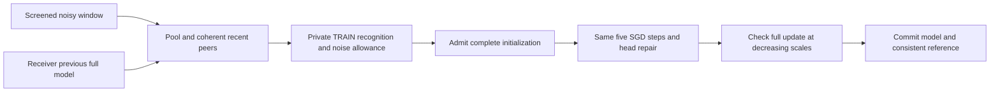

# CART revision: check the handoff and the committed local update

The completed 72-run HPC study did not establish a useful non-IID CIFAR defense:
both v2 CART and its control finished at 10%. The clean comparison averaged
56.60%. MNIST’s near-zero CART/control difference also does not establish a CART
benefit. We preserve those results and treat the revised architecture as a new
method requiring evaluation.

## Mechanism and mathematical scope

Each receiver has its previous full model and a window of noisy received models.
The unchanged SHARP selector supplies a pooled proposal. The revision also
considers up to eight recent screened peer snapshots and the receiver’s own
model. These are coherent complete models, not independently mixed encoder and
classifier pieces. All scoring uses only that receiver’s private TRAIN partition.
Two disjoint probe sets are separate from the evaluation holdout, but are reused
for training decisions; they are not an independent statistical test.

For class c, recognition is the standard one-versus-rest Matthews correlation
coefficient (MCC):

```
s_c = (p(y=c, prediction=c) - p(y=c) p(prediction=c))
      / sqrt(p(y=c)(1-p(y=c)) p(prediction=c)(1-p(prediction=c)))
```

A degenerate denominator gives zero. Predicting one class for every example
therefore does not count as perfect knowledge of that class. MCC is established
prior work, not a new metric, and is not generally invariant to class prevalence.
The internal `prior_neutral` name refers to discounting constant-class guesses.

Let f_c and k_c be the two probe scores and t_c the smaller score for the
receiver’s previous model. Classes need at least eight positive examples on
each probe and t_c >= 0.2 to qualify for retention. A physical-noise allowance
a_c is the largest observed score drop under 19 keyed, configured-sigma Gaussian
parameter perturbations of that previous model. It is an empirical calibration,
not a conformal/generalization guarantee or a bound on arbitrary Byzantine attacks.

The class-aware utility is:

```
Q(model) = min(mean_c f_c, mean_c k_c)
           - mean_c [qualified_c * max(t_c - min(f_c,k_c) - a_c, 0)]
```

The macro ablation removes the second term. Admission activates only after the
receiver’s own mean recognition exceeds 0.02 on both probes; cold-start class
bias is not a memory worth freezing. Among models within 0.01 of the best Q,
prefer the most recent nearby coherent peer. Including the previous own model
ensures the **measured ingress score** is at least its Q minus 0.01 when active.
This does not guarantee accuracy, per-class monotonicity or global convergence.

The admitted initialization is also the actual proximal anchor. Own-model
initialization adds no new link perturbation, so that activation’s link-noise
coefficient is zero; historical corruption is not erased. Peer initialization
uses the configured regularizer. Adaptive selection does not justify claiming
that its effective noise always remains Gaussian with variance sigma²/q.

The same five SGD steps and existing classifier repair are then computed.
Before committing the complete model, test delta scales 1, 1/2, 1/4, 1/8 and 0,
and accept the largest whose Q is at least the admitted model’s Q minus 0.01.
This adds inference checks, not optimizer steps. If scaled, keep the previous
head reference; a reference evaluated for an uncommitted model is not admitted.
The change covers the complete local update, so it can modify the backbone and
does not inherit v2’s classifier-only backbone invariant.



## Evidence and what it does not establish

Local full-data CIFAR-10 non-IID screens use 100 clients, sigma 0.01 and active
Hidden attacks, with shorter horizons/onsets than the HPC campaign. Early attempts
to protect class recall or raw F1 alone froze biased or weak models, generally
ending near 10–13%. Those failures are retained in the development receipt.

At 10 rounds, seed 2025, attack start 3, the revised recognition/commit architecture
reached **22.361%**, its macro ablation **22.395%**, and the same recognition router
without the commit check **16.321%**. Independent CPU evaluation reproduced all
three final model accuracies exactly. This supports testing the joint ingress/
commit mechanism, but does **not** establish an incremental benefit for the class
penalty over the macro ablation. The earlier raw-F1 commit screen reached
22.605%/23.919%; MCC is used to remove the constant-class recognition loophole,
not because these development means prove higher accuracy.

See [compact receipts](https://github.com/Ojaswi03/PaperMerge/blob/a731e45b08c4fc66c613fa33342d900a65bb7eda/docs/validation/CART_TRANSACTIONAL_SCREENS_20261028.json) and
the [HPC sequence](https://github.com/Ojaswi03/PaperMerge/blob/a731e45b08c4fc66c613fa33342d900a65bb7eda/docs/CART_NEXT_HPC_RUN.md). Short screens cannot establish clean-level
performance, a successful 100-round defense, or novelty. Final TRAIN-holdout means,
last-ten-round endpoints, paired seed variation, worst-node/class behavior,
wall time and official TEST evaluation must be distinguished.

The actual source-frozen production runner also completed a second-seed,
five-round confirmation with 100 clients and attack start 2: **27.828% IID** and
**14.562% non-IID**, with no worker failures. Independent CPU inference reproduced
both final models exactly. [Metrics, plots, snapshots and verification receipt](https://github.com/Ojaswi03/PaperMerge/tree/a731e45b08c4fc66c613fa33342d900a65bb7eda/docs/validation/cart-admission-confirmation-5r-20261028)
are exported without checkpoints. These are confirmation of execution and early
learning, not matched 100-round performance estimates. The [hardware gate receipt](https://github.com/Ojaswi03/PaperMerge/blob/a731e45b08c4fc66c613fa33342d900a65bb7eda/docs/validation/CART_REVISION_GPU_GATE_20261028.json)
records the exact scoring and admitted-objective comparisons on the local RTX 4070 Ti;
the gate must be rerun on HPC’s different GPUs/software.

## Attribution and novelty test

[Downloaded primary papers](../papers/cart_continuity_novelty_20261028/README.md)
include FedFomo, Bristle, FedWeIT, FedKNOW, uncertainty-aware memory, Zeno and
Zeno++. Local model retention, per-class performance integration, memory-based
interference control and validation-based update admission already exist.
MCC, ridge repair, regularization and line search are established components.

The narrow research hypothesis is the **coupled receiver-local admission and
full-update commitment of coherent models under a noisy decentralized Byzantine
protocol**, with recognition-qualified class memory and explicit channel
calibration. A defensible paper needs matched ingress-only, macro, class-penalty,
noise-calibration and commit ablations, plus competitive prior-work baselines.
We cannot claim an unseen invention or tune on the official TEST set. The next
six runs test practical efficacy across IID/non-IID and three seeds; they do not
by themselves complete that novelty study.

## Runtime and recovery

The new batched candidate scorer was checked against the original scalar scorer
on 66 CIFAR candidate vectors, with exactly equal losses. Local scoring-stage
benchmarks showed improvement; this is not a whole-campaign speedup claim.
Telemetry omits losing candidates’ class vectors but keeps their scores and the
selected evidence. Model, optimizer and reference state remain unchanged; an
interrupted/recovered protocol test verifies identical complete model state.

The frozen original 23 scientific files and eight compiled-runtime files remain
unchanged. The revision has its own extended source contract and source snapshots;
old reporters reject it instead of labeling new experiments as original v2.
Failure isolation, checkpoint resume, automatic complete-seed plot replacement
and short spaced phone notifications are exercised through the new runner.
