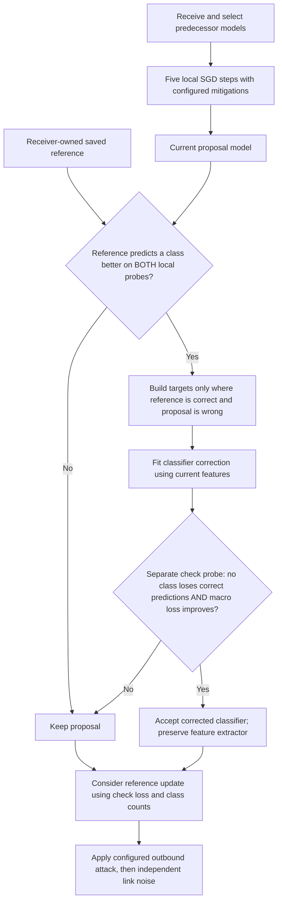

# CART v2: correctness-qualified class retention

This is a separately versioned development method, `sharp_cart_v2`, built on
the [guarded selector](SHARP_SURVIVOR_GUARD.md). Original SHARP and CART files
and their results remain unchanged. This revision changes CART, not the attack,
channel, five-step SGD objective, or hop-aware RLA formula.

## Plain explanation

Each client keeps one saved model of its own. When a new model arrives and is
trained, the client asks: “Has this model forgotten a class my saved model can
still recognize?” It checks two separate groups of its own training pictures.
The saved model must recognize more pictures of that class in both groups.

CART then fits a small correction to the final classifier, using only pictures
the saved model gets right and the current model gets wrong. It tests several
correction sizes on the second group. A correction is accepted only if no
checked class loses correct predictions and the average class loss improves.
The image feature extractor stays unchanged. If these checks fail, the client
keeps the ordinary trained model. No other client's pictures or official test
pictures enter CART.



## Mathematics and where each quantity comes from

For receiver/client \(i\), let \(F_i\) and \(C_i\) be disjoint, deterministic
fitting and checking subsets of **its own TRAIN partition**. They are not
received from the previous node. Let \(p\) be the newly trained proposal and
\(r\) the receiver's previously admitted reference. The proposal starts from
the guarded predecessor selection and receives the same five SGD steps as
its non-CART control. The reference was stored at an earlier activation of
this same receiver, before outbound attack or communication noise.

For a supported class \(c\), define:

$$
n_c^S(v)=\sum_{(x,y)\in S}\mathbf{1}\{y=c,\ \arg\max_j z_{v,j}(x)=c\},
\qquad S\in\{F_i,C_i\}.
$$

Here \(z_v(x)\) is model \(v\)'s vector of class logits, \(j\) ranges over
classes, and \(\mathbf{1}\) is one when the condition holds and zero otherwise.
Thus \(n_c^S(v)\) counts correctly classified class-\(c\) pictures in probe
\(S\). A class is qualified only if the reference has strictly more correct
predictions than the proposal on **both** probes:

$$
Q_c=\mathbf{1}\{n_c^{F_i}(r)>n_c^{F_i}(p),\quad
                       n_c^{C_i}(r)>n_c^{C_i}(p)\}.
$$

Let \(L_c^{F_i}(v)\) be mean cross-entropy for class \(c\) on the fitting
probe. Let \(u_c\ge0\) be the saved channel allowance: inherited CART
calibration uses 19 seeded Gaussian perturbations of the saved model, at the
declared absolute coordinate standard deviation. This is a finite simulation
envelope, not a confidence bound. Define the excess loss and bounded gate:

$$
d_c=[L_c^{F_i}(p)-L_c^{F_i}(r)-u_c]_+,
\qquad g_c=Q_c\frac{d_c}{d_c+u_c+10^{-6}}.
$$

\([a]_+=\max(a,0)\). The gate \(g_c\) lies in \([0,1]\): it is zero when
the class is unsupported, correctness qualification fails, or the loss gap
does not exceed the calibrated allowance. No gradient is computed to form
these counts or gates.

For each fitting example \((x_j,y_j)\), construct:

$$
m_j=\mathbf{1}\{\arg\max z_r(x_j)=y_j,\quad
                       \arg\max z_p(x_j)\ne y_j\},
$$

$$
T_j=m_jg_{y_j}\left[\bar z_r(x_j)-\bar z_p(x_j)\right],
\qquad \bar z=z-\frac{\mathbf{1}^{\mathsf T}z}{K}\mathbf{1}.
$$

\(K\) is the number of classes. Centering removes a logit offset common to
all classes. \(T_j\) is the desired classifier change for that example. It is
**zero whenever the reference is wrong**, and also zero when the proposal is
already correct. Zero targets on the remaining fitting examples discourage
unnecessary changes there; they do not guarantee unchanged predictions.

Let \(h_p(x_j)\) be the proposal's feature vector immediately before its final
classifier. Form matrix \(A\) with rows \([h_p(x_j)^{\mathsf T},1]\), adding
a bias coordinate. For \(J\) represented fitting classes with \(s_c\) examples
of class \(c\), use diagonal weights \(D_{jj}=1/(J s_{y_j})\). Fit:

$$
\Delta=\arg\min_V\|D^{1/2}(AV-T)\|_F^2+\rho\|V\|_F^2
       =(A^{\mathsf T}DA+\rho I)^{-1}A^{\mathsf T}DT,
$$

$$
\rho=0.01\,\frac{\operatorname{tr}(A^{\mathsf T}DA)}{\dim(A^{\mathsf T}DA)}.
$$

\(V\) is a candidate classifier correction; \(\Delta\) is the fitted one.
\(\|\cdot\|_F\) is the sum-of-squares matrix norm, \(I\) is an identity
matrix, and \(\operatorname{tr}\) sums a matrix's diagonal. The implementation
solves the linear system rather than explicitly inverting a matrix. Positive
ridge regularization is inherited from CART; ridge regression itself is not
claimed as new. This step fits the final classifier directly and does not
replace or alter the five SGD updates.

For scales \(a\in\{0.25,0.5,0.75,1\}\), evaluate the classifier
\(W_p+a\Delta\), including its bias row, on checking probe \(C_i\). Eligible
scales must satisfy:

$$
\forall c:\ n_c^{C_i}(p+a\Delta)\ge n_c^{C_i}(p),
\qquad
L_{\mathrm{macro}}^{C_i}(p+a\Delta)
 < L_{\mathrm{macro}}^{C_i}(p)-10^{-4}.
$$

\(L_{\mathrm{macro}}\) is the mean of the supported classes' mean
cross-entropies, giving each supported class equal weight. Among eligible
scales, choose the largest total gain in correct checking predictions, then
the lowest macro loss. Recheck the actual float32 model after applying the
correction; otherwise roll back to the proposal. Reference replacement also
requires no decline in checked class correct counts and lower checked macro
loss. The first reference requires a nonempty checking probe.

The count condition proves non-regression **on these fixed checking pictures
for this activation only**. It does not prove improved unseen accuracy,
long-term retention, convergence, arbitrary Byzantine robustness, or novelty
relative to all literature. Repeated use of a small local check probe can
overfit it, and absent classes cannot be protected directly. Full reporting
uses separate held-out TRAIN data; official TEST remains unused in development.

## Implementation map

| File | Responsibility |
| --- | --- |
| [sharp_cart_v2.py](../basil_core/sharp_cart_v2.py) | Qualification, disagreement targets, ridge solve, checking and memory admission |
| [sharp_cart_v2_protocol.py](../basil_core/sharp_cart_v2_protocol.py) | New method/configuration identity, source hashes and transactional ring activation loop |
| [run_cart_v2_study.py](../scripts/run_cart_v2_study.py) | GPU verification, one independent configuration per GPU, tmux, recovery and reporting |
| [run_cart_v2_cpu_case.py](../scripts/run_cart_v2_cpu_case.py) | Explicit CPU development executor with its own recorded program hash |
| [verify_sharp_results.py](../scripts/verify_sharp_results.py) | Independent final inference, attack reconstruction, channel replay, RLA and CART invariant audits |
| [check_cart_v2_recovery.py](../scripts/check_cart_v2_recovery.py) | Interrupted/resumed/uninterrupted runs in fresh interpreters |
| [report_cart_v2_pilot.py](../scripts/report_cart_v2_pilot.py) | Matched control/CART comparisons across separate output folders |
| [test_sharp_cart_v2.py](../tests/test_sharp_cart_v2.py) | All 288 configuration identities/logical switch cases, exact recovery and a real classifier-forgetting repair test |

The proposed architectural contribution is receiver-owned class retention
through qualified, channel-gated classifier transport in a guarded ring. Its
ingredients include established selection, loss calibration and ridge fitting;
this implementation alone does not certify research novelty or general gains.
See the existing [literature and mechanism guide](CART_ARCHITECTURE_MATH_AND_PAPER_GUIDE.md)
for attribution and downloaded papers.

## Completed development evidence

The [validation index](validation/CART_V2_VALIDATION_INDEX_20261027.json)
records frozen source and receipt hashes. [All forty real GPU switch cases](validation/CART_V2_GPU_ALL_SWITCHES_20261027.json)
completed and passed independent CPU inference and telemetry audits: two
datasets, both partitions, all ten conditions, seed2025 and central sigma0.01.
They used eight nodes, five rounds, onset1 and bounded TRAIN subsets; these
are execution checks rather than the full 288-run research matrix. The audit
reconstructs each final outbound attack exactly and checks deterministic link
replay, receiver-specific noise and actual-q hop-aware RLA coefficients.

The full suite passed **1,250 tests and 644 subtests**, with four skips. Tests
validate all 288 configuration identities and logical attack/mitigation switch
cases, strict separation from earlier method families, exact partial-round
recovery, and a real classifier-forgetting example in which v2 improves
predictions while preserving the feature extractor. Logical switch tests use
a small deterministic worker; they are not 288 trained research experiments.

The [100-node MNIST receipt](validation/CART_V2_MNIST_100NODE_10R_20261027.json)
contains four completed, independently verified full-fitting-data CPU cases:
seed 2025, sigma 0.01, ten rounds, attack onset2, both partitions, joint
mitigation with and without CART v2. Initialization, partition/data/runtime,
and pre-memory first-ring model hashes match within each pair.

| Split | Joint control, final | Joint + CART v2, final | CART v2 − control | Accepted corrections |
| --- | ---: | ---: | ---: | ---: |
| IID | 83.770% | 83.812% | +0.042 percentage points | 162 |
| Dirichlet 0.5 | 67.859% | 67.711% | −0.148 percentage points | 111 |

The primary endpoint (all ten rounds in this short pilot) differs by +0.0442
points IID and −0.2332 points non-IID. Fresh-process
[CPU](validation/CART_V2_FRESH_CPU_RECOVERY_20261027.json) and
[GPU](validation/CART_V2_FRESH_GPU_RECOVERY_20261027.json) recovery are exact
after 32 activations each, including three nonzero CART corrections. These results
establish active, reproducible implementation; they do **not** show a consistent
accuracy improvement, near-clean behavior or an improvement over original CART.
They use one seed and one noise level and are explicitly development evidence.

A [matched original-CART comparison](validation/CART_V2_MATCHED_LEGACY_COMPARISON_20261027.json)
was also completed and independently verified at this same ten-round horizon:
original CART reaches 84.481% IID and 68.872% non-IID. It outperforms v2 here.
The earlier 35-round original-CART failures must not be compared with v2's
ten-round values as evidence that v2 improves accuracy. The stricter local
checks are implemented and tested; their usefulness over longer horizons
still requires direct comparison. This is why the next HPC command is a pilot.

## HPC execution

Use a new output directory. The old SHARP and guarded-CART checkpoints must
not be resumed under CART v2. Keep the stopped 288-run campaign as evidence.
The following pilot runs **all 288 combinations**, with 100 nodes and ten
rounds. Attack onset is deliberately moved to round index 2 so this short
pilot actually exercises eight attack-active rounds.

```bash
cd ~/Masters_Research/PaperMerge
git pull --ff-only
source .venv-hpc/bin/activate
python scripts/hpc.py gpu-status

COMMON=(
  --profile hpc --gpus 0,1,2,3
  --datasets mnist cifar10 --partitions iid dirichlet
  --seeds 2025 2026 2027 --sigmas 0.005 0.01 0.02
  --conditions clean attack_only attack_defense noise_only noise_rla
    attack_noise attack_noise_defense attack_noise_rla
    attack_noise_defense_rla attack_noise_defense_rla_cart
  --nodes 100 --local-steps 5 --alpha 0.5 --model paper
)
RUN="$PWD/.papermerge/local-tests/cart-v2-hpc-100n-10r-pilot-v1"
python scripts/run_cart_v2_study.py --preflight "${COMMON[@]}" --rounds 10 --attack-start 2 --output "$RUN" &&
python scripts/run_cart_v2_study.py --verify-gpus "${COMMON[@]}" --rounds 10 --attack-start 2 --output "$RUN" &&
python scripts/run_cart_v2_study.py --execute "${COMMON[@]}" --rounds 10 --attack-start 2 --output "$RUN" --tmux cart-v2-pilot

python scripts/run_cart_v2_study.py --monitor --output "$RUN"
```

Ctrl+C exits the monitor; the tmux campaign continues after SSH disconnect.
The monitor provides timing estimates when corresponding workload samples
exist. GPU processes execute configurations concurrently; logical activations
within each configuration remain sequential.

After completion:

```bash
python scripts/verify_sharp_results.py --require-complete --output "$RUN"
python scripts/run_cart_v2_study.py --report --output "$RUN"
```

Retain every outcome and compare CART with its exact joint-mitigation control
at the same dataset, split, seed and sigma. Average node/endpoint results
within each seed first, then the three seeds at the **same** sigma. Do not
average different noise levels together or select the best round after seeing
results. A ten-round pilot's last-ten endpoint includes warm-up; it is not the
same endpoint as the final ten rounds of a hundred-round study.

For the full 100-round protocol, first finish and review the pilot. Use the
same `COMMON` array in the same shell, a fresh output, and the original onset20:

```bash
RUN="$PWD/.papermerge/local-tests/cart-v2-hpc-100n-100r-v1"
python scripts/run_cart_v2_study.py --preflight "${COMMON[@]}" --rounds 100 --attack-start 20 --output "$RUN" &&
python scripts/run_cart_v2_study.py --verify-gpus "${COMMON[@]}" --rounds 100 --attack-start 20 --output "$RUN" &&
python scripts/run_cart_v2_study.py --execute "${COMMON[@]}" --rounds 100 --attack-start 20 --output "$RUN" --tmux cart-v2-full
python scripts/run_cart_v2_study.py --monitor --output "$RUN"
```

If a campaign is interrupted, retain the frozen source and identical arguments,
then add `--recover` to its execute command. Never change rounds, attack onset,
method, dataset or source in place. Do not run the pilot and full campaign on
the same four GPUs simultaneously.
