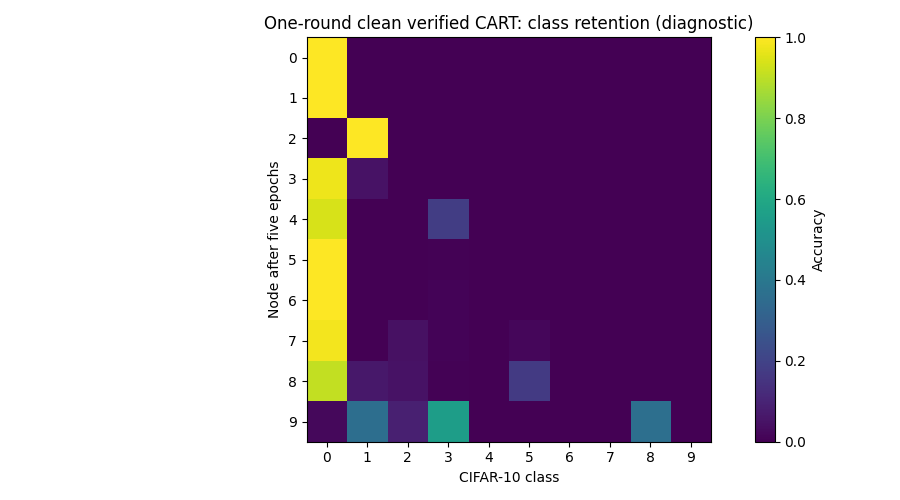
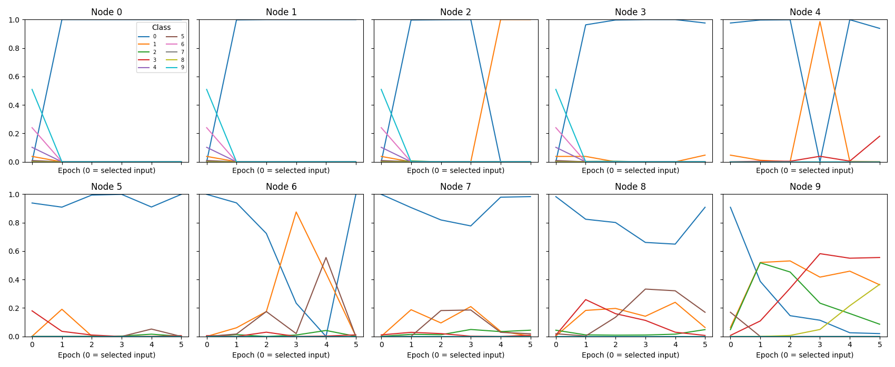

# Verified CART: bounded full-data learning diagnostic

This stage follows the [GPU and resource gates](CART_RESOURCE_AND_RECOVERY_GATES.md).
It is a **single clean ring traversal**, not A/B/C/D or a production campaign.
The authoritative execution status is in the new output directory's `progress.json`;
an error is recorded in `failure.json`. No partial output is a completed result.

## Fixed scope

| Setting | Value |
|---|---|
| TRAIN / local data | Complete CIFAR-10 TRAIN; 5,000 class-i examples at active node i |
| Verifier data access | Ten independently isolated replicas can access the committed full TRAIN corpus |
| TEST | Full 10,000 images, evaluation-only; never mounted inside a verifier |
| Horizon | Exactly one ring round, nodes 0 through 9 |
| Local training | Five full epochs; batches 512, final 392; 50 updates/node |
| Total | 500 updates, 250,000 local example visits |
| Model / initialization | Existing 117,706-parameter BASIL CNN; CPU canonical initialization, seed 2025 |
| Optimizer | Existing SGD, initial LR 0.05, round decay; no momentum, clipping or weight decay |
| Snapshot memory | Five distinct counterclockwise predecessors; strict parameter replacement |
| Selection | Certified mean available-owner TRAIN CE; identical 512-example probes for each candidate |
| Objective | Mean available-owner CE plus fixed frozen-snapshot anchor, μ=0.01 |
| Attack / channel noise / EBM | All disabled for this first full-data learning check |
| Backend | GPU coordinator with 6 GiB cap; ten CPU-only verifier processes, each capped at 2 GiB |
| Telemetry | Full-test CE, accuracy, ten class accuracies and confusion matrix before/after each epoch |
| Cloud / queue | No W&B; no GUI queue change or execution |

The objective is the existing clean CART adaptation:

\[
L_i=\frac{1}{|C_i|}\sum_{c\in C_i}CE_c
+\frac{0.01}{2}\|\theta-\theta_{selected}\|_2^2.
\]

During round zero, only owners 0 through i are available. Older-class helper
gradients use the existing keyed 16-example TRAIN batches. The active node uses
its full local epoch schedule. At least five identical signed independent
results are required; no tolerance or quorum is relaxed.

**Scientific qualification:** multi-class TRAIN replication and balanced-owner
selection are explicit changes from exclusive-data, receiver-local paper BASIL.
The coordinator/data bootstrap is trusted. The prior successful fault-injection
checks are correctness evidence, not universal Byzantine robustness. This clean
learning diagnostic does not inject a new attack or claim a noise-defense benefit.

## Safety and recovery

The launcher verifies the current integrated GPU proof and source hashes before
starting. Existing output directories are never overwritten by `--execute`.
Checkpoints are saved after selection, each full epoch and each activation.
An atomically replaced progress manifest points to an immutable checkpoint and
its matching evaluation records. If interrupted between commits, `--resume`
recomputes from the last committed boundary; at most one epoch's uncommitted
updates must be replayed. It does not invent missing metrics or skip batches.
An orphan checkpoint from an interrupted commit is preserved and causes a
fail-closed error requiring investigation, rather than silent overwrite.

Resume requires identical script/scientific hashes, initial state, data root,
device policy and fixed config. New replica membership is recorded. Test metrics
never select stopping time, hyperparameters or candidate snapshots.

The bounded runner retains checkpoint generations, checks a 2 GiB archive
budget before each new generation, and retains the existing 256 MiB per-file
limit plus free-disk guard. This is not a tested long-campaign storage policy.
Per-replica peak RAM and kernel OOM counters are captured each epoch.

## Commands and outputs

```bash
# Default: inspect configuration, zero training
environment/basil-noise-env/bin/python scripts/run_verified_cart_learning.py

# Explicit fixed one-round learning diagnostic
environment/basil-noise-env/bin/python scripts/run_verified_cart_learning.py --execute

# Only after interruption, from the last consistent commit
environment/basil-noise-env/bin/python scripts/run_verified_cart_learning.py --resume

# Regenerate plots/report only, from completed saved evidence
environment/basil-noise-env/bin/python scripts/run_verified_cart_learning.py --report
```

Results: `newResults/nonIID/cart_verified/clean_full_data_one_round_v1/`.
Plots: `newPlots/nonIID/cart_verified/clean_full_data_one_round_v1/`.

The final generated `LEARNING_REVIEW.md` reports measured values only. Early
node states have not yet received all ten classes, so one-round node fairness
and accuracy should not be compared as if all states had identical class history.
One traversal cannot establish convergence or readiness for the full campaign.

## Pre-run verification

* 25 focused launcher/resource/runner tests passed, with two dependency deprecation warnings.
* Compile checks passed.
* Lazy-import audit: 252 source files; zero heavy imports retained or moved.
* Historical evidence baseline: 24,599 files, 13,125,719,966 bytes; recheck after execution.
* Before launch: 11,303 MiB free VRAM; host available RAM exceeded the 24 GiB startup requirement.

No research accuracy threshold was used as an implementation pass criterion.

The full CPU test suite was also run during the diagnostic: **644 passed,
2 skipped, 644 subtests passed**, with 3 dependency/Keras warnings, in 105.46 s.
The two skipped tests require a GUI display. This concurrent test activity
means the diagnostic's wall time is an observed elapsed time, not an isolated
performance benchmark.

```bash
DISPLAY= CUDA_VISIBLE_DEVICES=-1 TF_ENABLE_ONEDNN_OPTS=0 TF_NUM_INTRAOP_THREADS=1 TF_NUM_INTEROP_THREADS=1 MPLCONFIGDIR=/tmp/cart-resource-mpl PYTEST_DISABLE_PLUGIN_AUTOLOAD=1 environment/basil-noise-env/bin/python -m pytest -q -rs tests
environment/basil-noise-env/bin/python -m compileall -q scripts/run_verified_cart_learning.py scripts/verify_cart_learning_evidence.py tests/test_verified_cart_learning.py
```

The separate read-only `scripts/verify_cart_learning_evidence.py` checks the
completed checkpoint lineage, minimum selection scores and their signed CE
bindings, keyed helper requests, frozen anchors, all epoch/sample counts,
confusion matrices, finite model tensors, and the next-round rolling memory.
`--save` writes only its derived audit into this new diagnostic directory.

## Completed results

The fixed one-round run completed on 2026-10-13. Nothing was extended or tuned
after observing accuracy. All ten activations, 50 local epochs and 500 optimizer
updates completed, including every 392-example final batch.

| Measurement | Result |
|---|---:|
| Initial full-test accuracy | 9.01% |
| Final Node-9 full-test accuracy | 13.90% |
| Final mean of ten stored node states | 10.80% |
| Final worst-node accuracy | 10.00% |
| Final Node-9 full-test CE | 2.301564 |
| Elapsed time, including setup/evaluation/checkpointing | 816.34 s (13.61 min) |
| Complete test evaluations | 60 |
| Independent helper RPC calls | 22,725 |
| Saved certificates / signatures verified offline | 2,525 / 22,725 |
| Peak per-replica cgroup memory | 1,696,559,104 bytes (1.58 GiB), below 2 GiB cap |
| Recorded replica OOM / OOM-kill events | 0 / 0 |
| Non-finite failure | None observed |
| Checkpoint archive | 399.09 MiB |
| GPU memory free after process exit | 11,303 MiB |
| Historical research/paper files | 24,599 matched; zero changed |

### What the learning evidence actually shows

| CIFAR-10 class | Node-9 accuracy after five epochs |
|---|---:|
| Airplane | 2.0% |
| Automobile | 36.3% |
| Bird | 8.6% |
| Cat | 55.5% |
| Deer | 0.0% |
| Dog | 0.0% |
| Frog | 0.0% |
| Horse | 0.0% |
| Ship | 36.6% |
| Truck | 0.0% |

The final model is **not predicting only one class**, but its predictions cover
only classes 0, 1, 2, 3 and 8. It never predicts the other five classes on the
full TEST set. This is a serious coverage limitation, not a successful retention
result. Across Node 9's five epochs, airplane recall fell from 90.8% to 2.0%,
while cat recall rose from 0.7% to 55.5% and ship from 0% to 36.6%.
Mean other-class accuracy can rise while a particular previously learned class
is lost; the class curves are necessary to see that tradeoff.

Node 9's overall accuracy was 11.96% at its selected input, 15.34% after epoch 1,
then 14.76%, 13.96%, 14.12% and 13.90%. All five epochs were retained despite the
earlier higher value. No epoch was selected by TEST performance.

### Cold-start selection finding

Nodes 0–3 selected the original initialization snapshot from sender 9, round -1.
For Nodes 1–3 this means the certified balanced TRAIN criterion preferred an
untrained cached model to the available already-specialized models. Nodes 4–9
then selected their immediate predecessor's round-0 trained snapshot.
The minimum-score and deterministic tie contracts passed; this observation is
**not evidence of a handoff implementation defect**. It does explain why the
first traversal is not uninterrupted cumulative learning from Node 0's output.
No initial memories or selection rules were changed to improve the score.

### Engineering verdict versus scientific verdict

* **Engineering:** the measured full-data, GPU-coordinator/CPU-verifier path ran
  successfully. Strict handoff, fixed anchors, selection minima, request-bound
  signatures, update lineage and Node 0's next-round memory (senders 5–9, round 0)
  all passed the offline evidence audit. Workers exited and released resources.
* **Scientific:** one clean traversal has not solved class retention. It is not
  a convergence study, a matched comparison with prior trusted-helper runs, an
  EBM efficacy test or an attack-resilience experiment.
* **Next ordered work:** validate full-batch noisy/EBM execution and bounded
  adversarial end-to-end behavior separately, including costs, before preparing
  A/B/C/D. Do not infer a 500-round resource budget from this short run or change
  the method based on its TEST curve.

The raw records and per-node table are in the
[generated learning review](../newResults/nonIID/cart_verified/clean_full_data_one_round_v1/LEARNING_REVIEW.md).
The offline audit is
[EVIDENCE_AUDIT.json](../newResults/nonIID/cart_verified/clean_full_data_one_round_v1/EVIDENCE_AUDIT.json).
The new plots, cross-checked against the saved evaluation arrays, are:





**A/B/C/D remain unstarted. No W&B logging or production-readiness claim.**
