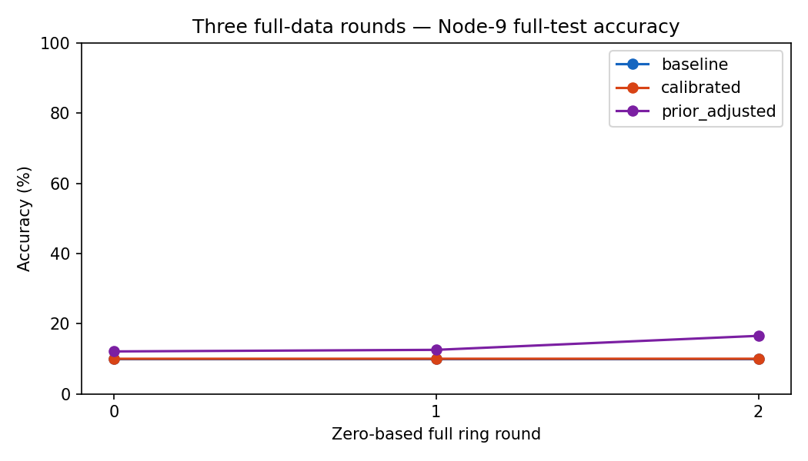

# Small Dirichlet learning tests and the local-accuracy fix

**Three full-data, three-round GPU diagnostics completed. Local-accuracy
reporting is fixed. A local-prior correction improved early learning, but the
non-IID learning problem and Byzantine-filtering problem are not solved.**

No A/B/C/D queue was started or changed. No W&B session, attack, communication
noise or EBM was enabled in these learning diagnostics. All are explicitly
`researchValid=false` bounded diagnostics, not replacements for the completed
30-round evidence.

## Results

Each condition uses the complete 50,000-image TRAIN partition and the full
10,000-image evaluation-only TEST set. Five full local epochs execute at every
activation: **510 steps per ring, 1,530 updates and 30 activations per condition**.

| Local objective | R0 Node-9 test accuracy | R1 | R2/final | Final node mean | Final worst node | Runtime | Peak VRAM |
|---|---:|---:|---:|---:|---:|---:|---:|
| Ordinary CE + anchor | 10.00% | 10.00% | 10.00% | 10.00% | 9.99% | 115.48 s | 272.37 MiB |
| FedLC-inspired count margin + anchor | 9.99% | 10.00% | 10.00% | 10.00% | 10.00% | 132.67 s | 390.16 MiB |
| Local-prior logit adjustment + anchor | 12.09% | 12.54% | **16.53%** | **13.05%** | **11.10%** | 139.61 s | 394.35 MiB |

The prior-adjusted final Node-9 gain is **+6.53 percentage points** versus the
matched baseline, not a 6.53% relative improvement. Its final node-mean gain is
about +3.05 pp and its worst-node gain about +1.11 pp. The first margin variant
did not improve final Node-9 accuracy within this short horizon.

VRAM values are allocator high-water marks, not isolated per-model allocation:
the first two conditions ran serially in one process. These short measurements
do not guarantee the memory behavior of a later long experiment.



| Final Node-9 class recall | CE + anchor | Count margin + anchor | Prior adjustment + anchor |
|---|---:|---:|---:|
| airplane | 0.0% | 0.0% | 51.6% |
| automobile | 0.0% | 0.0% | 0.8% |
| bird | 100.0% | 100.0% | 2.4% |
| cat | 0.0% | 0.0% | **0.0%** |
| deer | 0.0% | 0.0% | **0.0%** |
| dog | 0.0% | 0.0% | 0.1% |
| frog | 0.0% | 0.0% | 32.9% |
| horse | 0.0% | 0.0% | 0.9% |
| ship | 0.0% | 0.0% | 8.9% |
| truck | 0.0% | 0.0% | 67.7% |

The prior-adjusted model is no longer predicting bird on every image, but many
classes remain nearly unrecognized. This is encouraging early evidence, **not
adequate class retention or a promise of >50% performance**.

## What was held fixed

| Item | All three conditions |
|---|---|
| Partition | Existing Dirichlet α=0.2, seed 2025; unequal node sizes, disjoint complete coverage |
| Model | Existing 117,706-parameter BASIL CNN; same canonical initialization |
| Local training | Five full epochs; batch 512; every partial batch retained |
| Optimizer | Reset SGD, initial LR 0.05; `0.05/(1+0.05r)`; no momentum, clipping or weight decay |
| Handoff | Complete selected parameters; no averaging |
| Memory | Latest snapshots from five distinct predecessors; S=5 |
| Snapshot Selection | Same seeded local TRAIN batch for every candidate; **ordinary unadjusted CE** |
| Anchor | Fixed μ=0.01; immutable selected received snapshot throughout the activation |
| Attacks / channel / EBM / helpers / W&B | Disabled |
| Inference | Raw model logits; no post-hoc test-set calibration |

Partition hash:
`2c792027992625ff914827842fc41e27a88411c0ae0fcc4ef900160ec5463f1e`

Canonical initialization hash:
`7c717dbbd9bd1f2f230b1ff3d288bd8fec33dcd3ec730eb43e8a14e496cdc2df`

## The real software fix: measure all local examples

The old engine used a class-grouped prefix of the local partition:

```python
_, accuracy = self.probe(final, x[:512], y[:512])
```

[`basil_core/research_protocol.py`](../basil_core/research_protocol.py), line 439,
now uses a batch-streamed, whole-partition evaluation:

```python
accuracy, _ = evaluate_params(self, final, x, y, batch_size=batch_size)
# Returned scope: "full_local_train_unaugmented"
```

This fixes misleading local telemetry without changing SGD or test-accuracy
values. It does not allocate one giant GPU batch. Old result fields/files are
not rewritten. The new clean baseline reproduced **all 30/30** selected input,
trained output and outbound hashes, selected sender/round decisions and global
test values from the old clean A's first three rounds. Thus this measured
same-device prefix shows zero algorithmic change from the telemetry correction.

## Two different source-grounded local-loss adaptations

Let `zθ(x)` be the model's ten raw logits, `nᵢ,c` the receiver's **full local
TRAIN** class counts, `θsel` its selected snapshot, and `τ=1` fixed before each
candidate's run. Counts are frozen throughout the five local epochs.

### Count-margin diagnostic

Following the margin shape in [Zhang et al., FedLC, ICML 2022](https://proceedings.mlr.press/v162/zhang22p.html),
define `δᵢ,c=τ·max(nᵢ,c,1)^(−1/4)` and train

$$F_i^{margin}(\theta)=\operatorname{mean}_{B_i}
CE(y,z_\theta(x)-\delta_i),\qquad
L_i=F_i^{margin}+\frac{\mu}{2}\|\theta-\theta_{sel}\|^2.$$

The count floor, strict ring and selected-snapshot anchor are our adaptations.
We use standard stable CE normalized over **all ten classes**; the printed
Eq. (7) denominator uses an exclude-target notation. This code is therefore
labeled **FedLC-inspired**, not an exact reproduction of that displayed formula
or of the authors' federated optimizer/architecture. τ=1 was a predeclared
diagnostic setting, not asserted to be their recommended CIFAR setting.

### Local-prior diagnostic

[Menon et al., ICLR 2021, §5.1 / Eq. (10)](https://openreview.net/forum?id=37nvvqkCo5)
uses prior adjustment **during training**. Our receiver-local adaptation is

$$\pi_{i,c}=\frac{\max(n_{i,c},1)}{\sum_k\max(n_{i,k},1)},\qquad
F_i^{prior}(\theta)=\operatorname{mean}_{B_i}
CE(y,z_\theta(x)+\tau\log\pi_i),$$

$$\boxed{L_i=F_i^{prior}+\frac{0.01}{2}\|\theta-\theta_{sel}\|^2.}$$

The **plus sign** belongs to the training loss. It is not the paper's different
post-hoc subtraction at inference. Snapshot Selection and test evaluation still
use raw logits and ordinary CE. No images, gradients, examples or class data are
shared between nodes; these priors use only the active receiver's local labels.
The floor adds no training samples. It is an explicitly disclosed finite
absent-class adaptation, not a missing-class learning guarantee.

[`basil_core/dirichlet_calibration.py`](../basil_core/dirichlet_calibration.py),
line 26, returns an offset whose subtraction yields the correct training sign:

```python
offsets = -tau * np.log(floored_counts / floored_counts.sum())
base = tf.reduce_mean(
    tf.nn.sparse_softmax_cross_entropy_with_logits(
        labels=y, logits=logits - offsets,
    )
)
```

For a constant classifier with every class present and empirical prior π, the
expected gradient at raw logits zero is `softmax(log π)−π=0`. Ordinary CE instead
has gradient `uniform−π`, encouraging local majority-class bias. The analytic
contract is checked in float64 and the actual float32 computation. This does
not prove convergence of a CNN or preservation of absent classes.

### EBM remains a different mechanism

These learning runs use **no EBM and no channel noise**. The ordinary baseline
and D's old `CE + σₑ²‖∇CE‖²` remain available and were not reinterpreted.
The new helper mathematically supports

$$F_i^{cal}+c\|\nabla F_i^{cal}\|^2+
\frac{\mu}{2}\|\theta-\theta_{sel}\|^2,$$

with derivative `gcal + 2c Hcal gcal + μ(θ−θsel)`. Its toy-model second-order
tests passed, but this is a **different base objective** from ordinary CE-based
EBM. The bounded runner prohibits EBM/threat mixing; no noisy learning benefit
was measured. There is no extra lambda in either new objective.

## Additional measurements and cautions

| Metric | CE + anchor | Count margin | Local-prior adjustment |
|---|---:|---:|---:|
| Mean absent-class forgetting per activation | 8.53 pp | 5.97 pp | 1.01 pp |
| Sample-weighted ordinary TRAIN CE across all step visits | 1.7494 | 1.7930 | 2.2935 |

Forgetting is `accuracy_before − accuracy_after`, pooled over the 39
absent-class/node/activation observations in each three-round run. Smaller
forgetting is not sufficient evidence of learning: a class that is poor both
before and after can have a small difference. Raw TRAIN CE is also not the
adjusted optimization objective; fitting the skewed local class prior can lower
ordinary local CE without improving balanced global recognition.

The second method was chosen after the first diagnostic as a source-grounded
response to the TRAIN-prior mechanism, with τ=1 and μ=0.01 fixed before running
it. This sequential exploratory design is **not a preregistered confirmatory
three-arm study**. There was no test-driven τ/μ/sigma sweep, early stopping or
best-checkpoint selection. Final test images were evaluation-only.

## Verification and reproduction

```bash
source environment/basil-noise-env/bin/activate
python -m compileall -q gui basil_core noise_comm reporting scripts tests
PYTEST_DISABLE_PLUGIN_AUTOLOAD=1 CUDA_VISIBLE_DEVICES=-1 \
  MPLCONFIGDIR=/tmp/papermerge-test-mpl xvfb-run -a python -m pytest -q tests

# Synthetic checks, no CIFAR learning:
python scripts/verify_iid_gpu.py
python scripts/run_dirichlet_calibration.py --verify-runtime --prior-only

# ONLY if another small diagnostic is deliberately wanted, use a new namespace:
python scripts/run_dirichlet_calibration.py --execute --device GPU --prior-only \
  --output-root newResults/nonIID/dirichlet_prior_repeat_3r
```

The default invocation is dry-run only. Existing output is never silently
overwritten. Explicit `--recover` requires matching configuration, source,
dataset and numerical/device identity; it is not permission to resume through
code changes. Future repetitions archive the executed source bytes. These
prototypes predate that archive addition and retain their actual source hashes;
completed evidence was not backfilled or made to look like current code.

| Validation | Result |
|---|---|
| Initial focused math/protocol suite | 105 passed, 2 warnings |
| Extended prior/math/protocol suite | 90 passed, 2 warnings |
| Full suite before final CLI/source-archive additions | 750 passed; 644 subtests passed; 3 warnings |
| Final complete suite | **751 passed; 644 subtests passed; 3 warnings; 0 failures; 0 skips**, 146.23 s |
| Count-margin CPU/GPU gradient relative difference | 3.68e−7 |
| Prior-adjusted CPU/GPU gradient relative difference | 7.76e−7 |
| GPU partial batches | 512, 19, 37, 160, 183, 311, 378, 385, 392, 444, 477, 502: finite |
| Reference / legacy lambda | Reference unchanged; lambda 1 versus 999999 gave identical outputs in the synthetic GPU gates |
| Completed learning | 90 activations, 4,590 updates; all five epochs and partial batches verified |
| Non-finite failures / OOM / memory pressure | None recorded in these three runs |
| Execution | Serial RTX 4070 Ti, TensorFlow 2.18, float32, TF32 disabled, 6 GiB allocator cap |

One newly added analytical test initially failed with a 3e−8 absolute tolerance:
float32 accumulation produced a maximum residual of 6.15e−8. Its float64
reference is checked at 1e−14; the production float32 assertion now uses 1e−7,
below one float32 epsilon and far below the unadjusted prior-gradient magnitude.
No training rule was changed to pass this test. Compilation and the publication
policy check passed. The three remaining suite warnings are upstream protobuf
deprecations and an existing Keras input-structure warning.

The final before/after integrity check matched **26,018 / 26,018 retained
artifact hashes**, with **zero changed and zero missing**. The old 30-round
study's 1,299 result/source-PDF files were also separately checked after code
changes using their verified archived source commit. No old results, plots or
PDFs were regenerated or rewritten.

## Files, outputs and readiness

| File | Responsibility |
|---|---|
| `basil_core/research_protocol.py` | Correct whole-local accuracy; scope metadata; explicitly gated calibration worker dispatch |
| `basil_core/dirichlet_calibration.py` | Two separately named local losses; immutable anchor; safe absent counts; bounded config validation |
| `basil_core/protocol_checkpoint.py` | Include new diagnostic source dependencies in checkpoint identity |
| `scripts/run_dirichlet_calibration.py` | Dry-run default, serial GPU gates, bounded execution, safe output routing, finite-failure evidence and checkpoints |
| `reporting/dirichlet_calibration.py` | Completed-only CSV/NPZ cross-checks, per-class review and comparison plots |
| `tests/test_dirichlet_calibration.py` | Objective/Hessian/anchor contracts, sign/prior proof, five epochs, no lambda, lazy imports and routing |
| `scripts/audit_dirichlet_learning.py` | Explicit archived-source verification for old completed evidence |

Saved data: `newResults/nonIID/dirichlet_logit_calibration_3r_v1/`.
Final review: `final_review/analysis.json`, `baseline_equivalence.json` and
`artifact_integrity.json`. Plots are local generated files under
`newPlots/nonIID/dirichlet_logit_calibration_3r_v1/final_review/`; they are not
published source assets. No context/handoff documents were added.

**NOT READY to promote this loss into the full A/B/C/D queue.** The prior
adjustment is a promising early clean diagnostic, not sufficient retention or
Byzantine/noise validation. A separately declared longer clean comparison and
an independent attack-admission check are still needed. The approved Hidden
attack remains untouched; neither calibration certifies a snapshot's honesty.
