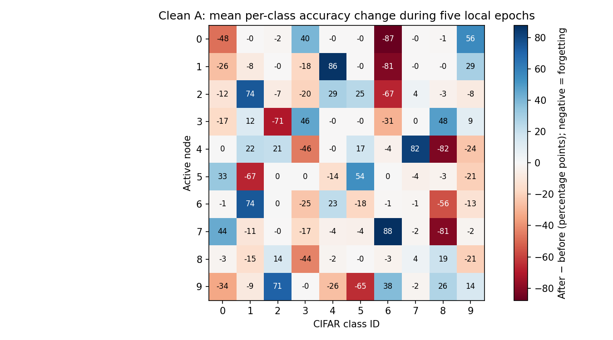
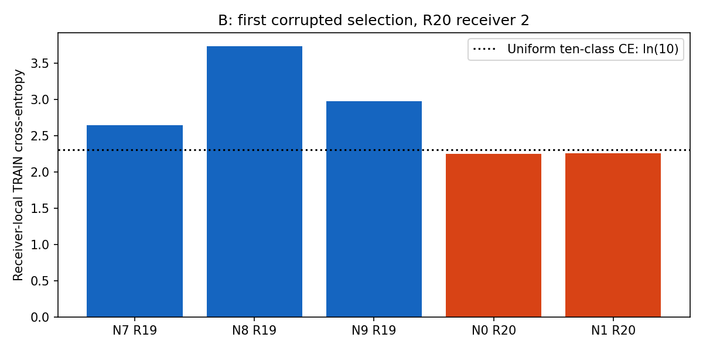
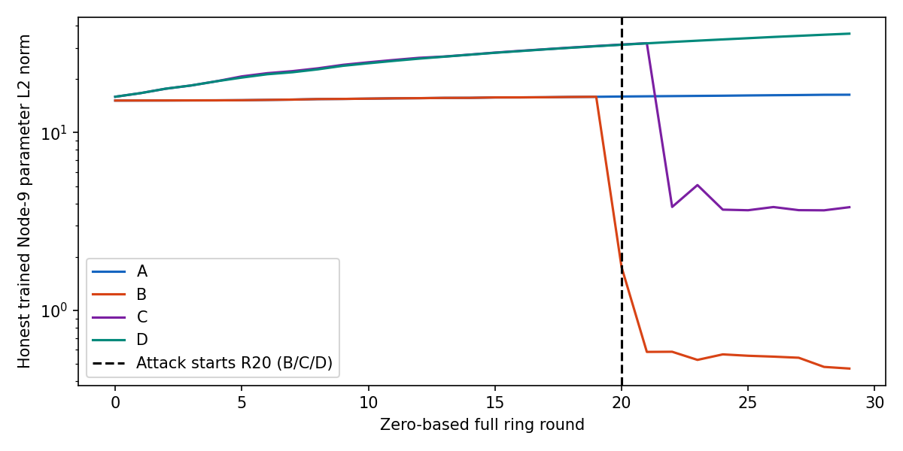

# Why the local-only Dirichlet study failed to learn adequately

**Diagnosis completed; no new experiment, optimizer update, queue execution or
protocol change was performed. The learning problem is not fixed yet.**

This report separates weak clean learning from attack-induced collapse. It reads
the completed `dirichlet_alpha02_local_anchor_30r_v1` study without rewriting its
results. The source commit is `60cbabc0`; the additional diagnostic code does not
change any source file fingerprinted by those runs.

## 1. What actually happened

| Condition | Final Node-9 test accuracy | Final node mean | Final worst node | Selected actually corrupted snapshots, R20–29 |
|---|---:|---:|---:|---:|
| A: clean CE + anchor | 24.34% | 22.79% | 16.53% | 0 / 100 |
| B: Hidden + CE + anchor | 10.00% | 10.00% | 10.00% | 64 / 100 |
| C: Hidden + absolute noise + CE + anchor | 10.00% | 10.00% | 10.00% | 48 / 100 |
| D: Hidden + absolute noise + EBM + anchor | 31.56% | 21.16% | 10.00% | 18 / 100 |

`full_test_accuracy` evaluates the **honest trained Node-9 model**, before its
outbound corruption, on all 10,000 test images. Node mean/minimum use the ten
trained node states, not an ensemble. Attacker-designated snapshots from rounds
before 20 are **not** counted as actually corrupted.

B and C finally predicted **bird on every test image** at Node 9. Other nodes
also reached 10%, but need not predict that same class. D's final nodes 2, 5 and 7
remained at 10%; its higher Node-9 accuracy is not adequate node-wide retention.

## 2. A is not an IID clean control

A is **attack-free**, not IID. Its Dirichlet α=0.2 local class distributions are
very uneven. A node may have a few examples of a class, or none at all.

| Node | Local TRAIN images | Classes present | Largest class | Largest-class fraction | Optimizer steps / activation |
|---|---:|---:|---|---:|---:|
| 0 | 2,938 | 7 | truck | 60.07% | 30 |
| 1 | 4,407 | 7 | deer | 53.46% | 45 |
| 2 | 4,768 | 9 | automobile | 28.10% | 50 |
| 3 | 989 | 9 | ship | 26.49% | 10 |
| 4 | 9,660 | 10 | horse | 35.90% | 95 |
| 5 | 6,693 | 10 | dog | 33.11% | 70 |
| 6 | 2,945 | 9 | automobile | 44.04% | 30 |
| 7 | 5,622 | 9 | frog | 41.78% | 55 |
| 8 | 4,115 | 7 | ship | 76.33% | 45 |
| 9 | 7,863 | 10 | bird | 29.96% | 80 |

All 50,000 TRAIN examples are assigned disjointly. Unequal sizes produce
**510 optimizer steps per ring traversal**, not 500 or 610. Five full epochs
still execute at every activation, including each final partial batch.

### Local fitting repeatedly loses other-class performance

The following are **mean within-activation changes**, over 30 clean-A
activations per node. They compare the selected model immediately before local
training with the same activation's model after epoch 5. They are not a
round-to-round improvement estimate.

| Active node | Mean global accuracy change | Example lost class | Mean class-accuracy change |
|---|---:|---|---:|
| 0 | −4.31 pp | frog | −86.76 pp |
| 1 | −1.84 pp | frog | −81.06 pp |
| 4 | −1.42 pp | ship | −82.01 pp |
| 7 | +1.11 pp | ship, absent locally | −80.87 pp |
| 8 | −4.97 pp | cat, absent locally | −43.57 pp |
| 9 | +1.31 pp | dog, 46 local examples | −65.05 pp |

A node can increase average accuracy while severely losing a particular class.
These measurements support repeated specialization/forgetting; they do not show
that every hidden layer is broken in A.



Blue is improvement; red is forgetting. Entries are percentage-point changes,
not percentage changes. Class IDs follow CIFAR-10's standard order.

## 3. The anchor is mathematically present but usually small

The unchanged loss is

$$L_i=CE_i+c\|\nabla CE_i\|^2+
\frac{0.01}{2}\|\theta-\theta_{\mathrm{selected},i}\|^2,$$

where `c=0.0001` in D and `c=0` in A/B/C. The update direction is

$$\nabla L_i=g_i+2cH_i g_i+0.01(\theta-\theta_{\mathrm{selected},i}).$$

The immutable reference equals the fully received/selected model. It is not a
verified good global model, and can itself be attack-corrupted.

| Condition | Mean anchor-gradient norm / CE-gradient norm | Mean EBM-correction norm / CE-gradient norm |
|---|---:|---:|
| A | 0.744% | 0 |
| B | 0.874% | 0 |
| C | 0.578% | 0 |
| D | 0.519% | 0.799% |

These are **arithmetic means of per-step norm ratios**, including the zero-drift
first step, not ratios of averaged gradients. Small gradient ratios are not
proof that a term has zero cumulative effect. They do show that the anchor is
not a large direct counterforce to CE in this run. Increasing μ based on final
test accuracy would be tuning, not fixing a confirmed implementation defect.

## 4. The retained Hidden transformation shrinks and reverses parameters

The actual dispatched project transformation, with blend `a=0.55` and strength
`s=1.4`, is

$$\theta_{\mathrm{attack}}=(1-a)\theta+
a[-s\theta+\delta]=-0.32\theta+0.55\delta,$$

$$\delta_q\sim N(0,[0.05\max(\mathrm{std}(\theta_{\mathrm{tensor}}),0.01)]^2).$$

Without its small additive perturbation, this reverses parameters and reduces
their norm to **32%** of the honest model norm. Repeated accepted corruptions
can therefore produce strong contraction. The small Gaussian component is part
of this transformation; dispatch is **Hidden**, not the separate Gaussian
attack. It remains the operator-approved project variant, **not a claimed exact
reproduction of the BASIL authors' Hidden implementation**.

### The first corrupted selection in B

At R20, receiver 2 evaluated these candidates on the same deterministic local
TRAIN batch:

| Sender | Snapshot round | Actually corrupted? | Receiver-local CE | Received parameter norm | Selected? |
|---|---:|---|---:|---:|---|
| 7 | 19 | No: designated attacker, warm-up | 2.638968 | 15.9057 | No |
| 8 | 19 | No | 3.729791 | 15.8875 | No |
| 9 | 19 | No | 2.973366 | 15.8985 | No |
| 0 | 20 | Yes | **2.251778** | **5.1142** | **Yes** |
| 1 | 20 | Yes | 2.258402 | 5.1118 | No |

A uniform ten-class predictor has CE `ln(10) ≈ 2.302585`. A weak/nearly constant
model can beat a confidently wrong honest model on the receiver's skewed data.
**Minimum receiver-local CE does not certify honesty or global usefulness.**
The observed decision follows the configured rule; using global accuracy to
override it would introduce test leakage.



The red bars are actually corrupted; the blue bars are uncorrupted, including
sender 7's warm-up snapshot. B's honest-trained Node-9 norm falls from **15.8985
at R19 → 1.7547 at R20 → 0.5842 at R21 → 0.4709 at R29**.



The norm axis is logarithmic. C/D's absolute noise norm is not dynamically scaled
by these parameter norms.

## 5. Saved-model inspection: features become nearly constant, not all dead

A new **CPU-only, zero-update** probe evaluates final node parameters on the
same fixed 320 TRAIN images, 32 per class. It computes ordinary CE gradients but
never applies SGD. It verifies weight hashes before/after and restores the
inspector model after each probe. This is a mechanism check on TRAIN images,
**not an independent validation score or a hyperparameter-selection criterion**.

| Final Node-9 quantity | A | B | C | D |
|---|---:|---:|---:|---:|
| Last hidden layer: mean feature variance across images | 4.65e−2 | **4.02e−23** | **1.14e−10** | 1.16e−1 |
| First conv kernel: ordinary CE gradient norm | 3.65 | **1.18e−11** | 2.29e−5 | 4.52 |
| Output bias: ordinary CE gradient norm | 0.273 | 0.0471 | 0.0529 | 0.304 |
| Predicted class on every probe image | Not constant | bird | bird | Not constant |

B retains nonzero hidden activations; about 52% of its last hidden entries are
zero. Calling this “all ReLUs dead” would be incorrect. Instead, its features
vary negligibly with the image and early-layer gradients are tiny. Bias updates
can still fit local class priors without recovering useful discrimination.
C has the same broad collapse pattern with more residual feature variation.

The probes establish the **final-state mechanism**, not the exact hidden-feature
variance at the first R20 selection: historical parameters for that activation
are not available in the final-state archives. D's smaller number of corrupt
selections and surviving Node-9 features are observations, not proof that EBM
universally prevents poisoning or solves forgetting.

## 6. Engineering findings versus method limitations

| Check | Evidence | Classification |
|---|---|---|
| Fully selected weight state is anchor reference | Every saved input/reference hash matched | No mismatch found |
| Five full epochs, partial batches and correct step count | All 1,200 activations checked | No mismatch found |
| Distinct five-predecessor rolling memory, including R11 | Sender/round identities checked at every activation | No mismatch found |
| Lowest local CE and nearest-sender tie-breaking | Every recorded decision recomputed | No mismatch found |
| Accidental class-grouped first-512 selection batch | Existing sampled local selection implementation inspected; regression tests retained | Not the active path |
| Feature loss and constant predictions | Saved confusions, norms and zero-update TRAIN probe | Confirmed observed failure |
| Small anchor contribution | Actual per-step telemetry | Confirmed measurement, not a missing loss term |
| Non-IID local CE admits contracted corruptions | Actual first selection and post-attack decision counts | Confirmed selection vulnerability in this realization |
| Hidden exactly reproduces source-paper implementation | Project variant is explicitly labeled; exact authors' implementation not verified | Must not be claimed |
| Whole-partition local training accuracy | Historical field uses only first 512 class-grouped indices | Confirmed misleading coverage; full-local analysis added |

### A separate confirmed telemetry defect

[`SequentialWorker.train`](../basil_core/research_protocol.py) at line 433 computes
the historical `localTrainingAccuracy` from `x[:512], y[:512]`, not the entire
local partition. Those indices are class-grouped in the Dirichlet allocator.
The field can therefore be 0% on the first class even when predictions fit a
different locally common class. This does **not** affect SGD, Snapshot Selection,
or full-test accuracy; it is not the explanation for the low test curves.

The new read-only [`full_local_training_metrics`](../basil_core/dirichlet_diagnosis.py)
measurement uses every assigned TRAIN example, in batches of at most 512,
including the partial batch, with no augmentation or SGD. Its separately named
`fullLocalTrainingMetrics` is saved beside `historicalFirst512Accuracy`. Old run
fields are preserved, not relabeled or rewritten. The historical worker remains
unchanged to preserve executed-source/checkpoint identity; this correction is in
the analysis tooling, not yet the live engine's metric emission.

The final Node-9 readout demonstrates the difference:

| Condition | Historical first-512 local accuracy | Correct full-local TRAIN accuracy, 7,863 images | Full TEST accuracy, 10,000 images |
|---|---:|---:|---:|
| A | 8.01% | 44.91% | 24.34% |
| B | 0.00% | 29.96% | 10.00% |
| C | 0.00% | 29.96% | 10.00% |
| D | 31.84% | 54.72% | 31.56% |

B/C's 29.96% local accuracy is simply the fraction of bird examples at Node 9,
not evidence of multi-class learning. TRAIN accuracy and TEST accuracy must not
be conflated; the corrected readout does not raise any test-accuracy result.

This audit did **not** identify a training-code bug whose correction is known to
solve A/B/C/D. Turning off attacks, weakening the attack, changing μ, adding a
norm guard or replacing CE would be a new scientific condition, not a cosmetic
bug fix. The completed results must remain unchanged.

## 7. A defensible next step, not an accuracy promise

Work on two independent mechanisms rather than retrying the failed four-run
queue:

1. **Clean label-skew learning first.** Study a separately named receiver-local
   loss/selection calibration against unchanged clean A. No helpers, data
   sharing or global-test-based selection. Hold α, seed, architecture, five
   epochs, optimizer and anchor fixed. Any new loss must be declared before its
   test results; hyperparameter choices require TRAIN-side validation.
2. **Corruption admission separately.** Preserve the approved Hidden formula and
   paper-style SS baseline. Any plausibility guard is a separately labeled
   enhanced defense, with honest/noisy false-rejection tests. Class balancing
   alone is not a certified rejection rule for weak or malicious snapshots.

Relevant primary literature supports investigating label skew, but not assuming
a fix: [FedLC (Zhang et al., ICML 2022)](https://proceedings.mlr.press/v162/zhang22p.html)
uses local logit calibration; it is not simply inverse-frequency CE and is not
our current algorithm. [Cui et al. (CVPR 2019)](https://openaccess.thecvf.com/content_CVPR_2019/html/Cui_Class-Balanced_Loss_Based_on_Effective_Number_of_Samples_CVPR_2019_paper.html)
uses effective-number reweighting, not an assurance that extreme inverse-count
weights are safe. [Guo et al. (AAAI 2025)](https://ojs.aaai.org/index.php/AAAI/article/view/33864/36019)
explicitly studies absent classes alongside imbalance; reweighting existing
examples cannot create supervision for a locally absent class. None of these
papers certifies Byzantine robustness for our strict handoff variant.

The supplied BASIL paper's non-IID experiments use ACDS data sharing. Those
results cannot be treated as a guarantee for this deliberately local-only,
no-ACDS protocol. No additional method has been activated by this diagnosis.

## 8. Reproduction and integrity

```bash
source environment/basil-noise-env/bin/activate
python scripts/audit_dirichlet_learning.py --probe \
  --output gui/worker_state/dirichlet_learning_diagnosis_repeat.json
```

The output filename must be unused. The script refuses incomplete evidence,
source/hash mismatches, invalid contracts and overwrite attempts. Large image
cache identities are hashed in chunks, without copying the complete image array.
All numerical/plotting libraries remain lazy on import. No GPU lease, optimizer,
W&B run or queue is started. Recorded test metrics are read for analysis only;
the new probe loads **TRAIN only**.

Evidence JSON: `gui/worker_state/dirichlet_learning_diagnosis_full_local.json`;
the earlier `dirichlet_learning_diagnosis_verified.json` holds the same
zero-update feature check without full-local evaluation.
**1,299 completed-study/source-PDF files matched before and after the probe.**
The wider preexisting baseline also matched **24,722 / 24,722 files**, with
**zero changed and zero missing**. Generated JSON
and PNG outputs stay local; this scientific report is not a context/handoff
document. The diagnostic CPU path does not claim CPU/GPU gradient equivalence.

### Subsequent telemetry correction

The later small-calibration task corrected the **live training engine** too:
local accuracy is now full-partition, unaugmented and batch-streamed, with an
explicit scope field. This changes the source fingerprint, not the completed
30-round results. To repeat this historical read-only audit after the source
update, add `--executed-source-commit 60cbabc0`. Every archived file must match
the original recorded hash; model/loss changes cannot be silently substituted.
The subsequent clean baseline reproduced all 30 selected/trained/outbound hashes
and full-test accuracy values from the original study's first three rounds.

### Verification

The initial focused suite completed **54 passed, 2 warnings** before the
additional streaming-hash and plotting regression tests were added.

```bash
python -m compileall -q gui basil_core noise_comm reporting scripts tests
PYTEST_DISABLE_PLUGIN_AUTOLOAD=1 CUDA_VISIBLE_DEVICES=-1 \
  MPLCONFIGDIR=/tmp/papermerge-test-mpl xvfb-run -a \
  environment/basil-noise-env/bin/python -m pytest -q tests
```

Compilation passed. The sandboxed full-suite attempt completed **730 passed,
3 failed, 644 subtests passed, 3 warnings** in 141.95 seconds. All three failures
were Tk virtual-display connection errors, not failures of the new audit or
training mathematics. The same suite is rerun with virtual-display access;
its result is recorded separately rather than treating those failures as passes.

The virtual-display-access rerun completed **733 passed, 644 subtests passed,
3 warnings, 0 failures** in 140.00 seconds. After adding the full-local accuracy
regression test, the **final complete suite passed: 734 passed, 644 subtests
passed, 3 warnings, 0 failures, 0 skips**, in **140.45 seconds**.

| Final validation | Result |
|---|---|
| Compile all application/core/reporting/script/test modules | Passed |
| Complete suite with virtual-display access | 734 passed; 644 subtests passed |
| Saved evidence contracts | 1,200 activations; five epochs; 510 steps/ring |
| Read-only final-model TRAIN measurements | 40 node models; 200,000 assigned-example evaluations; zero updates |
| Historical source/artifact integrity | 24,722 original files matched; 1,299 study/source-PDF files matched |
| Publication-policy check | Passed; no tracked context/handoff documents |
| Additional scientific runs / queue entries | 0 / 0 |

The final suite's warnings are two upstream protobuf/Python deprecations and an
existing Keras input-structure warning. No display-test failures remain with the
working virtual display. Synthetic test optimizer updates are mathematical
contract checks, not additional CIFAR research conditions.

**Status: diagnosis supported; learning remediation requires a separately
labeled, explicitly approved method comparison. No new research run started.**
