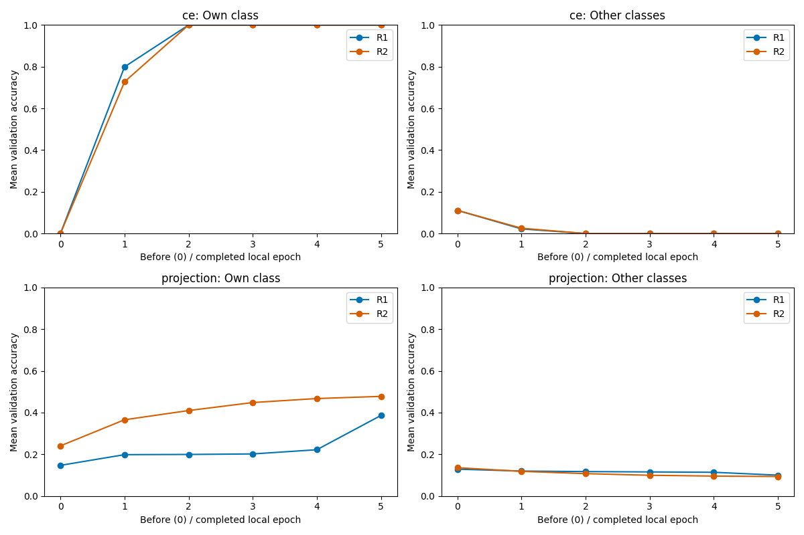
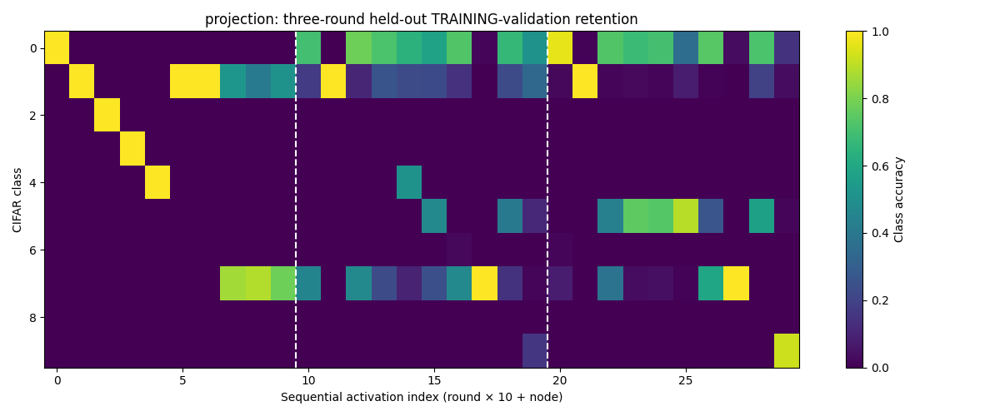

# Three-round warmed-memory retention diagnostic

This separately authorized follow-up keeps the gradient-projection implementation
unchanged. It does not restart or extend any previous run. The earlier
[one-traversal result](GRADIENT_PROJECTION_RETENTION.md) remains preserved.

## Why a second diagnostic?

In the earlier cold-start gate, Nodes 0–4 selected initialization snapshots:
their projection bases were empty, so their updates matched CE exactly.
The first-four-node screen could not isolate projection's effect. After one
complete ring traversal, each receiver has five **trained** candidate snapshots.
Rounds 1–2 therefore expose the actual history-preserving update mechanism.

```text
fresh canonical W0, identical training-validation split
                     |
       CE control: R0 -> R1 -> R2 -> stop
                     |
 fresh canonical W0 again, reset all snapshot memories
                     |
 projection: R0 -> R1 -> R2 -> stop

R0: cold start; initialization can still be selected
R1/R2: all five candidates contain trained snapshot history
```

## Fixed settings

| Item | This diagnostic |
|---|---|
| Class assignment | Ten nodes; node i owns class i |
| SGD / reserved validation | 4,500 / 500 training images per class, deterministic disjoint split |
| CIFAR test set | Not evaluated, trained on, selected from or used for tuning |
| Model | Existing 117,706-parameter biased ten-logit CNN |
| Horizon | Three complete rounds **per control**, no extension |
| Local epochs / batch | Five full epochs / 512 |
| Full diagnostic epoch | Eight batches of 512 plus one of 404 |
| Optimizer steps | 45 per activation; 1,350 per control; 2,700 total |
| Optimizer | Reset SGD per activation, momentum 0, no clipping/weight decay |
| Round LR | Existing `0.05 / (1 + 0.05*r)` |
| BASIL | S=5, latest distinct predecessors, same receiver-local CE selection/tie-break |
| Handoff | Complete selected parameters; no averaging |
| Projection | Existing bias-aware `G - Q @ (Q.T @ G)` |
| Basis sampling | 32 training images, at most 2,048 patches/layer; energy threshold 0.99 |
| Auxiliary history | Only the chosen snapshot's bases; other candidates' histories not merged |
| Attack / channel noise / EBM / anchor | All off |
| W&B / production queue | Disabled / untouched |
| `researchValid` | **false**: this reserved-validation diagnostic is not the full-data research protocol |

The original full-data protocol remains five full epochs over 5,000 examples,
50 updates per activation and final batch 392. This diagnostic neither changes
that protocol nor claims full-data test accuracy.

## Predeclared assessment, before execution

Analyze warmed rounds 1–2 separately from cold-start round 0:

| Conservative descriptive screen | Criterion |
|---|---|
| New-class learning is not routinely blocked | Own-class validation accuracy >5% in at least 80% of warmed activations |
| Retention is more than one old constant-class predictor | At least two **other** classes exceed 5% accuracy in at least 50% of warmed activations |
| Useful paired accuracy gain | Mean warmed validation accuracy exceeds paired CE by at least 5 percentage points |

These are modest prespecified trend screens, not algorithmic correctness tests,
statistical significance tests or the 50% research target. Also report the raw
own/other-class trajectories, before/after forgetting, basis ranks, selected
histories and applied/base-gradient ratios regardless of the screen outcome.
No adjustment to the projection threshold, LR, epochs or BASIL selection is
allowed after viewing the result. There is **no automatic promotion** to any
30-/500-round run even if the screen passes.

## Reproduction and saved-only review

```bash
# Synthetic objective/device check; no CIFAR training.
environment/basil-noise-env/bin/python scripts/run_gradient_projection_gate.py --device GPU --verify-device

# Authorized bounded experiment, fresh state only; refuses existing outputs.
environment/basil-noise-env/bin/python scripts/run_gradient_projection_warm_gate.py --device GPU --execute

# Regenerate tables/plots from saved measurements, with no training.
environment/basil-noise-env/bin/python scripts/run_gradient_projection_warm_gate.py --report
```

| File | Responsibility |
|---|---|
| `scripts/run_gradient_projection_warm_gate.py` | Bounded fresh three-round orchestration, paired state, warmed-memory contracts, finite audits |
| `scripts/report_gradient_projection_warm_gate.py` | Saved-only verification, CSV, tables, class heatmaps and six-stage epoch confusions |
| `tests/test_gradient_projection_warm_gate.py` | Configuration, exact rolling memory over three traversals, cold-start exclusion, new-class learning requirement, incomplete-run rejection |
| `basil_core/gradient_projection_retention.py` | **Unchanged** scientific update/basis implementation |

Outputs are isolated under `newResults/nonIID/gradient_projection/clean_training_validation_warm_gate_3r_v1/`
and the matching `newPlots/nonIID/gradient_projection/` subdirectory.
The runner refuses existing result/plot directories. Memory NPZ files store
all candidate parameters and bases, but **are not complete resumable research
checkpoints**. A stop aborts rather than guessing an exact continuation.

## Integrity and interpretation

Existing IID/nonIID results/plots, the earlier projection gate and `papers/`
were SHA-256 inventoried before editing: **23,672 files**. The baseline is
`gui/worker_state/gradient_projection_three_round_before.json`.
The after comparison excludes only this newly created diagnostic's output
subdirectories; no pre-existing file is excluded.

Single-process GPU execution uses the existing 6-GiB allocator cap, startup
headroom, float32 policy and finite checks. CPU/GPU synthetic tolerance checks
do not establish bitwise equivalence or multiprocessing reproducibility.
Representation exposure metadata is not proof of retained class knowledge.
The source GPM study's multi-head/bias-free architecture differs materially
from this adaptation; consult the linked original guide for source attribution.

If warmed histories still block learning new classes, stop this variant.
The next approach needs an explicitly agreed representative previous-class
training signal/data-privacy design, not a more favorable test-set-tuned number.

## Execution result

**Completed both three-round controls on GPU in 24.32 minutes:** 60 activations
and 2,700 optimizer updates. All five epochs ran in every activation.
The conservative warmed-memory screen **did not pass**. No longer run,
attack/noise condition, W&B run or queue change followed.

| Control | Round (zero-based) | Mean node validation | Node 9 validation | Own-class mean | Other-class mean | Constant-class states |
|---|---:|---:|---:|---:|---:|---:|
| CE | 0 | 10.000% | 10.000% | 100.000% | 0.000% | 10/10 |
| CE | 1 | 10.000% | 10.000% | 100.000% | 0.000% | 10/10 |
| CE | 2 | 10.000% | 10.000% | 100.000% | 0.000% | 10/10 |
| Projection | 0 | 10.974% | 12.900% | 58.600% | 5.682% | 7/10 |
| Projection | 1 | 12.862% | 11.380% | 38.620% | 10.000% | 1/10 |
| Projection | 2 | 13.204% | 11.220% | 47.780% | 9.362% | 0/10 |

These are **not full-test research results**. Mean node validation averages
the ten just-trained node states; Node 9 is one model, not an ensemble or
best-node measurement. Own/other means average each node's own/other classes.
Constant-class means every one of the 5,000 validation images received the
same predicted label, regardless of whether that label belongs to the node.

### What changed after memories warmed?

| Evidence in rounds 1–2 | Measured observation |
|---|---|
| Actual protected history | 20/20 projection activations; all five candidates trained |
| Own-class accuracy above 5% | 11/20 activations (55%); below the predeclared 80% screen |
| At least two other classes above 5% | 14/20 activations (70%); passes the retention screen |
| Paired warmed mean validation gain | +3.033 pp; below the predeclared 5 pp screen |
| Final mean node validation gain | +3.204 pp |
| Mean applied/base-gradient norm | 0.043262; not a fraction of gradient coordinates |
| Mean base / applied gradient norm, R1 | 13.2241 / 0.5350 |
| Mean base / applied gradient norm, R2 | 13.9494 / 0.5346 |
| Maximum projection orthogonality residual | 2.6285e-7 |
| Other-class forgetting, R1 | Projection 2.880 pp versus CE 11.111 pp |
| Other-class forgetting, R2 | Projection 4.229 pp versus CE 11.111 pp |
| First-round parameter hashes versus earlier evidence | 10/10 matches for **each** control |

Forgetting is the signed mean of other-class accuracy before minus after local
training. The projection does show partial retention and reduces this measured
forgetting. It also suppresses updates strongly: final nodes 2, 3, 4 and 8 had
0% own-class accuracy, and Node 6 had only 0.2%. This is not simply an
unpopulated-memory artifact anymore. It is evidence of a retention/new-learning
trade-off in this biased, single-head BASIL-plus-projection adaptation.

Final Node 9 reached 92.4% truck accuracy but only 14.6% airplane, 3.4%
automobile and 1.8% dog. Bird, cat, deer, frog, horse and ship were all 0%.
Although no final projection state predicted one single label for every image,
eliminating exact constant-class collapse did **not** establish ten-class learning.
The final Node-9 validation score was lower than after the first traversal even
as the ten-node mean increased; do not conflate those two metrics.

**Decision:** keep this as a measured partial-retention result, not a green
light for a long threat matrix. No criterion or parameter was adjusted after
observing it. A next approach needs a separately approved representative
previous-class learning signal; increasing parameter protection alone is not
supported as a solution by these diagnostics. This is one seed and three rounds,
not proof that all gradient-projection approaches fail.

### Report and visuals

[Complete measured report, 32 contracts and warmed-node tables](../newResults/nonIID/gradient_projection/clean_training_validation_warm_gate_3r_v1/GRADIENT_PROJECTION_WARM_REVIEW.md)




The result directory also contains `round_validation_metrics.csv`,
`activation_validation_metrics.csv`, raw activation JSON with all six
confusions per activation, per-step audits and snapshot memory files.
The matching plot directory contains 17 PNGs, including round node/class
matrices, representative epoch confusions and gradient/history diagnostics.

### Actual verification

| Verification | Result |
|---|---|
| Compileall | Exit 0 |
| Focused new/existing tests before execution | 224 passed, 1 display-dependent skip, 2 dependency warnings; 25.66 seconds |
| Same focused suite rerun after execution | 224 passed, 1 display-dependent skip, 2 dependency warnings; 22.88 seconds |
| Saved-result contracts | 32/32 passed |
| Synthetic GPU versus CPU gradients | Relative L2 2.2755e-7; tolerance 0.01 |
| Synthetic maximum SGD update difference | 1.4901e-8; tolerance 1e-4 |
| Numerical stability | No recorded NaN/Inf, failed updates or OOM |
| GPU memory | Peak 269.26 MiB; 0 pressure events |
| Existing evidence/paper hashes | 23,672 before / after / matched; **0 changed** |
| Training mode | Deterministic single process, RTX 4070 Ti, float32; no CPU/GPU bit-equivalence claim |
| Multiprocessing | Not validated or used |

Actual compile/test commands (the GPU execution command is listed above):

```bash
environment/basil-noise-env/bin/python -m compileall -q gui basil_core reporting scripts tests

DISPLAY= MPLCONFIGDIR=/tmp/papermerge-projection-test-mpl PAPERMERGE_LIVE_TRACKING=disabled WANDB_MODE=disabled PYTEST_DISABLE_PLUGIN_AUTOLOAD=1 CUDA_VISIBLE_DEVICES=-1 TF_ENABLE_ONEDNN_OPTS=0 TF_NUM_INTRAOP_THREADS=1 TF_NUM_INTEROP_THREADS=1 environment/basil-noise-env/bin/python -m pytest -q tests/test_gradient_projection_warm_gate.py tests/test_gradient_projection_retention.py tests/test_class_aware_retention.py tests/test_retention_diagnostic.py tests/test_noniid_study.py tests/test_iid_study.py tests/test_research_protocol.py tests/test_protocol_recovery.py tests/test_iid_500r.py tests/test_memory_safety.py tests/test_research_audit.py tests/test_iid_gpu.py tests/test_iid_campaign.py
```

The known unrelated legacy full-suite collection issue was not changed or
claimed fixed; these are focused regression tests. SHA-256 verification includes
the previous projection gate as well as all older retained IID/nonIID evidence
and papers; only this new output namespace is excluded from the after inventory.
