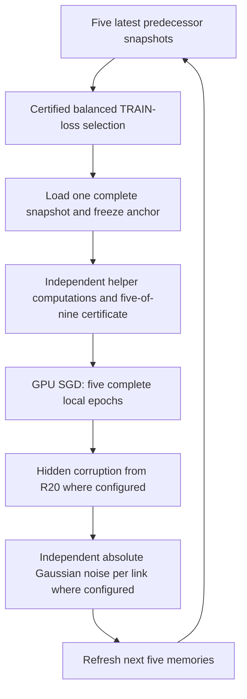

# Non-IID CART: four matched 30-round GUI runs

**Queue status: prepared and idle.** The next experiment is a fixed 30-round
feasibility study. Its accuracy is unknown until the runs finish. No W&B run is created.

## What to say in the meeting

> Ordinary five-epoch training on one class overwrote knowledge of other
> classes. We therefore extended CART to obtain fresh supervised gradients
> from other class owners at the active model's current parameters. We also
> preserve the selected incoming snapshot with a fixed proximal term.
> EBM remains a separate noise-awareness term, enabled only in D.
> Independent verifier processes recompute and certify helper gradients and
> selection losses. The four queued conditions measure attacks, communication
> noise, and the added EBM term under this explicitly changed information model.

**The qualification matters:** verifier processes can read replicated TRAIN
data and the coordinator is trusted. This is a CART adaptation with additional
information exchange, not the original exclusively local one-class BASIL
experiment. There is no privacy or general distributed Byzantine-consensus claim.
We have not proved that the selector rejects every corrupted model.

## A/B/C/D

All four use the same one-class partition, canonical initialization, fixed
ring, five complete local epochs, SGD schedule, memory size five and μ=0.01.

| Condition | Outbound model attack | Snapshot channel | Training objective |
|---|---|---|---|
| A | None | Clean | Balanced owner CE + fixed snapshot anchor |
| B | Existing Hidden, IDs [0,1,5,7], R20 | Clean | Same as A |
| C | Same as B | Absolute Gaussian, σₑ=0.010 | Same as A |
| D | Same as B | Same as C | Balanced owner CE + local-CE EBM + fixed anchor |

B/C/D additionally exercise four adversarial helper identities starting at R20:
0 poisons responses, 1 forges signatures, 5 withholds responses, and 7 exits.
Thus A/B measures this **combined attack environment** under verification, not
only the outbound Hidden transformation. B/C isolates snapshot-channel noise;
C/D isolates the added local EBM term.

## Exact loss and gradient

Let θ be the active CNN parameters and θₛ the **selected received snapshot**.
θₛ is frozen throughout the activation. If the selected snapshot already
contains channel noise or attack corruption, that is the reference actually used.

For receiver i and local minibatch Bᵢ:

$$
F_i(\theta;B_i)=\frac{1}{|B_i|}\sum_{(x,y)\in B_i}
CE(f_\theta(x),y).
$$

The active receiver uses its actual 512-example batch, or the final 392-example
batch. Other available class owners provide fresh gradients using 16
deterministically sampled TRAIN examples each, evaluated at **the same θ**.

Let 𝒞ᵢʳ be the available class owners and K=|𝒞ᵢʳ|. In Round 0, these are
classes 0 through i. From Round 1 onward all ten classes are available.

$$
\boxed{F_{CART}(\theta)=\frac1K\sum_{c\in\mathcal C_i^r}
F_c(\theta;B_c)}
$$

Each class receives weight 1/K regardless of the differing minibatch sizes.
This averages **gradients/objectives at one parameter state**, not trained
models, incoming snapshots, or stale receiver weights.

### A, B and C

$$
\boxed{
L_{ABC}(\theta)=F_{CART}(\theta)
+\underbrace{\frac{\mu}{2}\|\theta-\theta_s\|_2^2}
_{\text{snapshot preservation}},\quad\mu=0.01
}
$$

$$
\nabla L_{ABC}
=\frac1K\sum_c\nabla F_c+0.01(\theta-\theta_s).
$$

### D

$$
\boxed{
L_D(\theta)=
\underbrace{F_{CART}(\theta)}_{\text{class-balanced CART supervision}}
+\underbrace{\sigma_e^2\|\nabla F_i(\theta)\|_2^2}_{\text{source-motivated EBM}}
+\underbrace{\frac{\mu}{2}\|\theta-\theta_s\|_2^2}_{\text{snapshot preservation}}
}
$$

With σₑ=0.010 and μ=0.01:

$$
L_D=F_{CART}+0.0001\|\nabla F_i\|_2^2
+0.005\|\theta-\theta_s\|_2^2.
$$

If gᵢ=∇Fᵢ and Hᵢ=∇²Fᵢ, the applied gradient is

$$
\boxed{
\nabla L_D=
\frac1K\sum_c\nabla F_c
+0.0002H_i g_i
+0.01(\theta-\theta_s).
}
$$

Nested TensorFlow tapes compute the Hessian-gradient correction without
constructing a full Hessian. **There is no lambda.** The EBM inner gradient is
receiver-local CE; it does not include the helper mean or the anchor.

Plain-text version for slides or a whiteboard:

```text
A/B/C loss = mean available-class CE
             + 0.005 × sum((current parameters − selected parameters)²)

D loss     = mean available-class CE                 [CART supervision]
             + 0.0001 × sum((gradient of local CE)²)  [EBM]
             + 0.005 × sum((current − selected)²)     [snapshot anchor]
```

The anchor uses **current parameters during training**, not a distance evaluated
only after training. Its reference is fixed for all fifty optimizer steps.

| Term | Intended role | What it does not establish |
|---|---|---|
| Balanced owner CE | Keeps older classes in the supervised update, including encoder gradients | Does not make helper replies honest without verification |
| EBM, σₑ²‖∇Fᵢ‖² | Studies sensitivity to parameter noise | Does not explicitly preserve all older classes |
| Anchor, μ/2‖θ−θₛ‖² | Limits drift away from the selected input | Cannot reconstruct knowledge missing from that input |
| Certificates | Require independent agreement on the requested TRAIN calculation | Cannot certify that a model with low measured loss is benign |

The model update remains

$$
\theta_{k+1}=\theta_k-\eta_r\nabla L(\theta_k),
\qquad \eta_r=\frac{0.05}{1+0.05r}.
$$

Momentum, weight decay and gradient clipping remain zero/disabled.

## Snapshot selection and ring memory

Paper BASIL selects by receiver-local CE. This CART extension instead selects
by the **certified balanced available-owner TRAIN loss**:

$$
\boxed{
\theta_s=\arg\min_{\theta_j\in\mathcal M_i^r}
\frac1K\sum_{c\in\mathcal C_i^r} CE(\theta_j;B_c^{SS}).
}
$$

Each owner's fixed, normalized, unaugmented selection batch contains up to
512 TRAIN images. All five candidates see exactly the same batches.
Effective ties (within 10⁻⁸) choose the nearest counterclockwise sender.
Neither sender-reported metrics nor the global test set controls selection.

The complete selected parameter vector initializes training:

$$\theta_{start,i}=\theta_s.$$

There is no model averaging or half-weight initialization.

| Memory moment | Sender: latest snapshot |
|---|---|
| Before Node 0, R11 | 5:R10, 6:R10, 7:R10, 8:R10, 9:R10 |
| Before Node 1, after Node 0 sends in R11 | 6:R10, 7:R10, 8:R10, 9:R10, 0:R11 |

Only the immediate successor trains next; the other four receive cache refreshes.



## Hidden attack and communication noise

We retain the repository's existing **model-space Hidden adaptation**. We do
not claim an exact reproduction of the BASIL authors' attack code. Per tensor w:

$$
z\sim N(0,[0.05\max(\operatorname{std}(w),0.01)]^2I),\qquad
m=-1.4w+z,
$$
$$
\boxed{w_{attack}=0.45w+0.55m=-0.32w+0.55z.}
$$

This transformation is inactive before zero-based R20. Its internal random
component does not mean that the separate Gaussian attack implementation is enabled.

C/D apply the channel **after the attack**:

$$
\boxed{w_{received}=w_{outbound}+\epsilon_{sender\to receiver},
\quad \epsilon\sim N(0,0.0001I).}
$$

The **standard deviation is 0.010**, the **variance is 0.0001**. Neither is
a percentage. Model norms are telemetry only and never rescale this channel.
Each directed link uses a separate key derived from seed, round, sender and receiver.

## What verification changes

For each helper request, the owner is excluded from a nine-identity committee.
At least five independently computed, exactly matching, authenticated replies
are required. Requests bind the model hash, TRAIN content hash, class owner,
round, local step, indices and augmentation seed.

The consumer does not use the attacker list to decide whose result is correct.
Invalid signatures, disagreeing values and unavailable processes cannot replace
the certified result. Insufficient agreement aborts. The active SGD calculation
is performed by the trusted GPU coordinator, with the existing verified
recomputation policy for faulty proposals.

Nine verifier RPCs now run concurrently; replies are still assembled in
canonical identity order. Each process performs its own calculation. No single
gradient is copied into multiple votes. Only one experiment and one active
trainer run at a time.

## What changed in which file

| File | Change | Training/mathematical effect |
|---|---|---|
| [noniid_verified_study.py](../basil_core/noniid_verified_study.py) | Fixed A/B/C/D configs, strict pairing validation and checkpoint inspection | Locks the declared formulas, μ, σ, horizon and data identity |
| [parallel_verifier_service.py](../basil_core/parallel_verifier_service.py) | Concurrent independent verifier calls with canonical certificate order | Same certified CE/gradient; request scheduling changes |
| [run_noniid_verified_condition.py](../scripts/run_noniid_verified_condition.py) | Serial GPU worker, delayed helper faults, full epochs, epoch evaluation, two-slot checkpoint pointer and archived proofs | Calls the existing verified CART update; saves actual progress and preserves exact model/memory/anchor state |
| [prepare_noniid_verified_queue.py](../scripts/prepare_noniid_verified_queue.py) | Reads real labels and canonical initialization, creates configs and idle queue | Zero training; all four receive the same partition/model hashes |
| [noniid_execution_service.py](../gui/services/noniid_execution_service.py) | Registered GUI subprocess adapter and epoch events | Live progress/accuracy; starts only on manual Run Queue |
| [iid_execution_service.py](../gui/services/iid_execution_service.py) | Reusable validated launcher/path parameters | Existing IID defaults retained; non-IID uses its own script and logs |
| [app.py](../gui/app.py), [queue_service.py](../gui/services/queue_service.py) | Non-IID routing, saved status, recovery hints, both result roots | No implicit fallback to the old local-only research worker |
| [experiment_state.py](../gui/state/experiment_state.py), [experiment_builder_view.py](../gui/views/experiment_builder_view.py), [queue_view.py](../gui/views/queue_view.py) | Validate/display all four presets, objective, information model, GPU and done/total | Keeps the queue configurations identifiable and prevents accidental protocol edits |
| [noniid_telemetry.py](../gui/services/noniid_telemetry.py), [network_view.py](../gui/network_view.py) | Live/replay bridge from actual activation archives | Correct selected-source, attack and channel display |
| [noniid_verified_plots.py](../reporting/noniid_verified_plots.py), [plot_service.py](../gui/services/plot_service.py) | Round trajectories, per-class and confusion plots, comparisons | Evaluates saved evidence; does not train or choose settings |

The existing [owner EBM implementation](../basil_core/cart_owner_ebm.py),
[verified runner](../basil_core/verified_cart_runner.py), model, attack formula,
local-epoch semantics and SGD schedule were preserved. The new worker calls
them rather than substituting another optimizer.

The exact applied-gradient composition already present in
[`owner_objective_gradients()`, line 69](../basil_core/cart_owner_ebm.py#L69) is:

```python
drift = [w-tf.stop_gradient(tf.cast(a, w.dtype))
         for w, a in zip(weights, reference)]
distance = tf.add_n([tf.reduce_sum(d*d) for d in drift])
anchor = [tf.cast(mu, d.dtype)*d for d in drift]
anchor_penalty = tf.cast(mu, tf.float32)*distance/2
applied = [tf.convert_to_tensor(g)+c+a
           for g, c, a in zip(balanced, correction, anchor)]
objective = tf.cast(metadata['crossEntropy'], tf.float32)+penalty+anchor_penalty
```

Here `balanced` is the mean owner gradient, `correction` is the nested-tape
EBM contribution, and `anchor` is μ(θ−θₛ). `legacy_lambda` is deliberately unused.
The nested tapes begin at [line 18](../basil_core/cart_owner_ebm.py#L18);
full epoch scheduling is at [line 97](../basil_core/verified_cart_runner.py#L97).

## Scientific evidence and limits

| Existing measured evidence | What it supports |
|---|---|
| Earlier clean 30-round owner-assisted CART pair: 46.71% local SS versus 49.10% balanced SS, fixed μ=0.01 | Positive multiclass learning under that earlier trusted-helper implementation and seed |
| One clean traversal of the isolated verified backend: Node 9 13.90%, mean 10.80%, worst 10% | Execution works; one traversal does not solve retention |
| Two matched full-data EBM activations: all 50 faulty-helper updates matched the honest reference | Bounded full-batch correctness under the tested helper faults |
| Independent 512/392-batch EBM checks: largest absolute gradient error below 7×10⁻⁹; extreme legacy lambdas had zero effect | Correct full loss derivative and no lambda leakage |
| R20 boundary fixture selected a truly corrupted model with balanced CE 2.303237, below the best other candidate's 2.305581 | Truthful scores do not guarantee rejection of corrupted snapshots |

The R20 fixture used explicitly constructed memories from one-round weights;
it was not a measured 20-round learning trajectory. The new 30-round study
records actual corrupted selections and downstream performance. We do not
exclude known attacker IDs to manufacture successful filtering.

**No accuracy threshold decides whether software is correct.** No test-set
tuning, automatic horizon extension, or expected ordering A>B>D>C is used.

## Sources and attribution

- BASIL supplies the sequential ring, bounded predecessor memories and
  receiver-local performance selection concept. Our balanced owner selection
  is a separately labeled CART adaptation.
- We adapt the expectation-based gradient-norm regularization of Ang et al.
  to multiclass CIFAR-10 cross-entropy. The source's Eq. 14 squared-loss
  approximation and simplified Eq. 23 scaling are not general identities for
  a nonlinear CNN. Our nested-tape derivative contains Hessian-gradient terms.
- Proximal regularization has established precedent, including FedProx.
  Choosing the selected received snapshot as the frozen reference is our
  integration choice.
- Fresh class-owner gradient supervision, replicated TRAIN verification and
  this combined ring integration are described as repository adaptations;
  no novelty or universal robustness claim is made.

See [literature and attribution](CART_LITERATURE_AND_ATTRIBUTION.md) and the
original PDFs retained in [papers/](../papers/). Feature-only replay, ACDS,
adaptive μ and the earlier prototype translation branches are not enabled here.

## Launch and resume

From the repository root:

```bash
source environment/basil-noise-env/bin/activate
python run_gui.py
```

1. Open **Queue**. The persisted queue contains A, B, C, D in order.
2. Confirm **30 rounds**, **GPU**, **0/30** initially and the expected labels.
3. If needed, **Load Queue** → `gui/queues/noniid_abcd_30r_verified_gpu.json`.
4. Click **Run Queue**. Opening/loading the queue alone does not launch a worker.
5. For a graceful stop, use **Stop**. Select the stopped entry and click **Retry**,
   then **Run Queue**. The worker restores the committed state automatically.

The full state includes parameters, ten stored node models, all five-sender
memories, selected snapshot and frozen anchor, round/node/step cursor, keyed RNG
semantics, source/config fingerprints and existing metrics. Source or device
changes block an exact resume. A crash may lose work after the last epoch
checkpoint; the incomplete steps are reproduced from that committed cursor.
A graceful stop commits the current step. Loading only final weights is never
used as a fake resume.

Two checkpoint slots bound storage. Completed 50-step certificates and
before/after-each-epoch metrics are kept in individual activation archives.
If a checkpoint write fails, the earlier committed pointer remains usable.
Final figures are generated after each completed condition; four-way comparison
figures are generated when D finishes and all four completed manifests exist.
The live GUI accuracy and network events update during execution.

| Output | Path |
|---|---|
| Configs | `gui/configs/nonIID/cart_verified_30r/` |
| Queue preset | `gui/queues/noniid_abcd_30r_verified_gpu.json` |
| Results | `newResults/nonIID/cart_verified_abcd_30r_v1/<condition>/` |
| Plots | `newPlots/nonIID/cart_verified_abcd_30r_v1/<condition>/` |
| Comparisons | `newResults/nonIID/cart_verified_abcd_30r_v1/comparison/` and matching plot directory |
| Worker logs | `gui/worker_state/noniid_verified/` |

## Resource and runtime expectations

The GPU cap is 6 GiB, with an additional 1 GiB required free at startup. Each
of ten CPU helpers has a kernel-enforced 2 GiB RAM limit, no swap, one CPU core
maximum and 64-task limit. Host startup requires the full 20 GiB pool ceiling
plus 4 GiB headroom. Pool and GPU leases prevent duplicate allocation.

These limits reduce resource risk; no implementation can guarantee that the
OS or another application will never exhaust memory. Non-finite values,
missing quorum or resource failure stop the affected run and preserve evidence.

The current transport check measured honest selection requests at 1.180 s
sequential / 0.248 s concurrent and gradient requests at 0.998 s / 0.162 s.
Those are bounded request measurements with serial-before-parallel ordering,
not a controlled whole-run speed benchmark. The fault case's first serial
request also included a deliberately withheld-response timeout.

A 30-round condition contains **15,000 optimizer updates**, with many verified
helper computations. Expect hours, not completion before an 11am meeting.
The preparation and explanation can be available before the meeting; final
research results cannot responsibly be promised by that deadline.

## Completed preparation verification

| Check | Actual result |
|---|---|
| Full unit/contract/Tk suite on virtual display | **676 passed, 644 subtests passed**, zero skipped; 3 existing dependency/Keras warnings; 153.44 s |
| Actual GPU worker startup | Passed on RTX 4070 Ti, TensorFlow 2.18.0, float32 / TF32 off, 6 GiB cap |
| Actual full-data selection and checkpoint restoration | Passed; initial tied selection chose nearest predecessor Node 9; exact parameter hash restored |
| Actual runtime-check optimizer updates | **Zero** |
| Concurrent versus sequential verifier computations | Identical signed CE results and gradient arrays for 512-example selection / 16-example helper-gradient requests; honest and four-fault cases passed |
| Mocked thirty-round orchestration | All 15,000 expected update cursors, 300 activation archives and 30 measured fixture rounds handled; stop inside step 13 and exact next-cursor resume passed; this is not research accuracy evidence |
| Compilation | Passed for gui, basil_core, reporting, scripts, tests and run_gui.py |
| Lazy import audit | 265 files; zero changed/retained eager third-party imports |
| Saved research outputs, plots and papers | 24,678 before / 24,678 after / 24,678 SHA-256 matched / **zero changed** |
| Final queue | A→B→C→D; all four pending, 0/30, fresh GPU execution; no active queue marker or worker |

Commands executed from the repository root:

```bash
MPLCONFIGDIR=/tmp/papermerge-noniid-queue environment/basil-noise-env/bin/python scripts/prepare_noniid_verified_queue.py
MPLCONFIGDIR=/tmp/papermerge-verifier-check environment/basil-noise-env/bin/python scripts/check_parallel_verifiers.py --check
MPLCONFIGDIR=/tmp/papermerge-noniid-runtime environment/basil-noise-env/bin/python scripts/run_noniid_verified_condition.py --config gui/configs/nonIID/cart_verified_30r/D_noniid_verified_cart_30r_gpu.json --validate-runtime
xvfb-run -a env CUDA_VISIBLE_DEVICES=-1 TF_ENABLE_ONEDNN_OPTS=0 TF_NUM_INTRAOP_THREADS=1 TF_NUM_INTEROP_THREADS=1 MPLCONFIGDIR=/tmp/papermerge-noniid-final-tests PYTEST_DISABLE_PLUGIN_AUTOLOAD=1 environment/basil-noise-env/bin/python -m pytest -q -rs --show-capture=no tests
environment/basil-noise-env/bin/python -m compileall -q gui basil_core reporting scripts tests run_gui.py
environment/basil-noise-env/bin/python scripts/audit_lazy_imports.py --report gui/worker_state/noniid_verified_30r_lazy.json
```

Evidence is saved under `gui/worker_state/`: `noniid_verified_30r_preparation.json`,
`CART_PARALLEL_VERIFIER_CHECK.json`, `NONIID_VERIFIED_GUI_RUNTIME_CHECK.json`,
`noniid_verified_30r_lazy.json`, and `noniid_verified_30r_before.json` (artifact baseline).

The initial runtime check incorrectly compared integer-key in-memory selection
metadata with string-key restored JSON. The check was corrected to compare
canonical JSON metadata while still requiring exact parameter hashes, and the
real GPU check then passed. A development test also correctly rejected source
files edited while its mocked execution was running; the final suite ran against
frozen Python sources and passed. No failed scientific training was hidden or rerun.

**Ready to execute the explicitly qualified 30-round study.** Accuracy and
attack/noise robustness remain measurements to obtain, not promises made by
configuration validation. The prepared conditions remain marked
`researchValid=false` and `fullResearchReady=false` because the replicated-data
information model and filtering/retention limitations need scientific review.

