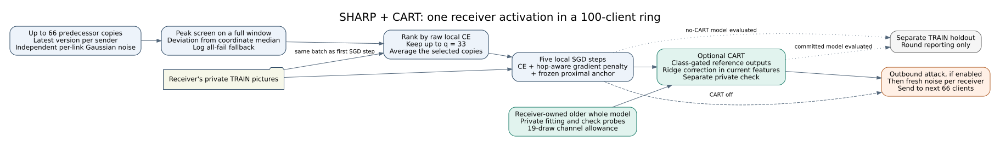

# Professor SHARP protocol and the independent CART contribution

Specification: [sharp_algorithm_OJ_1.pdf, supplied 27 October 2026](specifications/SHARP_professor_20261027.pdf).
SHA-256: `b010c9c79a2282c5835e0b9b4bc5cd95500afbcf7395dd9d04fd6a2a0b9ce700`.

This is a new protocol family. Earlier ten-node BASIL/CART configurations and
their results are preserved. They must not be pooled with these experiments.

## What changes

The receiver now considers a window of predecessor models, screens unusual
parameter deviations, ranks the survivors on one local training batch and
averages the best copies. It trains that average for five gradient steps with
the specified noise-aware objective and a frozen proximal anchor. CART then
optionally applies the existing receiver-owned classifier transport correction.
Its benefit is measured against an otherwise identical SHARP run without CART.

In plain language, imagine 100 students passing a notebook around a circle.
Each student has a different collection of picture cards. SHARP checks several
incoming notebooks and combines the ones that work best on that student's own
cards. The student studies five small batches of cards. CART then asks whether
some useful answers from that student's earlier notebook were lost. It translates
those answers into the new notebook's final answer chart and checks the proposed
change on a second private pile of cards. A change is accepted only if that
local checking score passes. No student's cards or older notebook are shared by
CART. Passing this local check does not guarantee better answers on every unseen
picture; the experiments measure that separately.



| Setting | New default |
| --- | --- |
| Full network | 100 logical clients, sequential ring |
| Design Byzantine budget | 33; actual attackers are zero in clean/noise-only conditions |
| SHARP window/fanout | 66 distinct predecessor/successor IDs, one latest copy per sender |
| Non-IID partition | Class-wise Dirichlet concentration 0.5, as in the professor PDF |
| Seeds | 2025, 2026, 2027 |
| Absolute Gaussian standard deviations | 0.005, 0.01, 0.02 |
| Local computation | Five mini-batch SGD steps, **not five epochs** |
| Mini-batch size | MNIST 14; CIFAR-10 and CIFAR-100 80 |
| Learning rate | 0.03 / (1 + 0.03 × zero-based round) |
| Momentum, weight decay, gradient clipping, augmentation, logit adjustment | Off |
| Curvature scale | h = 1, an explicit illustrative assumption |
| Proximal coefficient | 1 in SHARP defense-bearing conditions; zero in untreated controls |
| Development evaluation | A stratified 1,000-image TRAIN holdout; official TEST remains unused |

The design budget remains positive even in attack-free conditions. It describes
the defense/window design; it does not secretly introduce attackers into clean
experiments. The PDF's formula for q is undefined as a useful averaging rule at
b = 0, so actual attack count and design budget are separate configuration fields.

## Equations and implementation map

### Screen, rank and average: PDF equations 7–14

For a window containing m actual transmissions and design budget b:

$$
q_{\mathrm{target}}=\min\{b,\max(1,m-b)\}.
$$

Here m counts actual available senders, not synthetic initialization copies.
Windows start empty; the initial model is an explicitly logged fallback at the
first receiver. At a full 66-sender window, the target count is 33.

For each received parameter vector v, subtract the coordinate-wise median of
the full window and compute the largest absolute deviation divided by its RMS:

$$
R=\frac{\|v-\operatorname{median}(W)\|_\infty}
{\|v-\operatorname{median}(W)\|_2/\sqrt d},
\qquad T=2.5\sqrt{2\log d}.
$$

The symbol d is the actual number of trainable parameters, not a hardcoded model
dimension. A zero deviation has ratio zero. Screening runs only on a full
window. The default all-fail behavior retains all copies and records a counter,
matching Algorithm 1; it is not presented as a secure fallback.

All surviving copies are scored with raw cross-entropy on the **same** local
batch. This batch is also used for the first SGD step, as Algorithm 1 specifies.
Exact loss ties prefer the newer round and then the nearer predecessor.
Non-finite losses rank last; an all-non-finite window stops the run.

The selected count can be smaller than the target after screening. The actual
mean uses the actual surviving count. Attacker labels never enter screening,
ranking, averaging or CART; they are used only for outbound simulation and audit.

Code: [sharp_math.py](../basil_core/sharp_math.py),
[select_input](../basil_core/sharp_protocol.py).

### Hop-aware RLA: PDF equations 15–18

$$
\eta_k=\frac{\eta_0}{1+\eta_0 k},\qquad
\lambda_k=\frac{\sigma^2}{2q\eta_k h}.
$$

| Symbol | Meaning and source |
| --- | --- |
| k | Zero-based ring traversal index |
| eta_0 | Configured initial learning rate, default 0.03 |
| sigma | Declared absolute per-coordinate channel standard deviation |
| q | Number of copies actually selected, with one for initial-model fallback |
| h | Explicit curvature-scale assumption, default 1 |
| lambda_k | Constant for this activation, computed before local SGD |

The text uses q whereas Algorithm 1 line 10 substitutes b. They coincide in
a full unscreened selection of b copies. The default `--hop-denominator
actual_selected` follows the text and accounts for window filling or screening
that leaves fewer copies. `--hop-denominator budget` reproduces the literal
line-10 coefficient. This difference is explicit in every manifest.

With the selected average held fixed as theta_bar, the local objective is:

$$
F(\theta)=\ell(\theta)+\lambda_k\|\nabla\ell(\theta)\|_2^2
+\frac{\mu}{2}\|\theta-\bar\theta\|_2^2.
$$

Its applied update direction is:

$$
\nabla F=g+2\lambda_k H g+\mu(\theta-\bar\theta).
$$

The loss ell is raw mini-batch cross-entropy; g and H are its gradient and
Hessian at the current local parameters. Nested differentiation computes H g;
no dense Hessian is stored. The anchor is the incoming average, fixed during
all five steps. No gradient clipping, scalar-gradient substitute, optimizer
momentum or hidden prior adjustment changes this objective.

This modifies the earlier EBM coefficient, which was sigma squared for a
single hop. It remains a gradient-norm regularizer motivated by the noise
model. It is **not** an exact identity for expected noisy neural-network CE.
The PDF's stationary variance formulas use local-curvature and independence
approximations; its equations 4 and 19 also place the fresh-noise contraction
differently. The implemented coefficient is a stated model-based design choice,
not a measured accumulated variance or a general convergence theorem.

Code: [hop_coefficient](../basil_core/sharp_math.py),
[objective_gradients and SharpWorker](../basil_core/sharp_worker.py).

### CART remains a separate intervention

CART retains one older coherent model at the receiver. On private fitting
pictures it computes a class loss gap against the trained proposal. A gate
attenuated by a 19-draw channel allowance selects historical output residuals.
Class-balanced ridge regression fits those residuals in the current proposal's
feature coordinates. Separate local check pictures select strength 0, 0.25,
0.5, 0.75 or 1. An actual-network recheck can reject the correction. Only the
final classifier kernel and bias change at commit; the proposal backbone stays
bitwise unchanged. Both probe groups are local TRAIN subsets also used by SGD;
neither includes the reporting holdout.

This revision supports arbitrary declared class count, including CIFAR-100.
The chance-recall threshold is 1 / number_of_classes. Classes without local
labels or separate checking support cannot be verified and have zero gate.
The ridge system uses the model's actual feature dimension: the paper CNN has
192 features, the optional ResNet has 64 and the MNIST MLP has 32.

Code: [sharp_cart.py](../basil_core/sharp_cart.py) and
[the class-generic ridge solver](../basil_core/sharp_math.py).
The previous [CART study guide](CART_ARCHITECTURE_MATH_AND_PAPER_GUIDE.md) explains
the mechanism and related work; its older five-epoch recipe is not this SHARP
protocol. Ridge regression, distillation and class weighting retain their prior
attribution. A positive paired result would support the measured contribution;
implementation correctness alone does not establish algorithmic novelty.

#### CART's actual correction and its limited guarantee

For each supported class, the current proposal and the receiver's stored
reference are evaluated on the same private fitting pictures:

$$
d_c=[L_{p,c}-L_{r,c}]_+,\qquad
g_c=I_c\frac{d_c}{d_c+u_c+10^{-6}}.
$$

| Symbol | Meaning and source |
| --- | --- |
| c | A picture category supported by this receiver's private data |
| L_p,c | Average raw CE of the newly trained proposal on fitting pictures labeled c |
| L_r,c | Average raw CE of this receiver's older reference on those same pictures |
| [a]_+ | max(a, 0), so only a measured reference advantage creates a gap |
| u_c | Nonnegative allowance stored with the reference, calibrated using 19 local simulated Gaussian parameter perturbations |
| I_c | One only if class c also has checking pictures and reference fitting recall exceeds chance; otherwise zero |
| g_c | Strength of historical transfer for examples labeled c; it is not an SGD gradient |

The older reference belongs to this receiver; it is not a second model
requested from the preceding client. Its gradient is never transmitted or
used as CART's correction. CART instead fits an output-score residual:

$$
\mathsf C(z)=z-\frac{\mathbf1^\top z}{K}\mathbf1,
\qquad t_j=g_{y_j}\mathsf C\!\left(z_r(x_j)-z_p(x_j)\right).
$$

| Symbol | Meaning and source |
| --- | --- |
| x_j, y_j | The j-th fitting picture and its known label, both private TRAIN data |
| z_r, z_p | K raw output scores produced by the stored reference and current proposal |
| K, one-vector | Number of dataset classes and the K-vector of ones |
| C | Centering across output classes, removing a shared score offset |
| t_j | The gated, centered historical output difference to translate |

Let row j of A contain the proposal's current features followed by a constant
one for its classifier bias. The implementation solves:

$$
\Delta=(A^\top D A+\rho I)^{-1}A^\top D T,\qquad
D_{jj}=\frac{1}{|\mathcal C_{\mathrm{fit}}|\,n_{y_j}},\qquad
\rho=0.01\frac{\operatorname{tr}(A^\top D A)}{f+1}.
$$

| Symbol | Meaning and source |
| --- | --- |
| A | Features of the private fitting pictures from the newly trained proposal, with a bias column |
| T | Matrix whose rows are the historical residuals t_j |
| C_fit, n_yj | Observed fitting classes and number of fitting pictures with label y_j |
| D | Diagonal weights giving each represented class equal total fitting weight |
| f | Actual proposal feature dimension: 32 for MNIST, 192 for the paper CNN, 64 for the residual model |
| rho, I | Positive ridge coefficient and identity matrix; distinct from the RLA coefficient lambda |
| Delta | Correction to the final classifier kernel and bias; no backbone parameters |

The code uses a linear solve rather than explicitly forming a matrix inverse.
This is the unique minimizer of the class-balanced squared-residual objective
plus rho times the squared correction norm. Positivity follows because D has
positive weights and A has a nonzero bias column, making rho positive.
That establishes a well-defined fit; it does not establish improved accuracy.

The receiver tests scales 0.25, 0.5, 0.75 and 1 on separate checking pictures,
keeping a candidate only when it improves the best checked macro CE by more
than 0.0001; scale zero is always available. It then recomputes the actual
network score and rejects any increase over the baseline beyond 0.000001.
The checked loss safeguard is local and numerical. A zero gate for an absent
label supplies no fitting target for that label; it does **not** freeze that
output column or guarantee retention on pictures absent from the receiver.

## Datasets, models and class support

- MNIST uses its original 60,000 TRAIN images and a documented 64/32-hidden-unit
  MLP. The PDF gives a 17,610-parameter digits example but does not specify enough
  layers to reproduce it, so that exact parameter count is not claimed.
- CIFAR-10 uses the supplied 117,706-parameter paper CNN by default.
- CIFAR-100 uses the same feature extractor with a 100-class output layer.
- `--model resnet20` explicitly selects the earlier GroupNorm residual model
  for CIFAR. It is a model ablation, not the PDF's small-CNN reproduction.
- CIFAR-100 still has 50,000 TRAIN images. At 100 nodes it does not increase
  the average client sample count compared with CIFAR-10 and can reduce
  per-class support. Preflight exports every node's sample/class counts and
  the number of classes with at least two examples.

TRAIN is split before node partitioning. The 1,000-image holdout is shared
across seeds; each seed creates its own fitting partition. Small-test subsets
are explicitly labeled and never silently mixed with full-data results.
Dirichlet attempts are deterministically repeated only when clients would have
fewer than two examples; the accepted attempt is audited. All fitting examples
are assigned exactly once and none overlaps the holdout.

## Requested conditions and aggregation

| Condition | Attack | Noise | Selection defense | RLA | CART |
| --- | --- | --- | --- | --- | --- |
| clean | No | No | No | No | No |
| attack_only | Yes | No | No | No | No |
| attack_defense | Yes | No | Yes | No | No |
| noise_only | No | Yes | No | No | No |
| noise_rla | No | Yes | No | Yes | No |
| attack_noise | Yes | Yes | No | No | No |
| attack_noise_defense | Yes | Yes | Yes | No | No |
| attack_noise_rla | Yes | Yes | No | Yes | No |
| attack_noise_defense_rla | Yes | Yes | Yes | Yes | No |
| attack_noise_defense_rla_cart | Yes | Yes | Yes | Yes | Yes |

In the SHARP family, enabled selection means screened, ranked averaging.
The proximal term accompanies SHARP defense-bearing conditions and is therefore
part of the named stack; `--mu 0` provides its explicit ablation. Noise-only RLA
without selection uses q = 1. The optional `--methods basil` lineage instead
uses single-copy raw-loss selection and the previous sigma-squared coefficient,
without the new proximal term. Its default window is b+1 (34 at 100 nodes),
so it satisfies the stated honest-copy availability bound. `--basil-window 10`
reproduces the PDF's illustrative small-window comparator, which does not meet
that bound when b=33. `--basil-window 66` supplies a matched-window ablation.
Differences in window size and communication cost must be reported when
comparing these families.

There are three non-noisy conditions and seven noisy conditions. Thus each
dataset has 2 partitions × 3 seeds × (3 + 7 × 3) = **144 runs**; MNIST plus
CIFAR-10 is 288 and adding CIFAR-100 is 432. Clean and attack-only runs are not
repeated as independent evidence for each sigma. Aggregation first averages
nodes and the prospectively fixed last-ten-round window within a seed, then
averages the same condition and sigma across seeds. Final-round values are
also retained. One-seed diagnostics do not report a seed standard deviation.

The default attack is the existing project Hidden outbound transformation,
after honest local training and CART, followed by fresh per-link Gaussian
noise. This broad tensor transformation differs from the professor PDF's
illustrative one-coordinate spiky attack. `--attack-type spike` is a separately
labeled stress test; neither is a reproduction of every published Hidden/ALIE
attack. The peak screen can miss distributed look-alike corruption, as the
specification itself explains.

## Resources, recovery and monitoring

One experiment owns one physical GPU; different configs can run simultaneously
on the four HPC GPUs. CUDA wheel paths are supplied before the worker Python
process starts. GPU execution is verified before research runs; no CPU fallback
is started when GPU access fails. GPU memory caps and project locks follow the
existing execution profile.

Sender models are stored once as immutable outbound versions, with per-edge
noise reconstructed from sender, round, receiver and seed. This preserves each
received realization across repeated evaluations without storing 6,600 separate
full noisy models. Source/configuration/data/partition/runtime identities are
frozen. Atomic round checkpoints save all current sender models, node models,
CART references and telemetry. A graceful stop also saves the most recent
completed activation; an incomplete local activation is discarded. An abrupt
crash can require replay of the uncheckpointed portion of a round. No optimizer
state crosses activations because the protocol specifies plain local SGD.

The monitor clears the terminal and refreshes every five seconds. It identifies
dataset, split, seed, sigma, condition and GPU, and exits when all experiments
complete or the campaign stops. It does not refresh a completed campaign.

For the read-only monitor with **per-run ETA and measured queue ETA**, use:

```bash
python scripts/monitor_sharp_study.py --output "$RUN"
```

This is a separate reader so it can be added while an older frozen SHARP
campaign is already running. It changes no training files, checkpoints or
configuration and imports neither TensorFlow nor NumPy. The training runner's
existing `--monitor` remains available but does not display ETA.

An active run's ETA starts after one complete ring traversal and uses its
recorded seconds per activation. Queued jobs use the median measured rate of
matching dataset, partition, model, condition and remaining configuration;
timing samples may combine seeds and positive sigmas, while accuracy values
remain separate. Same-GPU samples are preferred. Queue time is summed within
each GPU's actual sequential assignment, then the slowest GPU determines the
campaign ETA. If any unfinished workload has no matching timing, overall ETA
stays unavailable and lists the untimed jobs/datasets. MNIST timing is never
used to predict CIFAR time, nor clean timing to predict defense/CART workloads.

These are estimates from recorded training progress, not deadlines. Startup,
PTX/JIT compilation, changing class support and hardware contention can change
them. The monitor fits the terminal, refreshes every five seconds, catches
Ctrl+C cleanly and exits immediately after completion or a stopped campaign.
`--once` prints one snapshot without waiting. Campaign elapsed time is the
current supervisor session; per-run elapsed time includes recovered work.

Code: [run_sharp_study.py](../scripts/run_sharp_study.py),
[sharp_protocol.py](../basil_core/sharp_protocol.py),
[ETA monitor](../scripts/monitor_sharp_study.py),
[independent result verification](../scripts/verify_sharp_results.py).

## HPC commands

Use the same arguments for verification, execution and recovery. These are
full-data configurations; run the local validation and HPC pilot first. An
implementation test is not evidence that CART will outperform the other rows.

```bash
cd ~/Masters_Research/PaperMerge
git pull --ff-only
source .venv-hpc/bin/activate

RUN="$PWD/.papermerge/local-tests/sharp-hpc-pilot-v1"
COMMON=(--profile hpc --gpus 0,1,2,3 --output "$RUN"
  --datasets mnist cifar10 --partitions iid dirichlet --seeds 2025
  --conditions clean attack_noise_defense_rla attack_noise_defense_rla_cart
  --nodes 10 --rounds 5 --attack-start 1 --only-sigma 0.01)

python scripts/run_sharp_study.py --prepare-data --datasets mnist cifar10
python scripts/run_sharp_study.py --preflight "${COMMON[@]}"
python scripts/run_sharp_study.py --verify-gpus "${COMMON[@]}"
python scripts/run_sharp_study.py --execute "${COMMON[@]}" --tmux sharp-pilot
python scripts/monitor_sharp_study.py --output "$RUN"
python scripts/run_sharp_study.py --report --output "$RUN"
```

The separately verified fresh-process recovery check can also be repeated on
the HPC before its training campaign. It uses a small MNIST TRAIN subset and
compares an interrupted/recovered trajectory with an uninterrupted one,
including CART memory and actual nonzero corrections:

```bash
python scripts/check_sharp_recovery.py --device GPU --profile hpc --gpu 0 \
  --output "$PWD/.papermerge/local-tests/sharp-hpc-recovery-v1"
```

Use a fresh recovery-check output and an available GPU. This small check does
not replace the campaign's required `--verify-gpus` receipts on all four GPUs.

For a bounded learning comparison with the professor's delayed attack, use
25 rounds so five attack-active rounds are actually observed. The following
MNIST-only campaign repeats clean, the complete SHARP mitigation stack and
the same stack plus CART on both splits, three seeds and all three sigmas
(42 configurations). It uses the same MNIST model tag as the completed local
25-round study; the underlying MNIST network remains the documented MLP.
Repeat verification on the HPC GPUs before execution:

```bash
RUN="$PWD/.papermerge/local-tests/sharp-hpc-mnist-25r-v1"
COMMON=(--profile hpc --gpus 0,1,2,3 --output "$RUN"
  --datasets mnist --partitions iid dirichlet --seeds 2025 2026 2027
  --conditions clean attack_noise_defense_rla attack_noise_defense_rla_cart
  --nodes 100 --rounds 25 --attack-start 20 --model resnet20)

python scripts/run_sharp_study.py --preflight "${COMMON[@]}"
python scripts/run_sharp_study.py --verify-gpus "${COMMON[@]}"
python scripts/run_sharp_study.py --execute "${COMMON[@]}" --tmux sharp-mnist-25r
python scripts/monitor_sharp_study.py --output "$RUN"
python scripts/run_sharp_study.py --report --output "$RUN"
```

The five-round pilot above deliberately attacks early and can perform poorly;
it is an execution stress test. The completed local delayed-attack comparison
supports modest CART gains on non-IID MNIST, with a remaining gap from clean.
The IID branch in this new HPC campaign remains a separate comparison.

After assessing the pilot and freezing the intended full protocol:

```bash
RUN="$PWD/.papermerge/local-tests/sharp-hpc-100nodes-v1"
COMMON=(--profile hpc --gpus 0,1,2,3 --output "$RUN"
  --datasets mnist cifar10 --partitions iid dirichlet
  --seeds 2025 2026 2027 --nodes 100 --rounds 100)

python scripts/run_sharp_study.py --preflight "${COMMON[@]}"
python scripts/run_sharp_study.py --verify-gpus "${COMMON[@]}"
python scripts/run_sharp_study.py --execute "${COMMON[@]}" --tmux sharp-full
python scripts/monitor_sharp_study.py --output "$RUN"
python scripts/run_sharp_study.py --report --output "$RUN"
```

To include CIFAR-100, add it to `--datasets` in **every** corresponding command
and prepare its cache first. To resume, use `--execute --recover` with the same
COMMON arguments and source revision. Keep the previous output namespace.

Local test results and the final readiness evidence are recorded separately;
this implementation document does not fabricate their completion status.

## Separate final official-TEST evaluation

Development and the commands above report the reserved TRAIN holdout. Once
the intended configuration/analysis is frozen and all selected training runs
complete, evaluate saved final checkpoints without further training:

```bash
python scripts/evaluate_sharp_official_test.py --output "$RUN" \
  --profile hpc --gpu 0 --device GPU
```

This explicit inference-only action reads the full 10,000-image official TEST
split for each dataset. It never calls SGD, candidate selection or CART fitting,
and preserves the training manifests. It writes distinct per-run final-TEST
receipts and `official_test_summary.json`, grouping the same configuration and
sigma across seeds. An existing receipt with different data/config identity is
not overwritten. The final-TEST tool has been checked with synthetic fixtures;
official TEST has **not** been consumed during the local development studies.
