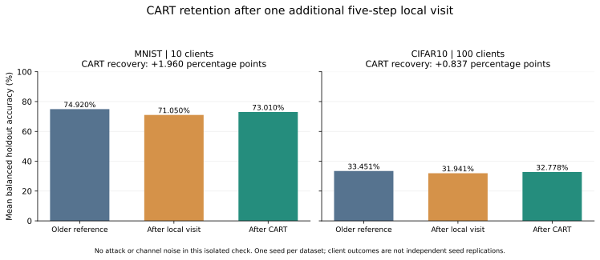
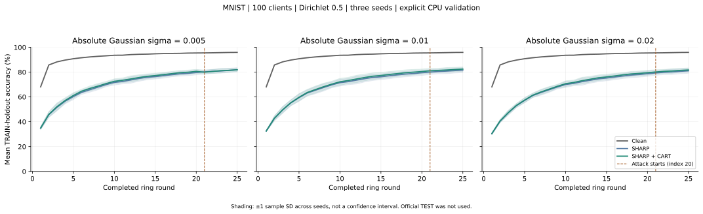

# SHARP and CART local validation — 27 October 2026

This report separates implementation checks from learning effectiveness.
The [professor's specification](specifications/SHARP_professor_20261027.pdf)
and [implementation/commands](SHARP_IMPLEMENTATION.md) describe the new family.

## Completed implementation evidence

- The focused tests verify the analytic `g + 2 lambda H g + mu(theta-anchor)`
  update against a binary softmax model with an independently computed Hessian.
- A 100-node, 66-sender-window protocol test reproduces uninterrupted parameters,
  telemetry and metrics exactly after saving and recovering a partial run.
- A separate actual-MNIST check uses three fresh CPU interpreters for a partial
  run, recovery and an uninterrupted run. All model arrays, outgoing models,
  sender versions, CART memory, telemetry and metrics match exactly after
  32 activations, including four nonzero CART corrections. This checks the
  real TensorFlow worker, in addition to the 100-node protocol test.
  Reproduction: `python scripts/check_sharp_recovery.py --device CPU --output
  .papermerge/local-tests/sharp-cpu-recovery-new` (use a fresh output).
- Real TensorFlow CART tests repair a deliberately degraded classifier for
  **both 10 and 100 classes**, preserve the proposal backbone exactly, and
  pass a separate local check. Real multi-round TensorFlow checkpoints reload.
- The tests check channel realization reuse, independent receiver noise, peak
  screening, all-fail fallback, ranking ties, window filling and coefficient
  changes with learning rate and selected count.
- All 432 full-matrix configurations passed TRAIN partition preflight at
  100 nodes. Splits are disjoint and exhaustive and exclude the reporting holdout.
- GPU objective/SGD checks passed on RTX 4070 Ti for MNIST, CIFAR-10 and
  CIFAR-100, including exact same-device repeated updates. The optional
  CIFAR residual model is verified separately in its 100-node pilot.
- The final complete repository suite passed **1,212 tests plus 644 subtests**,
  with four skips and three warnings, in 268 seconds. This includes reporting
  that keeps sigmas separate, a completed monitor that does not refresh, and
  explicit budget-valid or matched-window BASIL comparisons. Local log:
  `/tmp/sharp-release-tests-only.log`. The focused official-evaluation tests
  additionally passed after adding the final sigma-preserving summary check.

The all-finite numerical invariants above are not general Byzantine robustness
or population accuracy guarantees. Peak screening targets concentrated parameter
deviations; broad look-alike corruption may pass. Model initialization, local
training and outbound attack/noise ordering are explicit in the manifests.

## Completed five-round, ten-node learning pilots

These **18 actual GPU runs** use seed 2025, sigma 0.01, five local gradient
steps per activation, 200 fitting samples per class, Dirichlet concentration
0.5, and the paper CNN or documented MNIST MLP. Attack starts at round index 1.
They use a TRAIN holdout, not official TEST. Every final node and class metric
was independently recomputed on CPU from the saved final checkpoint.

| Dataset / split | Clean | SHARP, attack + noise | Same + CART | CART difference |
| --- | ---: | ---: | ---: | ---: |
| MNIST IID | 83.17% | 64.00% | 62.62% | -1.38pp |
| MNIST Dirichlet | 74.92% | 11.86% | 10.51% | -1.35pp |
| CIFAR-10 IID | 10.57% | 10.00% | 10.00% | 0.00pp |
| CIFAR-10 Dirichlet | 10.29% | 10.00% | 10.00% | 0.00pp |
| CIFAR-100 IID | 0.94% | 1.00% | 1.00% | 0.00pp |
| CIFAR-100 Dirichlet | 0.88% | 1.00% | 1.00% | 0.00pp |

These pilots **do not establish a CART accuracy benefit** in the new SHARP
family. CART made nonzero checked corrections in the MNIST and CIFAR-10 runs,
but better local checked CE did not ensure better balanced holdout accuracy.
Near-chance clean CIFAR results also show that these short small-network runs
are insufficient as an effectiveness comparison for that model/training recipe.
They do not justify a claim of closeness to clean or recovery to 90–95%.

The [machine-readable validation receipt](validation/SHARP_INITIAL_5R_20261027.json)
preserves final metrics, correction counts, independent inference differences,
source hashes and dataset identities. Local raw output is
`.papermerge/local-tests/sharp-cart-5r-three-datasets-v4/`.

The subsequent **actual 100-node GPU cohort** also completed and passed
independent verification. It uses full fitting data, five rounds, seed2025,
attack onset1 and the residual CIFAR model. Its final means were:

| Dataset / Dirichlet split | Clean | SHARP joint impairment | Same + CART |
| --- | ---: | ---: | ---: |
| CIFAR-10 | 33.451% | 10.000% | 10.000% |
| MNIST | 90.639% | 62.525% | 47.896% |

These are negative early-attack results: CART can substantially hurt when
useful historical knowledge has not yet formed. They are not replaced by the
positive delayed-attack or isolated-retention findings. See the
[100-node early-attack receipt](validation/SHARP_100NODE_EARLY_ATTACK_5R_20261027.json).

## Completed CART retention mechanism check on two datasets

An additional paired experiment starts with **every** saved clean node model
as that receiver's reference, takes one further five-step visit on its actual
private Dirichlet data, and applies CART. No artificial classifier damage is
inserted and no reporting holdout enters the fit, gate or acceptance decision.
This isolates local adaptation loss from attacks and communication noise.

| Dataset / clients | Reference before extra visit | After five local steps | After CART | CART gain | Clients improved / worsened / unchanged |
| --- | ---: | ---: | ---: | ---: | --- |
| MNIST / 10 | 74.920% | 71.050% | 73.010% | +1.960pp | 9 / 1 / 0 |
| CIFAR-10 / 100 | 33.451% | 31.941% | 32.778% | +0.837pp | 65 / 11 / 24 |

The figure is regenerated from the committed receipt by
`python -m reporting.sharp_validation_plots`. Its PDF and PNG versions are in
`docs/figures/sharp-study/` for sharing; the plot does not use invented values.

CART used nonzero corrections at 10/10 MNIST clients and 77/100 CIFAR clients.
The proposed classifier correction preserved the newly trained backbone and
passed its separate local macro-CE check. This supports the narrow empirical
claim that the architecture can **partially recover balanced accuracy lost
during an additional heterogeneous local update when a useful reference is
available**. It does not show improvement at every client or class, recovery
of all lost accuracy, long-horizon robustness, or independence of the client
observations. Each dataset uses one seed; the client count is not a seed count.

The CIFAR source uses the full-data residual-model 100-node clean pilot; the
MNIST source uses the earlier subset/10-node clean pilot. They are separate
mechanism checks and are not pooled into a single accuracy or significance test.

Reproduction script: [check_sharp_cart_retention.py](../scripts/check_sharp_cart_retention.py).
The [per-client receipt](validation/SHARP_CART_RETENTION_20261027.json)
records source configuration/hashes, private-check evidence, correction
strengths and holdout outcomes. These results do **not** replace the negative
joint attack/noise comparisons above.

## Completed three-seed, 100-node delayed-attack MNIST comparison

This comparison uses full MNIST fitting data, Dirichlet concentration 0.5,
100 logical clients, five SGD steps per activation and **25 rounds**. The
Hidden outbound attack begins at zero-based round 20, giving five attack-active
rounds. Gaussian sigma is 0.01. The three fixed seeds are 2025, 2026 and 2027.
All nine clean/control/CART runs completed using explicit one-thread CPU
execution and passed fresh independent inference and telemetry verification.

The actual MNIST network is the documented 784→64→32→10 MLP with 52,650
parameters. The common `resnet20` model tag selects the residual network for
CIFAR; it does not turn MNIST into a residual network. This is not a claim to
reproduce the unspecified 17,610-parameter digits example in the PDF.

Values below are percentages, **mean ± sample standard deviation across three
seeds**, not confidence intervals. Each seed endpoint first averages its nodes
and the stated rounds; noise levels are never averaged together.

| Condition | Primary: last ten rounds | Final round | Five attack-active rounds |
| --- | ---: | ---: | ---: |
| Clean | 95.412 ± 0.090 | 95.874 ± 0.076 | 95.673 ± 0.116 |
| Attack + noise + SHARP | 79.576 ± 2.099 | 81.612 ± 1.939 | 80.831 ± 1.970 |
| Same + CART | 80.544 ± 2.031 | 82.421 ± 1.738 | 81.725 ± 1.823 |

The **paired CART primary improvement is +0.968 ± 0.142 percentage points**.
All three seeds improve on the configured primary endpoint, the final round
and the attack-active secondary endpoint. Final-round paired gains are
+0.961pp, +1.071pp and +0.395pp; their mean is +0.809pp. This is preliminary
evidence that CART adds a repeatable retention benefit to the matched SHARP
stack in this particular non-IID MNIST setting. It is not a claim that all
datasets, channel strengths or attack timings improve.

The final gap from clean remains **13.453 percentage points** after CART, so
this study does not establish the requested near-clean target. The local
checker is a loss safeguard, not a population-accuracy guarantee. The central
sigma result is a development holdout comparison on CPU, not an official-TEST
or Blackwell-HPC confirmation. All three declared noise levels have now
completed with three seeds and both matched cases, and passed independent
validation:

| Sigma | SHARP primary mean | CART primary mean | Paired primary gain, mean ± SD | Final-round paired gain | Attack-active paired gain |
| --- | ---: | ---: | ---: | ---: | ---: |
| 0.005 | 79.741% | 80.164% | +0.423 ± 0.248pp | +0.035pp | -0.033pp |
| 0.010 | 79.576% | 80.544% | +0.968 ± 0.142pp | +0.809pp | +0.894pp |
| 0.020 | 78.831% | 79.644% | +0.813 ± 0.294pp | +0.666pp | +0.744pp |

All nine seed/noise pairs improve on the **configured primary endpoint**.
At sigma0.005 one seed worsens at the final and attack-active endpoints;
the mean attack-active difference is slightly negative. These data do not
support improvement at every endpoint or seed. The clean three-seed final
mean remains 95.874%; no noisy row is reported as near clean.

The [complete seed-level receipt](validation/SHARP_MNIST_100NODE_25R_3SEED_20261027.json)
preserves all outcomes, curves, source/configuration/data identities and the
independent verification records. The [aggregation program](../scripts/report_sharp_seed_study.py)
rejects duplicate seed results, mixed proximal settings and unpaired identities.
It reports primary, final and attack-active endpoints together.

## Completed GPU coverage of every requested configuration

All **144 actual GPU smoke runs** completed and passed independent CPU
checkpoint, telemetry and final-inference verification. This covers all ten
requested conditions, all three noise levels, IID and Dirichlet partitions,
and MNIST, CIFAR-10 and CIFAR-100. Each dataset/split has 24 distinct cases;
the three non-noisy cases are run once, not repeated for each sigma. Final
accuracy recomputation agreed exactly between the GPU runs and CPU checker.

These are deliberately small execution checks: eight clients, two rounds,
seed2025, 20 fitting examples per class, ten reporting examples per class,
and attack onset0. They verify switch wiring and complete execution, not
learning convergence, three-seed efficacy, closeness to clean or a universal
CART benefit. The [coverage receipt](validation/SHARP_ALL_SWITCH_GPU_SMOKE_20261027.json)
retains every outcome, configuration digest, runtime and source/data identity.

## Further validation in progress

The completed 100-node GPU cohort above retains five steps per activation and
performs 2,500 updates per run, compared with 250 in the ten-node pilot. It is
not pooled with the smaller-model/subset or later-onset results.

The three-seed 100-node MNIST GPU early-attack repetition is now running.
Its completion and results must be read from its frozen run manifests and
added to this report only after validation; no pending value is a result.

The [CPU validation tool](../scripts/run_sharp_cpu_validation.py) declares its
execution mode; it is not an automatic GPU fallback. Its three-noise-level
replication is complete and independently verified: **21 CPU runs**, consisting
of 18 noisy cases and three clean references. The clean references are reused,
not counted as new independent runs for each sigma.

The configured primary endpoint remains the mean node accuracy over the last
ten rounds (indices 15–24 here). A separately labeled secondary endpoint uses
the five attack-active rounds (20–24); final-round accuracy is also retained.
Report all of them, including negative paired differences, without substituting
the most favorable one for the configured primary endpoint.

## Reproduction and readiness scope

GPU workers are separate processes with their CUDA loader paths and selected
physical-device profile set before startup. Source hashes, TRAIN identities,
partition audits, initialization hash and runtime profile are frozen. Recovery
rejects mismatches. The monitor refreshes every five seconds and exits on
completion. One experiment occupies one GPU, allowing four independent HPC
configurations concurrently.

The commands in [SHARP_IMPLEMENTATION.md](SHARP_IMPLEMENTATION.md) include data
preparation, preflight, per-GPU verification, pilot execution, monitoring and
reporting. GPU verification must be repeated on HPC's Blackwell cards. Local
RTX verification is not a substitute for that hardware check.

The currently supported conclusions concern implementation and the explicitly
reported development experiments. A successful small test does not certify
long-run convergence, arbitrary Byzantine tolerance or CART novelty. Longer
HPC comparisons should be frozen and reported as new experiments, including
negative outcomes, with matched CART/non-CART settings and separate sigma means.
