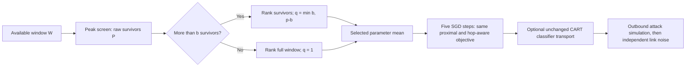

# Survivor-aware SHARP correction: separate development revision

This revision responds to the [confirmed v1 screen failure](SHARP_SCREEN_FAILURE.md).
It does not alter the active HPC v1 campaign, and it is not an unchanged
reproduction of the professor's Algorithm1. The changes are explicitly recorded
under method `sharp_guarded` and revision `sharp_survivor_guard_20261027_v1`.
The original method remains available for matched comparisons.

## The correction

Let W be the available predecessor window, P its **raw** peak-screen survivors,
p=|P|, and b the configured upper bound on directly Byzantine senders. The
original all-fail helper's keep-all result is not counted as raw survivors.

$$
q_{\mathrm{target}}=
\begin{cases}
1, & p\le b,\\
\min(b,p-b), & p>b.
\end{cases}
$$

| Case | Candidate pool | Local action |
| --- | --- | --- |
| No predecessor has transmitted yet | Initial model | Explicit bootstrap |
| p ≤ b, including all-fail | Full available window W | Receiver-local raw-CE single-copy selection |
| p > b | Raw survivors P | Rank by the same local CE and average up to min(b,p-b) copies |

The fallback uses the BASIL-style single-copy loss rule. It adds no tunable
accuracy threshold, does not use attacker identities, and does not switch at
known attack onset. The same rule applies during window filling and every
later activation. All candidates use the receiver's same TRAIN selection batch;
no reporting holdout or official TEST enters the decision.

At most b members of any pool can be directly Byzantine. Thus a pool of p
survivors has at least max(0,p-b) non-Byzantine senders. When p≤b that bound is
zero: the peak-screened pool could contain only attackers, as the actual
65-benign/1-attacked failure demonstrated. Reopening W recovers the original
window's honest-availability condition; choosing one copy does not force bad
copies into an average to meet the old target33. When p>b, the new target
does not exceed that pool's conservative non-Byzantine count.

This count is **not a robustness theorem**. Loss ranking can be fooled, benign
senders can carry attacked ancestry, and small startup windows need not contain
an honest sender. The inherited median/peak rule retains its assumptions.
The revision is intended to address the observed failure and must be evaluated
against other attacks, data splits and noise levels.



The actual selected count, which can be smaller after non-finite scores are
excluded, remains the default denominator in:

$$
\lambda_k=\frac{\sigma^2}{2q_{\mathrm{actual}}\eta_k h}.
$$

Sigma is the declared coordinate channel standard deviation; eta is the same
round-decayed learning rate; h remains the explicit curvature assumption1.
With a single-copy fallback the denominator correctly uses1 rather than33.
The five local SGD steps, source attack, data partition, initialization,
optimizer and optional CART objective are preserved.

## CART remains a separate contribution

This survivor-count repair is **not presented as CART novelty**. It repairs the
prototype selector, borrowing the established single-copy loss fallback idea.
CART remains the receiver-owned, class/channel-gated classifier transport
described in the [architecture guide](CART_ARCHITECTURE_MATH_AND_PAPER_GUIDE.md).
Its contribution requires a matched guarded joint-mitigation control versus
the identical guarded configuration plus CART. Improvements of attack-defense
alone must not be attributed to CART, which is disabled there.

## Implementation and current evidence

- [Guarded configuration, selection and activation loop](../basil_core/sharp_guarded_protocol.py).
  The loop preserves the original activation order, keyed random streams,
  transactional checkpoints and outbound attack/noise ordering.
- [CPU development driver v2](../scripts/run_guarded_sharp_case_v2.py).
  The first driver remains frozen because completed runs fingerprint it; v2
  fixes single-arm reporting without changing the training protocol.
- [Separate GPU/HPC launcher](../scripts/run_guarded_sharp_study.py). It assigns
  distinct method/run IDs and fingerprints, and refuses cross-version recovery.
- [Independent verification](../scripts/verify_sharp_results.py) recognizes the
  declared family, validates its raw survivor count, fallback and target count,
  and checks the actual-q RLA coefficient and final inference.
- [Three-seed CPU aggregation](../scripts/report_guarded_sharp_seed_study.py)
  requires every declared seed and keeps noise levels separate. It does not
  accept original-method configurations as guarded results.

Initial full-fitting-data MNIST development cases used 100 nodes,35rounds,
seed2025, attack onset20, sigma0 and model tag `paper`. They completed and
passed independent verification:

| Split | Original attack-defense | Guarded attack-defense | Clean control |
| --- | ---: | ---: | ---: |
| IID | 10.000% | 89.350% | 96.958% |
| Dirichlet0.5 | 10.000% | 82.603% | 96.024% |

Both guarded cases selected zero directly attacked copies across their observed
attack-active rounds. These are **one-seed development results**, not a claim
that every configuration is fixed or near clean. The selection change applies
before onset too, so the gain is a comparison of complete method trajectories,
not an isolated intervention at the attack-start instant.

### Completed three-seed, zero-noise replication

The [verified replication receipt](validation/SHARP_GUARDED_ZERO_NOISE_3SEED_20261027.json)
contains all twelve full-fitting-data MNIST runs: three seeds, both partitions,
clean and guarded attack-defense. All use 100 nodes, 35 rounds, attack onset at
zero-based round 20, model tag `paper`, and explicit CPU execution. Accuracy is
averaged across node models within each seed, then across seeds 2025–2027.
The ± values below are sample standard deviations across three seeds.

| Split | Guarded attack-defense, final | Clean, final | Gap from clean |
| --- | ---: | ---: | ---: |
| IID | 89.624 ± 0.268% | 96.700 ± 0.224% | −7.076 percentage points |
| Dirichlet 0.5 | 82.796 ± 1.034% | 96.113 ± 0.085% | −13.318 percentage points |

The configured primary endpoint averages the final ten rounds: guarded
attack-defense reaches 89.459 ± 0.403% IID and 82.237 ± 1.118% non-IID.
The corresponding clean values are 96.513 ± 0.154% and 96.058 ± 0.105%.
Only seed 2025 has a matched original-v1 reproduction here; the original-versus-
guarded table above must not be described as a three-seed causal comparison.
The correction avoids the reproduced collapse but leaves material clean gaps.

### Completed joint-noise/CART pilot: negative CART result

The [paired pilot receipt](validation/SHARP_GUARDED_JOINT_CART_PILOT_20261027.json)
contains four independently verified runs using the same 100-node/35-round
MNIST protocol, seed 2025 and absolute Gaussian coordinate σ = 0.01. The
control has Byzantine mitigation and hop-aware RLA; its paired arm adds the
unchanged CART mechanism. Initialization, partitions, training data, runtime,
and the first ring's input/trained hashes match within each pair.

| Split | Joint control, final | Joint + CART, final | CART − control | Primary endpoint difference |
| --- | ---: | ---: | ---: | ---: |
| IID | 88.077% | 86.117% | −1.960 points | −1.372 points |
| Dirichlet 0.5 | 83.647% | 79.277% | −4.370 points | −3.426 points |

CART made 3,162 nonzero corrections in IID and 2,789 in non-IID. It was active
and passed its local checked-loss acceptance rule, yet reduced the reporting
accuracy in both pairs. Local checked cross-entropy non-increase therefore
does not establish an accuracy benefit or class-retention guarantee. These
one-seed results do not support CART superiority, near-clean performance, or
a general claim about every seed or noise level. They are preserved alongside
earlier positive and negative studies; they must not be filtered out.

The first CPU driver's single-CART-arm postprocessing incorrectly required
its control in the same output folder. One completed CART run was consequently
marked failed after training; a local scheduler then interrupted two unfinished
development runs. The [continuation tool](../scripts/recover_guarded_sharp_case.py)
archives the previous manifests, validates the unchanged training contract,
and records its own program hash. It reconciled the completed IID CART run
without changing checkpoint or metric bytes, and resumed both interrupted
non-IID cases from committed checkpoints. All sixteen development runs now
pass independent verification. These local events did not affect HPC.

### Implementation checks and their limits

- The full suite passed 1,238 tests and 644 subtests, with four skips. Later
  reporting/recovery/official-evaluation changes passed twelve focused tests.
- [Eighteen GPU smoke cases](validation/SHARP_GUARDED_GPU_5R_20261027.json)
  completed and passed independent inference/telemetry checks: MNIST, CIFAR-10
  and CIFAR-100, IID and non-IID, three mitigation/CART conditions. These used
  eight nodes and five rounds with an early attack, so they establish execution
  coverage rather than full-data accuracy or 100-node efficacy on CIFAR.
- [Fresh-process GPU recovery](validation/SHARP_GUARDED_GPU_RECOVERY_20261027.json)
  reproduced guarded+CART state exactly after 32 activations, including seven
  nonzero classifier corrections. This is a bounded recovery check.
- The v2 CPU driver completed a separate two-round, four-node single-CART-arm
  run and passed independent verification, without requiring a paired report.
- No official TEST data were used in these development results.

### Separate HPC pilot commands

Preserve the original campaign and its results. If `sharp-full` is still
running, stop its supervisor gracefully before allocating the same four GPUs
to another campaign:

```bash
tmux send-keys -t sharp-full C-c
```

Wait for its workers to exit and check `python scripts/hpc.py gpu-status`.
Do not use `tmux kill-server`. This new pilot uses a fresh directory and a
separate launcher; it does not resume or rewrite the original 288-run output.

```bash
cd ~/Masters_Research/PaperMerge
git pull --ff-only
source .venv-hpc/bin/activate

GUARDED_RUN="$PWD/.papermerge/local-tests/sharp-guarded-hpc-mnist-35r-v1"
GUARDED_COMMON=(
  --profile hpc --gpus 0,1,2,3 --output "$GUARDED_RUN"
  --datasets mnist --partitions iid dirichlet
  --seeds 2025 2026 2027 --sigmas 0.005 0.01 0.02
  --conditions clean attack_defense attack_noise_defense_rla attack_noise_defense_rla_cart
  --nodes 100 --rounds 35 --local-steps 5 --attack-start 20
  --alpha 0.5 --model paper
)
python scripts/run_guarded_sharp_study.py --preflight "${GUARDED_COMMON[@]}" &&
python scripts/run_guarded_sharp_study.py --verify-gpus "${GUARDED_COMMON[@]}" &&
python scripts/run_guarded_sharp_study.py --execute "${GUARDED_COMMON[@]}" --tmux sharp-guarded-pilot

python scripts/run_guarded_sharp_study.py --monitor --output "$GUARDED_RUN"
```

This selects 48 runs. It evaluates the guarded baseline and unchanged CART;
it is not a newly improved CART revision. Include `attack_defense` explicitly:
the earlier 42-run pilot omitted the condition that later collapsed. After
completion, run independent verification before interpreting the results:

```bash
python scripts/verify_sharp_results.py --require-complete --output "$GUARDED_RUN"
python scripts/run_guarded_sharp_study.py --report --output "$GUARDED_RUN"
```

Review this pilot before spending another full 288-run budget. The current
evidence supports investigating the selector correction and improving CART;
it does not support claiming that all 288 combinations are fixed.
