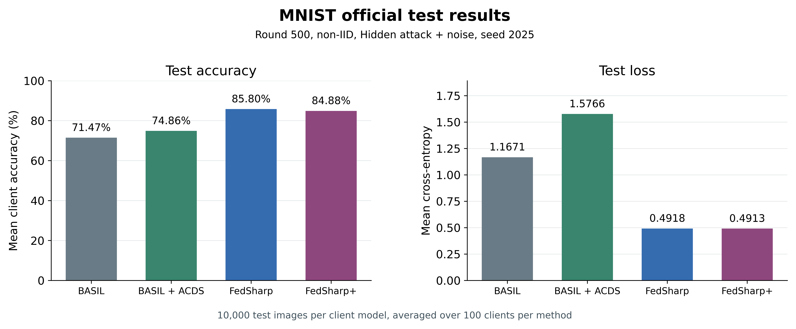
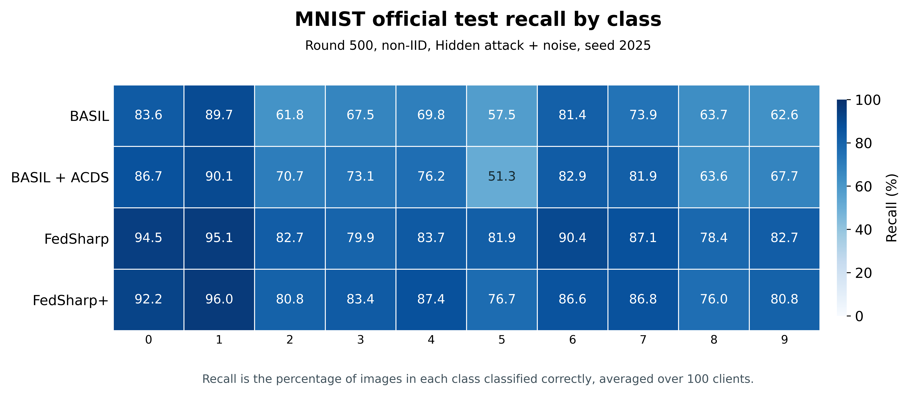
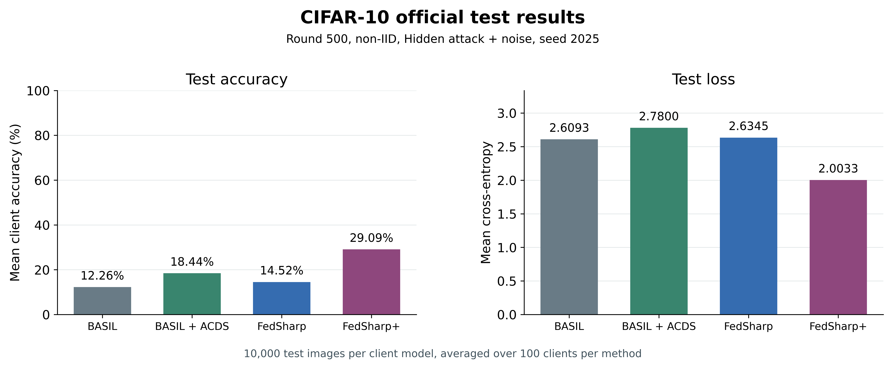
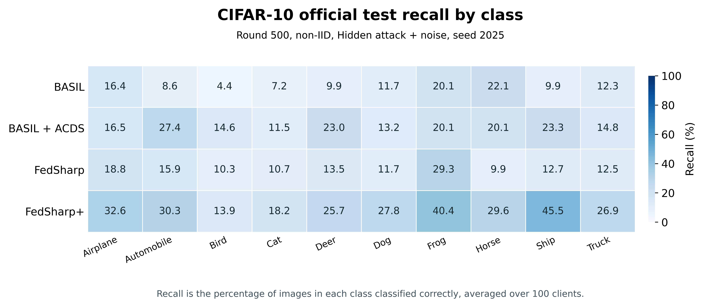

# Official test results for four methods

Final round-500 models under non-IID partitioning, Hidden attack + noise, and seed 2025.
Each of the 100 client models per method evaluated all 10,000 official test images per dataset.
BASIL + ACDS used its configured fitting-data sharing during training.

| Dataset | Method | Test accuracy | Mean test loss | Honest-client accuracy | Round-500 validation |
|---|---|---:|---:|---:|---:|
| MNIST | BASIL | 71.474% | 1.167073 | 71.971% | 69.104% |
| MNIST | BASIL + ACDS | 74.857% | 1.576609 | 74.541% | 73.953% |
| MNIST | FedSharp | 85.797% | 0.491761 | 85.874% | 84.713% |
| MNIST | FedSharp+ | 84.883% | 0.491335 | 84.896% | 83.896% |
| CIFAR-10 | BASIL | 12.259% | 2.609257 | 12.068% | 12.249% |
| CIFAR-10 | BASIL + ACDS | 18.437% | 2.780031 | 18.263% | 18.452% |
| CIFAR-10 | FedSharp | 14.523% | 2.634462 | 14.709% | 14.433% |
| CIFAR-10 | FedSharp+ | 29.086% | 2.003305 | 29.199% | 29.352% |

Test accuracy averages each client model's accuracy with equal weight.
The honest-client column averages the 67 honest clients.
The comparison covers one training seed and one attack setting.
Image 0 appeared in the earlier demonstration. Both evaluations use the frozen models.
The saved prediction arrays support independent verification of 8,000,000 client-image predictions.

## Source evaluations

- [full-official-test-20261110](../full-official-test-20261110/report.md)
- [basil-full-test-20261110](../basil-full-test-20261110/report.md)

## Test figures

### MNIST accuracy and loss

[PNG](mnist_test_accuracy_and_loss.png) · [SVG](mnist_test_accuracy_and_loss.svg)

### MNIST recall by class

[PNG](mnist_test_class_recall.png) · [SVG](mnist_test_class_recall.svg)

### CIFAR-10 accuracy and loss

[PNG](cifar10_test_accuracy_and_loss.png) · [SVG](cifar10_test_accuracy_and_loss.svg)

### CIFAR-10 recall by class

[PNG](cifar10_test_class_recall.png) · [SVG](cifar10_test_class_recall.svg)

