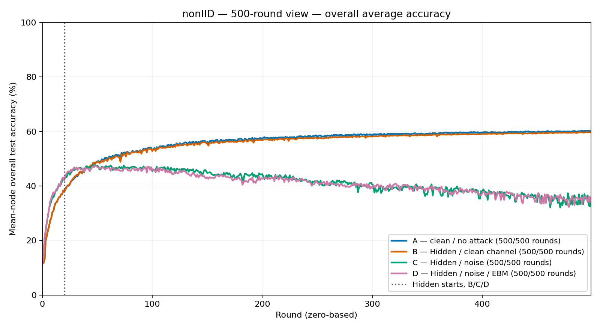

# Completed A/B/C/D non-IID results: 100 and 500 rounds

Checked against saved manifests, CSVs, NPZ arrays, activation/optimizer telemetry, source archives and final checkpoints on 2026-10-17. No training, protocol edits, restarts, extensions or additional scientific conditions were performed.

## Bottom line

All eight queued experiments completed. **The noisy conditions did not maintain their early learning performance.** At 500 rounds the mean-node accuracies are A **60.17%**, B **59.73%**, C **35.17%**, D **35.83%**. D exceeds C by just **0.66 percentage points (pp)** at the endpoint, and has a slightly lower best mean-node accuracy.

The evidence does **not** support describing the combined non-IID loss as a successful long-horizon channel-noise mitigation. Numerical/protocol checks pass, but this is not the same as scientific effectiveness.

[Overall average-accuracy line graph](../../../newPlots/nonIID/500round/ABCD_overall_average_accuracy_vs_round.png) · [Final average-accuracy bars](../../../newPlots/nonIID/500round/ABCD_final_average_accuracy_bar.png) · [Mean/worst-node trajectories](../../../newPlots/nonIID/500round/ABCD_mean_and_worst_node_accuracy.png)

## Metric and execution definitions

- **Overall average accuracy / mean-node accuracy:** arithmetic mean of the ten stored trained node models' full 10,000-image test accuracies. This is the primary metric in this report and in the refreshed organized plots.
- **Node-9 accuracy / `full_test_accuracy`:** the fixed end-of-ring Node-9 trained model's full-test accuracy **before its outbound attack/channel corruption**. It is not an ensemble or an averaged model.
- **Worst-node accuracy:** minimum of those ten model accuracies.
- **Full-test loss:** Node-9 raw-logit full-test cross-entropy, not adjusted local training CE.
- All round IDs are **zero-based**. R99 is the 100th measured round; R499 is the 500th.
- Best observed test accuracy is descriptive only. No best-checkpoint selection, early stopping or tuning was performed.
- The 100- and 500-round jobs were separate fixed-horizon runs, not weight-only continuations. Their first 100 metric/selection points match exactly for every condition; they are not independent statistical replications.

## Table 1 — Completion and executed configurations

| Condition | Actual attack | Channel | Local training loss | 100-round job | 500-round job | GPU runtime, 500r |
| --- | --- | --- | --- | --- | --- | --- |
| A | None | None | Prior-adjusted CE + anchor | 100/100; completed | 500/500; 5000 activations; completed | 6.83 h |
| B | Hidden, IDs 0/1/5/7, R20 | None | Prior-adjusted CE + anchor | 100/100; completed | 500/500; 5000 activations; completed | 6.88 h |
| C | Hidden, IDs 0/1/5/7, R20 | Absolute Gaussian, σₑ=0.010 | Prior-adjusted CE + anchor | 100/100; completed | 500/500; 5000 activations; completed | 6.91 h |
| D | Hidden, IDs 0/1/5/7, R20 | Absolute Gaussian, σₑ=0.010 | Prior-adjusted CE + EBM + anchor | 100/100; completed | 500/500; 5000 activations; completed | 6.95 h |

Each 500-round job contains **255,000 recorded SGD minibatch updates**, five full local epochs per activation and 25,000 directed transmissions. All use the RTX 4070 Ti, deterministic single-process float32 execution, TensorFlow 2.18.0, and TF32 disabled. Total 500-round A/B/C/D runtime: **27.56 h**. All four manifests record `researchValid=true`; this labels execution scope, not an accuracy endorsement.

Fixed protocol: CIFAR-10 TRAIN=50,000 / TEST=10,000; 10 nodes; Dirichlet α=0.2; 117,706 trainable parameters; batch 512 with final partial batches retained; SGD reset each activation; no momentum, clipping, or weight decay; strict selected-snapshot replacement; BASIL S=5; ordinary receiver-local CE selection and nearest-counterclockwise tie tolerance 10⁻⁸. No CART, helper service, replay or shared training examples.

## Table 2 — Primary 500-round accuracy/loss results

| Metric | A | B | C | D |
| --- | --- | --- | --- | --- |
| Canonical initial Node-0 model accuracy (%) | 9.01 | 9.01 | 9.01 | 9.01 |
| First measured round mean-node accuracy (%) | 11.95 | 11.95 | 11.33 | 11.33 |
| Final overall average accuracy (%) | 60.17 | 59.73 | 35.17 | 35.83 |
| Best overall average accuracy (%) | 60.28 | 59.77 | 47.68 | 47.45 |
| Best overall average round | 491 | 489 | 48 | 48 |
| Final Node-9 accuracy (%) | 59.91 | 59.97 | 38.20 | 38.68 |
| Best Node-9 accuracy (%) | 60.31 | 59.98 | 48.93 | 48.96 |
| Best Node-9 round | 463 | 489 | 40 | 48 |
| Final worst-node accuracy (%) | 59.90 | 59.32 | 26.90 | 30.93 |
| Final Node-9 full-test CE | 1.1267 | 1.1392 | 1.7003 | 1.6991 |

The same initial model evaluates at 9.01%; first-round mean accuracy already includes ten sequential activations and must not be described as untrained initialization.

## Table 3 — Prespecified contrasts at 500 rounds

Positive differences mean the right-hand condition has higher measured accuracy.

| Contrast | Final mean-node Δ (pp) | Final Node-9 Δ (pp) | Final worst-node Δ (pp) | Best mean-node Δ (pp) | Meaning |
| --- | --- | --- | --- | --- | --- |
| B − A | -0.44 | 0.06 | -0.58 | -0.52 | Attack environment while BASIL is active in both |
| C − B | -24.55 | -21.77 | -32.42 | -12.08 | Add channel noise under the same attack environment |
| D − C | 0.66 | 0.48 | 4.03 | -0.24 | Add EBM under matched attack/noise |
| D − A | -24.34 | -21.23 | -28.97 | -12.84 | Combined-condition gap to clean BASIL |

D improves worst-node endpoint accuracy by **4.03 pp**, but final average by only **0.66 pp**. Its best mean-node accuracy is **0.24 pp below C**, and its mean over R490–499 exceeds C by only **0.15 pp**. One endpoint is not evidence of sustained or statistically significant benefit. B−A is **not** the cost of BASIL: BASIL is on in both.

## Table 4 — Longer training and convergence

Values below use overall average accuracy, not Node 9.

| Condition | R49 (%) | R99 (%) | R499 (%) | R99→R499 change (pp) | R480–489 mean (%) | R490–499 mean (%) | Late-window change (pp) | R480–499 slope (pp/round) |
| --- | --- | --- | --- | --- | --- | --- | --- | --- |
| A | 48.77 | 53.97 | 60.17 | 6.19 | 60.03 | 60.18 | 0.15 | 0.0123 |
| B | 48.68 | 53.56 | 59.73 | 6.17 | 59.59 | 59.68 | 0.09 | 0.0099 |
| C | 47.36 | 46.51 | 35.17 | -11.34 | 34.50 | 35.12 | 0.63 | 0.0271 |
| D | 47.33 | 46.89 | 35.83 | -11.07 | 35.18 | 35.27 | 0.09 | 0.0090 |

| Condition | Mean R0–19 (%) | Mean R20–79 (%) | Mean R80–89 (%) | Mean R90–99 (%) | R199 (%) | R299 (%) | R399 (%) |
| --- | --- | --- | --- | --- | --- | --- | --- |
| A | 28.14 | 47.54 | 52.64 | 53.50 | 57.49 | 58.82 | 59.54 |
| B | 28.14 | 47.30 | 52.41 | 53.12 | 56.80 | 58.13 | 59.01 |
| C | 32.69 | 46.38 | 46.67 | 46.57 | 44.24 | 41.23 | 38.14 |
| D | 33.09 | 46.13 | 46.08 | 46.29 | 42.90 | 39.65 | 36.58 |

A/B continue improving slowly toward a roughly 60% level. C/D peak around R48 and decline substantially over the long horizon. The last 20 rounds contain small positive average-accuracy slopes, but that short rebound does **not** erase the multi-hundred-round decline or establish recovery.

The approved learning-rate schedule was preserved:

$$
\eta_r=\frac{0.05}{1+0.05r}.
$$

It gives η₀=0.05, η₉₉≈0.008403 and η₄₉₉≈0.001927. Channel coordinate standard deviation stays **0.010** throughout; it does not decay with the optimizer learning rate.

## Table 5 — Attack onset and BASIL selection

| Condition | Attack-applied activations | Designated-attacker selections / 5000 | Actually corrupted selections / 5000 | Corrupted rate | First corrupted selection | Receiving nodes/counts |
| --- | --- | --- | --- | --- | --- | --- |
| A | 0 | 0 | 0 | 0.00% | None | — |
| B | 1920 | 73 | 0 | 0.00% | None | — |
| C | 1920 | 115 | 38 | 0.76% | R287, node 0 | N0: 18; N1: 16; N2: 3; N4: 1 |
| D | 1920 | 91 | 19 | 0.38% | R412, node 0 | N0: 19 |

Attacker-designated senders behave honestly before R20. Classification as actually corrupted uses **source snapshot round ≥20**, not receiver round alone. The 100-round jobs selected **zero** actually corrupted models; the later C/D events must not be omitted when describing 500-round robustness.

| Condition | R19 mean (%) | R20 mean (%) | R21 mean (%) | R20−R19 (pp) |
| --- | --- | --- | --- | --- |
| B | 38.37 | 38.01 | 38.66 | -0.36 |
| C | 42.50 | 42.54 | 43.46 | 0.03 |
| D | 43.11 | 42.18 | 44.07 | -0.93 |

Training continues at attack onset; these fluctuations do not prove that attacks help or harm within one round.

### Concrete selection failures

- **C, R287, receiver 0:** selected attacked sender 5, snapshot R286, receiver-local CE **1.898707**, lower than honest candidates' CEs **2.134983, 2.366608, 2.011405**. The selected model's evaluation-only global accuracy before training was **10.00%**, and after five epochs **9.87%**.
- **D, R412, receiver 0:** selected attacked sender 7, snapshot R411, receiver-local CE **1.955796**, lower than honest candidates' CEs **2.637811, 3.338965, 2.136489**. The selected model was **10.00%** globally before training and **10.95%** afterward.
- Thus the implementation followed minimum receiver-local CE exactly, but on a skewed local distribution that score could prefer a globally poor attacked model. Node 0 owns 2,938 TRAIN examples, including 1,765 trucks and 1,147 cats; several other classes are absent.
- The first corrupted selections happen **after** the C/D trajectories have already declined from their peaks. These selections can compound degradation, but they cannot explain the entire earlier decline.
- D delayed the first observed corrupt selection and had fewer such selections in this seed. This is an observation for this attack realization, not a guarantee.
- Global evaluation was analysis-only. All candidate global accuracies were not collected, so a full candidate-wise local-loss/global-accuracy correlation cannot be inferred.

The retained Hidden transformation is the explicitly approved **project adaptation**, not a claimed exact reproduction of the BASIL authors' attack:

$$
w_q^{\mathrm{attack}}
=0.45w_q+0.55(-1.4w_q+\delta_q)
=-0.32w_q+0.55\delta_q,
\quad
\delta_q\sim\mathcal N\!\left(0,[0.05\max(\mathrm{std}(w_q),0.01)]^2I\right).
$$

It is **not** Gaussian replacement. The attack occurs before the separate channel noise.

## Table 6 — Final class accuracies, supplementary table only

These are **Node-9** per-class test accuracies, not averages across nodes. No new per-class plots were created.

| CIFAR-10 class | A (%) | B (%) | C (%) | D (%) |
| --- | --- | --- | --- | --- |
| airplane | 59.90 | 64.00 | 41.70 | 39.10 |
| automobile | 67.00 | 68.90 | 32.90 | 43.30 |
| bird | 52.00 | 54.80 | 39.10 | 36.00 |
| cat | 40.30 | 42.60 | 29.50 | 23.20 |
| deer | 58.10 | 41.40 | 27.40 | 27.30 |
| dog | 52.50 | 50.90 | 25.90 | 30.10 |
| frog | 72.60 | 71.30 | 37.10 | 54.70 |
| horse | 59.30 | 63.50 | 44.60 | 40.30 |
| ship | 70.00 | 74.60 | 60.70 | 52.40 |
| truck | 67.40 | 67.70 | 43.10 | 40.40 |

In D, frog and ship are strongest; cat, deer and dog are weakest. These class differences describe the saved outcome and do not identify a unique cause.

## Table 7 — Node-level consistency

| Condition | Node 9 (%) | Overall average (%) | Worst (%) | Best node (%) | Node spread (pp) | Node standard deviation (pp) |
| --- | --- | --- | --- | --- | --- | --- |
| A | 59.91 | 60.17 | 59.90 | 60.43 | 0.53 | 0.18 |
| B | 59.97 | 59.73 | 59.32 | 59.98 | 0.66 | 0.20 |
| C | 38.20 | 35.17 | 26.90 | 38.20 | 11.30 | 3.57 |
| D | 38.68 | 35.83 | 30.93 | 38.68 | 7.75 | 1.89 |

| Node | A (%) | B (%) | C (%) | D (%) |
| --- | --- | --- | --- | --- |
| 0 | 60.13 | 59.82 | 26.90 | 34.99 |
| 1 | 60.18 | 59.98 | 38.17 | 35.72 |
| 2 | 60.22 | 59.47 | 36.71 | 36.06 |
| 3 | 60.43 | 59.71 | 35.68 | 35.99 |
| 4 | 60.13 | 59.76 | 35.86 | 37.36 |
| 5 | 60.03 | 59.66 | 37.09 | 36.21 |
| 6 | 60.38 | 59.67 | 35.38 | 36.36 |
| 7 | 60.35 | 59.90 | 37.78 | 35.98 |
| 8 | 59.90 | 59.32 | 29.95 | 30.93 |
| 9 | 59.91 | 59.97 | 38.20 | 38.68 |

The noisy-condition problem is not merely a misleading Node-9 endpoint: multiple nodes have degraded, with materially larger node-to-node spread. D's improved worst-node endpoint is useful to report, but it does not restore the clean-channel performance level.

## Table 8 — Noise, EBM and anchor diagnostics

All step statistics here are **unweighted averages over recorded SGD minibatches**, including final partial batches. Late-step averages refer to R480–499.

| Metric | C | D |
| --- | --- | --- |
| Absolute coordinate σₑ | 0.010 | 0.010 |
| Coordinate variance σₑ² | 0.0001 | 0.0001 |
| Directed noisy links | 25,000 | 25,000 |
| Unique noise hashes per condition | 25,000 | 25,000 |
| C/D matching underlying draws | 25,000/25,000 | 25,000/25,000 |
| Mean sampled noise L2 | 3.430840 | 3.430840 |
| Sampled noise L2 range | 3.403795–3.467365 | 3.403795–3.467365 |
| Mean link noise/model L2 ratio (%) | 7.86 | 7.78 |
| Final ten trained model L2 range | 133.80–134.00 | 134.67–134.82 |
| Mean adjusted local training CE | 1.0993 | 1.0976 |
| Mean ordinary raw-logit local CE | 1.6160 | 1.6197 |
| Mean EBM penalty | 0 | 0.003485 |
| Maximum EBM penalty | 0 | 0.269818 |
| Mean ordinary gradient norm | 5.3841 | 4.5586 |
| Mean EBM correction norm | 0 | 0.4383 |
| Mean correction/base-gradient ratio (%) | 0 | 7.18 |
| Late correction/base-gradient ratio (%) | 0 | 13.83 |
| Maximum correction/base-gradient ratio (%) | 0 | 46.02 |
| Mean anchor/base-gradient ratio (%) | 0.03 | 0.03 |

The EBM correction is **active, not negligible throughout**: mean norm ratio **7.18%**, late mean **13.83%**, maximum **46.02%**. It is not an intentionally fixed gradient multiplier. Its active presence does not establish that it improves long-run accuracy.

Initial model L2 is about **15.08**. Clean A/B finish near **19.79/19.99**, while noisy C/D finish near **134.00/134.82**. The absolute noise magnitude remains about 3.43; it is **not amplified by a relative-L2 sigma rule**. The large noisy-model norm growth is consistent with accumulated perturbation/drift, but its exact cause requires a separate controlled mechanism analysis. A smaller relative noise/model ratio is not evidence that classification quality improved.

### Executed mathematics — important qualification

The non-IID classification term is **not ordinary unadjusted CE**:

$$
\pi_{i,c}=\frac{\max(n_{i,c},1)}{\sum_k\max(n_{i,k},1)},
\qquad
F_i(\theta;B_i)=\frac{1}{|B_i|}\sum_{(x,y)\in B_i}
\mathrm{CE}\bigl(y,z_\theta(x)+\log\pi_i\bigr).
$$

All conditions optimize:

$$
\mathcal L_i=F_i+c\|\nabla F_i\|_2^2+
\frac{0.01}{2}\|\theta-\theta_{\mathrm{sel},i}\|_2^2,
\qquad
c=\begin{cases}0,&A,B,C,\\0.0001,&D.\end{cases}
$$

D's differentiated update is:

$$
g_i+0.0002H_{F_i}g_i+0.01(\theta-\theta_{\mathrm{sel},i}).
$$

Nested autodiff supplies the Hessian-gradient contribution; the frozen anchor gradient is added analytically. There is **no extra lambda**. Legacy lambda is unused. The EBM term differentiates the **adjusted** CE in this family, not the historical IID raw CE.

Snapshot Selection and full-test inference still use **raw-logit CE / raw logits**. The anchor freezes exactly the selected received snapshot, including any corruption it already contains. It limits local drift from that state; it is not a clean reference or a channel denoiser.

## Table 9 — Pairing, device and reproducibility

| Check | Evidence / result |
| --- | --- |
| Partition, all current non-IID conditions | 2c792027992625ff914827842fc41e27a88411c0ae0fcc4ef900160ec5463f1e |
| Canonical initialization, all current non-IID conditions | 7c717dbbd9bd1f2f230b1ff3d288bd8fec33dcd3ec730eb43e8a14e496cdc2df |
| Model/optimizer/epochs/batch/LR/BASIL structure | Paired; 117,706 parameters; SGD; five epochs; 512; approved decay; S=5 |
| Attack identities/settings B/C/D | [0,1,5,7]; retained Hidden adaptation; R20 |
| A/B pre-attack trained parameter hashes | All first 200 activations match exactly |
| C/D actual underlying Gaussian draws | All 25,000 noise hashes match at corresponding directed links |
| Source fingerprints across A/B/C/D500 | All 22 implementation fingerprints match |
| Executed source archive integrity | All archived implementation SHA-256 values verified |
| 100-round jobs vs first 100 points of fresh 500-round jobs | Exact equality for saved node accuracy, Node-9 loss and selection arrays in all four conditions |
| Device history recorded for these jobs | GPU for all current 100/500-round jobs; no CPU→GPU segment recorded |
| Exact CPU→GPU state transfer | Not applicable to these all-GPU recorded runs |
| Bit-identical CPU/GPU continuation | Not established; no equivalence claim |
| Multiprocessing | Not used |
| W&B recorded state | All four 500-round tracking states completed; last round 499 / activation 4999 |

The local manifests record completed cloud logging. Remote W&B server contents were not independently re-fetched in this check.

### Matched-horizon historical IID comparison

| Condition | IID500 mean (%) | non-IID500 mean (%) | non-IID−IID (pp) | IID500 worst (%) | non-IID500 worst (%) |
| --- | --- | --- | --- | --- | --- |
| A | 62.59 | 60.17 | -2.42 | 61.57 | 59.90 |
| B | 61.66 | 59.73 | -1.94 | 61.40 | 59.32 |
| C | 40.06 | 35.17 | -4.89 | 36.15 | 26.90 |
| D | 40.56 | 35.83 | -4.73 | 38.84 | 30.93 |

These are distinct historical IID runs at the same 500-round horizon, not IID100 or a spliced trajectory. They share the canonical initialization, but IID training used ordinary CE without the current non-IID prior/anchor adaptation. Per-round optimizer work also differs (500 IID vs 510 non-IID minibatches). Therefore this table is descriptive, **not a partition-only causal ablation**. Both families exhibit poor long-horizon noisy-channel performance.

## Table 10 — Numerical and artifact integrity

| Check | Result |
| --- | --- |
| Eight queued statuses | All completed, no saved queue errors |
| 100-round trajectories | Four complete contiguous R0–99 series |
| 500-round trajectories | Four complete contiguous R0–499 series |
| 500-round activation/order contracts | 20,000 checked activations; no missing/duplicate activation |
| 500-round step records | 1,020,000 checked SGD steps; finite telemetry |
| Epoch coverage | Five full local passes, actual per-node counts and partial batches preserved |
| BASIL memory/selection/anchor identity | All saved activation contracts pass |
| CSV vs NPZ | Accuracy and loss series match; mean/min/Node9 definitions verified |
| Final checkpoint numerical arrays | Finite in all four conditions |
| Final saved parameters / rolling memories | 50 final directed links replay-verified per condition; 200 total |
| Attack/channel order | Final replay matches attack-before-channel exactly |
| Failure artifacts in current500 runs | None found |
| Recorded memory pressure events | 0 in A/B/C/D |
| Peak TensorFlow GPU MiB A/B/C/D | 404.05 / 398.58 / 404.20 / 368.88 |
| Retained raw files hashed before/after this analysis | 72 checked; 0 changed |
| Prior historical cleanup | Earlier user-authorized deletions are not reversed or misreported as matching a superseded historical baseline |
| Recovery/resume-event history | No separate event chronology in these manifests; completion alone is not proof that no external interruption ever occurred |

No recorded NaN/Inf, failed update, failed evaluation or OOM evidence was found in these completed outputs. This is a statement about saved evidence, not an assertion that every OS/driver event log was exhaustively available.

### Verification commands executed in this review

- `CUDA_VISIBLE_DEVICES=-1 OMP_NUM_THREADS=1 environment/basil-noise-env/bin/python scripts/check_completed_round_results.py` — saved result/protocol/math-telemetry/source/archive/checkpoint checks passed; zero training.
- `CUDA_VISIBLE_DEVICES=-1 OMP_NUM_THREADS=1 MPLCONFIGDIR=/tmp/papermerge-accuracy-mpl environment/basil-noise-env/bin/python scripts/report_round_accuracy.py` — all six organized views complete, 18 overall-accuracy figures refreshed.
- `PYTEST_DISABLE_PLUGIN_AUTOLOAD=1 CUDA_VISIBLE_DEVICES=-1 MPLCONFIGDIR=/tmp/papermerge-accuracy-mpl OMP_NUM_THREADS=1 environment/basil-noise-env/bin/python -m pytest -q tests/test_round_accuracy.py` — **11 passed**.
- Focused CPU objective/Hessian/anchor, prior-gradient and no-lambda tests: **7 passed**, two dependency deprecation warnings (5.75 s). These tiny unit tests do not run an additional research condition.
- Total focused tests in this review: **18 passed**, zero failed. CPU visibility was forced with `CUDA_VISIBLE_DEVICES=-1`; scientific training was not launched.
- Compile and whitespace checks passed. The initial saved-results review used focused tests. During subsequent publication preparation, the complete `tests/` suite returned **824 passed, 644 subtests passed, four GUI display-connection failures, three warnings**. Rerunning those exact four GUI tests outside the display-restricted sandbox returned **4 passed**. Thus all **828 collected tests** have passing evidence across these invocations; the initial full invocation was not reported as an all-pass run. No scientific experiment was launched.

The cross-check between class-average recall and global accuracy allows 2×10⁻⁷ absolute accuracy-fraction tolerance for float32 reduction order; this is not a change to training or reported outcomes.

## Why D is not good enough

| Finding | What it supports | What it does not establish |
|---|---|---|
| C and D both peak early and decline | The issue is not solely EBM; C has no EBM | An exact decomposition of noise, forgetting, and later attacks |
| Constant σₑ; learning rate decreases about 26-fold | Late SGD has less step size while incoming perturbations do not diminish | Proof that changing the LR schedule would solve it |
| Noisy trained model norms grow to about 134 | Substantial parameter drift is present despite fixed absolute noise | A relative-L2 channel bug; that channel was not used |
| EBM correction remains active | EBM was not accidentally switched off | That the gradient-norm surrogate guarantees expected noisy-CNN accuracy |
| Anchor is the received snapshot; mean anchor-gradient ratio ≈0.03% | It weakly limits local movement around a potentially noisy/attacked state | Preservation of a clean accumulated global model |
| Skewed local CE selects globally poor attacked snapshots late | BASIL's local score can disagree with global quality under heterogeneity | Permission to use global test accuracy for selection |
| A/B finish around 60% | This small-model/protocol setting learns without channel corruption | A universal 60% architectural ceiling or an 80–90% correctness requirement |

A mathematical limitation also matters: for smooth CE and small isotropic Gaussian parameter noise, a Taylor approximation to expected noisy loss involves **(σₑ²/2) times the Hessian trace**, not generally σₑ² times the squared gradient norm. Our gradient-norm EBM is a source-motivated adaptation, not an exact expected-loss identity for a nonlinear multiclass CNN. Penalizing local gradient norm does not guarantee reversal of cumulative incoming corruption.

## Key findings

1. Longer training improves clean-channel A/B by about **6.19/6.17 pp** in average accuracy from R99 to R499.
2. It worsens C/D by about **11.34/11.07 pp** over the same interval.
3. EBM's final average advantage is small; the endpoint worst-node advantage is larger. It does not demonstrate sustained recovery.
4. The 500-round study reveals late actually corrupted selections that the 100-round study could not reveal.
5. The saved execution checks pass. No confirmed mathematical implementation defect has been demonstrated by this review.
6. The noisy-condition result is inadequate if the scientific goal is long-horizon performance near clean BASIL.

## Limitations

Single seed (2025); one Dirichlet partition; small BASIL CNN; fixed approved protocol; adjusted-CE/anchor adaptation; project-specific Hidden attack rather than an exact paper reproduction; no clean/noisy-channel-only non-IID ablation without attackers; no anchor-off ablation in this four-condition set; no statistical-significance or universal robustness claim. GPU results are actual recorded GPU execution, but CPU/GPU bit equivalence is not established. No complete external interruption/event chronology was available.

## Verdict and next action

**Execution completed and the audited protocol contracts pass; long-horizon noise robustness is not demonstrated.** D modestly improves the final average and worst-node outcomes relative to C and delays this seed's first corrupted selection, but both noisy conditions degrade substantially and remain far below A/B. Do not advertise the combined loss as solving channel noise or non-IID robustness.

Preserve these completed results. The next sensible step is an explicitly authorized mechanism study: inspect saved models for accumulated drift and sensitivity, separate pre-existing noisy degradation from late corrupted-snapshot admissions, and design any new control prospectively. Do **not** merely increase lambda (absent by design), shorten the chosen horizon, choose a best test round, or retune against these test results. No further training was launched.

## Recorded corrupted-selection events

Before/after columns are evaluation-only global accuracy of the selected model before local training and the model after five epochs. They are not a comparison against the receiver’s prior unselected model, so they do not measure the full causal attack drop.

| Condition | Round | Receiver | Sender | Before (%) | After (%) |
|---|---:|---:|---:|---:|---:|
| C | 287 | 0 | 5 | 10.00 | 9.87 |
| C | 302 | 0 | 7 | 10.00 | 10.27 |
| C | 304 | 0 | 5 | 10.00 | 10.72 |
| C | 305 | 0 | 7 | 10.00 | 10.19 |
| C | 308 | 1 | 7 | 10.42 | 10.58 |
| C | 309 | 0 | 5 | 10.00 | 9.92 |
| C | 338 | 0 | 5 | 10.00 | 11.88 |
| C | 348 | 0 | 5 | 10.00 | 10.83 |
| C | 349 | 0 | 7 | 10.00 | 11.11 |
| C | 350 | 0 | 5 | 10.00 | 11.66 |
| C | 355 | 4 | 0 | 9.98 | 10.00 |
| C | 362 | 0 | 7 | 10.00 | 13.16 |
| C | 363 | 0 | 5 | 10.00 | 11.98 |
| C | 364 | 0 | 5 | 10.00 | 11.35 |
| C | 366 | 0 | 5 | 10.00 | 11.87 |
| C | 369 | 0 | 5 | 10.00 | 12.36 |
| C | 373 | 0 | 5 | 10.00 | 12.12 |
| C | 398 | 2 | 0 | 10.00 | 13.60 |
| C | 405 | 0 | 5 | 9.72 | 9.80 |
| C | 430 | 1 | 7 | 10.01 | 9.72 |
| C | 431 | 2 | 1 | 9.91 | 11.57 |
| C | 450 | 0 | 7 | 10.00 | 10.67 |
| C | 453 | 1 | 0 | 9.10 | 10.03 |
| C | 462 | 0 | 7 | 10.02 | 10.29 |
| C | 469 | 1 | 0 | 10.24 | 11.08 |
| C | 471 | 1 | 0 | 9.98 | 10.77 |
| C | 473 | 1 | 7 | 9.96 | 10.71 |
| C | 476 | 1 | 7 | 10.01 | 9.70 |
| C | 477 | 1 | 7 | 9.95 | 10.27 |
| C | 480 | 1 | 7 | 9.95 | 7.75 |
| C | 482 | 1 | 7 | 9.96 | 10.02 |
| C | 485 | 1 | 0 | 9.97 | 10.01 |
| C | 486 | 1 | 7 | 10.14 | 9.14 |
| C | 487 | 1 | 7 | 10.00 | 9.93 |
| C | 489 | 1 | 7 | 9.97 | 9.99 |
| C | 492 | 2 | 1 | 9.91 | 12.78 |
| C | 497 | 1 | 0 | 9.99 | 10.04 |
| C | 498 | 1 | 0 | 9.96 | 9.24 |
| D | 412 | 0 | 7 | 10.00 | 10.95 |
| D | 417 | 0 | 7 | 10.00 | 9.35 |
| D | 420 | 0 | 7 | 10.00 | 9.69 |
| D | 431 | 0 | 7 | 10.00 | 10.18 |
| D | 436 | 0 | 7 | 10.00 | 10.61 |
| D | 437 | 0 | 5 | 10.00 | 9.00 |
| D | 449 | 0 | 7 | 10.00 | 11.25 |
| D | 453 | 0 | 7 | 10.00 | 9.25 |
| D | 454 | 0 | 7 | 10.00 | 9.98 |
| D | 456 | 0 | 5 | 10.00 | 8.61 |
| D | 458 | 0 | 5 | 10.00 | 9.12 |
| D | 462 | 0 | 5 | 10.07 | 11.56 |
| D | 470 | 0 | 7 | 9.99 | 9.81 |
| D | 478 | 0 | 7 | 9.74 | 8.67 |
| D | 479 | 0 | 5 | 10.00 | 9.70 |
| D | 484 | 0 | 7 | 10.01 | 8.95 |
| D | 491 | 0 | 5 | 10.00 | 8.08 |
| D | 496 | 0 | 5 | 10.00 | 8.68 |
| D | 498 | 0 | 5 | 10.03 | 9.74 |
